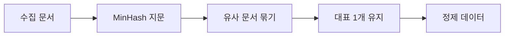
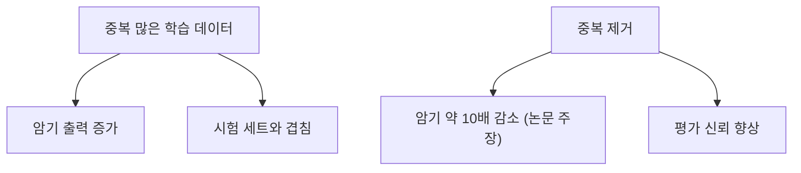

# 근접 중복 제거

> 글자 하나까지 같지는 않아도 거의 같은 문서·문장·이미지를 찾아 하나만 남기는 작업이다. 학습 데이터에는 중복이 놀라울 만큼 많고, 이것이 모델의 암기·평가 오염과 연결되므로 사전학습 데이터 정제의 핵심 단계다.

## 쉽게 말하면
도서관 신간 목록에 같은 책이 표지만 다른 판본으로 수십 번 올라 있다고 하자. 그대로 학생에게 읽히면 그 책 내용만 외우게 된다. 중복을 걸러 한 번만 읽히는 것이 근접 중복 제거다.

## 자세히
- **왜 하나(Lee 등 "Deduplicating Training Data Makes Language Models Better", arXiv:2107.06499, 초록 직접 확인)**
  - 흔한 언어 모델링 데이터셋에는 거의 같은 예제와 긴 반복 부분 문자열이 많다. C4에서 61단어 영어 문장 하나가 6만 번 넘게 나온다는 예가 제시된다.
  - 이런 데이터로 학습한 모델은 프롬프트 없이 낸 출력의 **1% 이상**을 학습 텍스트 그대로 재현한다.
  - 중복을 제거해 학습하면 암기한 텍스트를 내놓는 빈도가 **약 10배 줄고**, 같거나 더 나은 정확도를 더 적은 학습 단계로 얻는다.
  - 표준 데이터셋의 검증 세트 **4% 이상**이 학습 데이터와 겹친다. 겹침을 제거하면 더 정확히 평가할 수 있다. (초록은 이 수치를 C4 하나로 특정하지 않는다.)
- **방식(HF datatrove README 직접 확인, 도구의 예시 스크립트)**: 대규모 텍스트를 처리·필터링·중복 제거하는 라이브러리. 예시 스크립트로 **MinHash 중복 제거**(`minhash_deduplication.py`), **문장 수준 정확 중복 제거**(`sentence_deduplication.py`), **정확 부분 문자열 제거**(`exact_substrings.py`, google-research의 deduplicate-text-datasets 외부 저장소 필요)가 제시된다. FineWeb 전체 재현 스크립트(`examples/fineweb.py`)가 있으나 README는 FineWeb이 어떤 중복 제거 단계를 썼는지는 적지 않았다. 로컬 또는 Slurm 클러스터에서 실행하고, 설치는 Python 3.11+에서 `uv sync`.
- **FineWeb의 선택(검색 결과 요약)**: 스냅샷별 중복 제거가 전역 중복 제거보다 성능이 좋았다고 저자들이 밝힌다. RefinedWeb은 MinHash(퍼지)와 ExactSubstr(정확) 중복 제거를 함께 썼다.
- **평가 오염과의 관계**: 학습-시험 사이 근접 중복은 시험 점수를 부풀린다([데이터 누수](#data-leakage), [벤치마크 오염](#benchmark-contamination)).
- **주의(일반적)**: 너무 공격적으로 제거하면 유익한 반복(인용·정의문)까지 사라질 수 있고, 임계값은 데이터마다 실험해서 정한다.

## 그림으로 보기

## 예시
- 사내 문서 RAG: 같은 규정이 PDF·위키·공지에 복사돼 검색 결과 상위 5개가 모두 같은 문단 → 중복 제거 후 다양한 근거가 노출된다(제안).
- 이미지 분류: 학습과 시험에 같은 사진의 크기 변형본이 있으면 시험 점수가 높게 나온다 → 분할 전에 유사 이미지를 묶는다([그룹 단위 분할](#group-wise-split)).

## 헷갈리는 것과 비교
| 개념 | 차이 |
|---|---|
| 정확 중복 제거 | 완전히 같은 것만 |
| 근접 중복 제거 | 거의 같은 것까지(MinHash 등) |
| [그룹 단위 분할](#group-wise-split) | 중복·동일 출처를 같은 쪽에 둠 |
| [데이터 증강](#data-augmentation) | 반대로 변형 샘플을 의도적으로 늘림 |

## 더 읽을거리
- [Deduplicating Training Data Makes Language Models Better (arXiv:2107.06499)](https://arxiv.org/abs/2107.06499) — 암기·평가 겹침 수치(초록 직접 확인).
- [Hugging Face datatrove](https://github.com/huggingface/datatrove) — 중복 제거 예시 스크립트(README 직접 확인).
