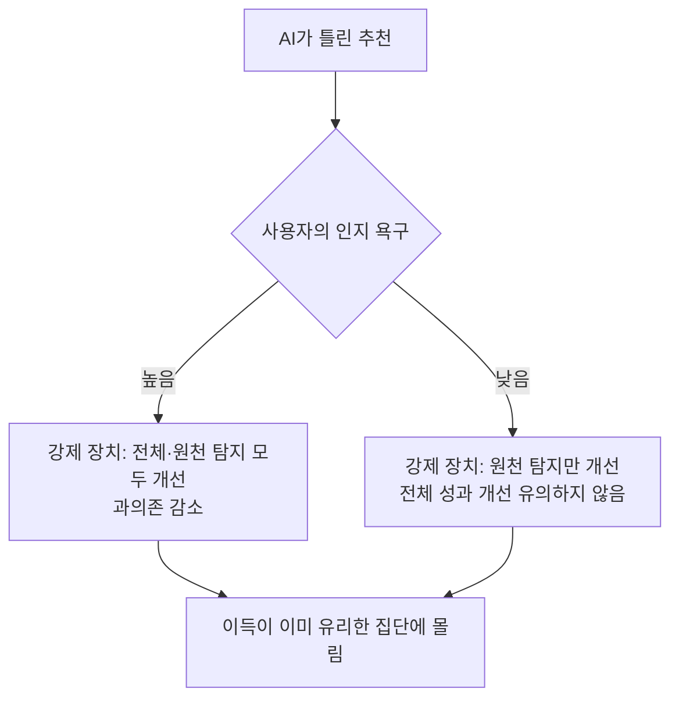
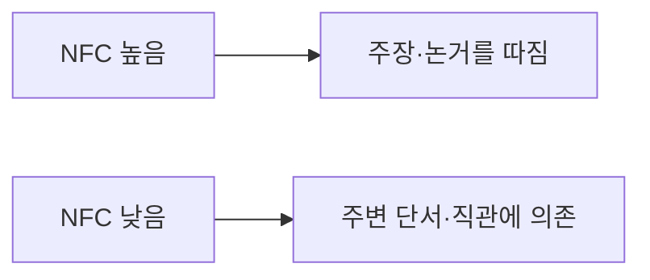

# 인지 욕구

> Need for Cognition(NFC). 노력이 드는 생각을 찾고 즐기는 정도를 나타내는 비교적 안정된 성격 특성. AI 도우미 설계에서는 같은 인터페이스가 사람에 따라 효과가 다르다는 변수로 쓰이며, 인지적 강제 장치가 NFC가 높은 사람에게 더 도움이 됐다는 실험이 있다.

## 쉽게 말하면
어떤 사람은 퍼즐이나 어려운 글을 일부러 골라 읽으며 즐긴다. 어떤 사람은 가능하면 간단히 결론만 알고 싶어 한다. 둘 중 어느 쪽이 더 낫다는 게 아니라 생각하는 습관이 다르다는 뜻이다. AI가 "이유를 직접 따져 보라"고 요구하는 설계는 앞의 사람에게는 잘 먹히지만, 뒤의 사람에게는 귀찮고 효과도 작을 수 있다.

## 자세히
출처: Buçinca 외 CSCW 2021(arXiv 2102.09692) 본문(직접 읽음), 위키백과 Need for cognition 항목(직접 읽음), 척도 서지는 검색 결과 요약.
- **개념**: Cacioppo와 Petty가 1982년에 현대적 개념으로 소개(앞서 Cohen 등 1955년 연구). 노력이 드는 사고를 추구하고 즐기는 경향. 자기보고 척도로 재며 원척도는 34문항, 널리 쓰는 단축판은 18문항(Cacioppo, Petty, Kao 1984), 6문항판도 검증됐다. 응답 방식(5점 vs 9점)은 자료가 엇갈려 확인하지 못했다.
- **관련 특성(위키백과)**: 경험에 대한 개방성, 지적 호기심과 가깝고 성실성과 양의 관계, 신경증과는 음의 관계. 유동 지능·언어 능력과 약한 연관. 높다고 판단이 항상 더 합리적이라는 뜻은 아니다.
- **정보 처리 차이**: NFC가 높은 사람은 주장을 꼼꼼히 따져 태도를 형성하고, 낮은 사람은 말하는 사람의 매력·신뢰감 같은 주변 단서에 더 기댄다(위키백과).
- **논문 방법**: 4문항 단축 척도로 측정해 중앙값에서 높음/낮음 두 집단으로 나눴다. 참가자 분석에서 AI 없는 상태의 기본 과제 성과도 높은 NFC 집단이 높았다(전체 성과 평균 0.44 vs 0.23, 탄수화물 원천 탐지 0.67 vs 0.44).
- **강제 장치 효과(과제: 식단 대체)**
  - AI가 **틀렸을 때** 높은 NFC 집단은 강제 장치로 전체·원천 탐지 성과를 모두 유의하게 높였고 과의존도 줄었다.
  - 낮은 NFC 집단은 원천 탐지만 유의하게 개선되었고 전체 성과는 유의한 개선이 없었으며, 과의존·인적 오류 분포 차이도 유의하지 않았다.
  - 따라서 저자들은 평균적으로 NFC가 높은 사람이 더 이득을 본다고 보고, 개입이 **이미 유리한 집단에 이득이 몰리는 불평등(intervention-generated inequality)** 을 만들 수 있다고 경고한다.
- **주관 평가**: 높은 NFC 집단은 단순 설명 방식에서 신뢰와 선호가 유의하게 더 높았고, 강제 장치를 더 복잡하다고 느꼈다. 낮은 NFC 집단은 조건 간 주관 평가 차이가 유의하지 않았다. 낮은 NFC는 과제와 시스템을 전반적으로 더 어렵고 복잡하게 느꼈다(정신적 요구 3.10 vs 2.62, 시스템 복잡도 3.04 vs 2.65).
- **설계 함의(이 글의 제안)**: 한 가지 UI를 모두에게 쓰지 말고, 낮은 NFC 사용자도 도움이 되는 가벼운 강제(예: 짧은 한 줄 이유 입력)나 단계적 도입을 고려한다. 단, 성격 척도로 사용자를 분류해 제한하는 것은 윤리·차별 문제가 있어 신중해야 한다.

## 그림으로 보기

## 예시
- 대출 심사 AI 도입 교육에서 모든 심사역에게 "먼저 판단하고 AI 보기"를 의무화하면, 노력 있는 사고를 즐기지 않는 심사역의 이탈이나 형식적 입력이 생길 수 있어 현업 반응을 파일럿으로 먼저 본다(제안).
- 교육 설계에서 학습자 특성별로 안내 방식을 다르게 한 버전을 비교 실험한다(제안).

## 헷갈리는 것과 비교
| 개념 | 차이 |
|---|---|
| 인지 욕구 | 생각하는 즐거움·노력 성향 |
| 지능 | 능력. NFC와 약하게만 연관 |
| 개방성(Big Five) | 넓은 성격 요인. NFC와 가까움 |
| [인지적 강제 장치](#cognitive-forcing-function) | 효과가 NFC에 따라 다르게 나타난 개입 |

## 더 읽을거리
- [To Trust or to Think (arXiv 2102.09692)](https://arxiv.org/abs/2102.09692) — §5 NFC 분석(직접 읽음)
- [Need for cognition (Wikipedia)](https://en.wikipedia.org/wiki/Need_for_cognition) — 개념·척도·정보 처리(직접 읽음)
