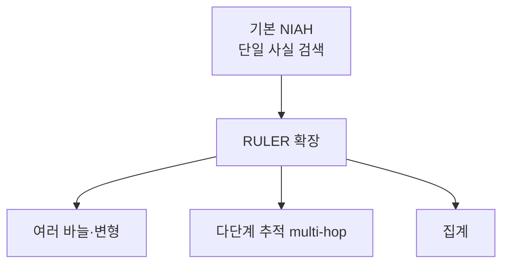

# 건초더미 속 바늘 테스트

> 아주 긴 글(건초더미) 속 임의의 위치에 **짧은 사실 하나(바늘)** 를 숨기고, 모델이 질문에 그 사실을 찾아 답하는지 재는 장문 컨텍스트 평가. 모델 소개 자료에서 "긴 컨텍스트에서도 거의 완벽하다"는 근거로 자주 쓰이지만, **단순 검색 능력만** 보여 준다는 한계가 있다.

## 쉽게 말하면
도서관 책 한 권 중간에 "비밀번호는 7342"라는 쪽지를 끼워 놓고 "비밀번호가 뭐지?"라고 묻는 시험이다. 쪽지를 찾는 건 쉬워도, 책 전체를 이해해 종합하는 능력과는 다르다.

## 자세히
- **방법**: 문서 길이(예: 8K~128K 토큰)와 바늘 위치(앞·중간·뒤)를 바꿔 가며 정답률을 격자 표로 그린다. 보통 초록(정답)이 거의 가득한 그림이 나온다. 일반적으로 Greg Kamradt(2023)가 대중화한 것으로 알려져 있다(원 저장소는 이번에 열어 보지 못해 논문 인용으로 확인).
- **RULER 논문(arXiv 2404.06654)의 결과**: 17개 장문 모델·13개 과제를 평가한 결과, 거의 모든 모델이 기본 바늘 테스트에서는 거의 만점이었지만 입력 길이가 늘수록 성능이 크게 떨어졌다. 모두 32K 이상을 표방했으나 **32K에서 만족스러운 성능을 유지한 모델은 절반 정도**였다. RULER는 바늘의 종류·개수를 늘리고, 다단계 추적(multi-hop)과 집계 과제를 추가해 이를 보완한다.
- **한계**: ① 숨긴 사실이 주변 글과 눈에 띄게 달라 찾기 쉬움(어휘 일치), ② 한 개 사실 검색만 평가, ③ 프로토콜이 연구마다 달라 점수 비교가 어려움, ④ "없다"고 잘못 판단하는 오류가 큰 비중이라는 후속 연구가 있다(검색 결과 요약에서 확인, 원문 미확인).
- **실무에서 읽는 법**: "needle 100%"는 최소 조건일 뿐이다. 내 업무(여러 문서 종합, 숫자 집계)와 비슷한 과제로 직접 시험한다. [컨텍스트 윈도우](#context-window)의 광고 크기 ≠ 유효 크기.

## 그림으로 보기



## 예시
```python
def make_prompt(haystack: str, needle: str, depth: float) -> str:
    pos = int(len(haystack) * depth)
    return haystack[:pos] + "\n" + needle + "\n" + haystack[pos:]
# depth 0.0~1.0, 길이 8k~128k 토큰으로 반복 평가
```
- 사내 계약서 200쪽에서 "해지 위약금 조항"을 찾게 하는 시험을 만들어, 위치별 정답률을 표로 확인.

## 헷갈리는 것과 비교
| 개념 | 차이 |
|---|---|
| 건초더미 속 바늘 | 단일 사실 검색 평가 |
| RULER | 다중 바늘·추적·집계로 확장한 평가 |
| [중간 정보 소실](#lost-in-the-middle) | 중간 위치 정보를 놓치는 현상 |
| [컨텍스트 부패](#context-rot) | 길어질수록 품질이 떨어지는 현상 |

## 더 읽을거리
- [RULER: What's the Real Context Size of Your Long-Context Language Models? (arXiv 2404.06654)](https://arxiv.org/abs/2404.06654) — 바늘 테스트의 한계와 확장 벤치마크.
