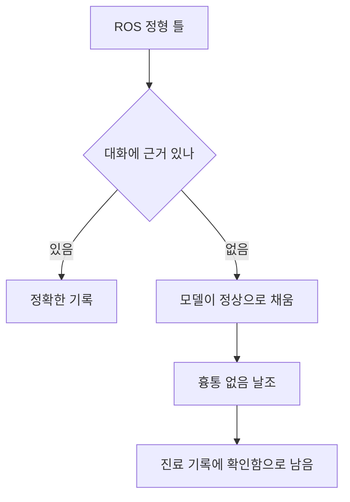
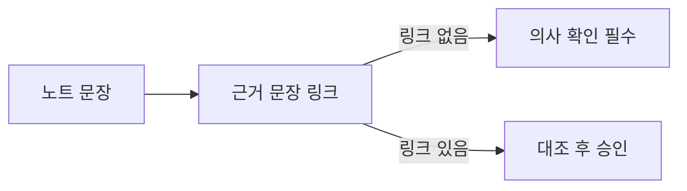

# 음성 소견 날조

> 환자가 말하지도, 의사가 검사하지도 않은 "없음"(예: 흉통 없음, 발열 없음)을 AI가 노트에 적어 넣는 환각. 음성 소견은 "확인했더니 없었다"는 뜻이라 거짓이 더 믿기 쉽다.

## 쉽게 말하면
회의록에 "이의 없음"이라고 적혔는데 실제로는 아무도 이의를 묻지 않았던 경우와 같다. 없는 발언을 지어내면 눈에 띄지만, "문제없음"은 자연스러워서 읽는 사람이 그냥 넘어간다. 그 한 줄이 나중에 "그때 확인했다"는 증거처럼 쓰인다.

## 자세히
- **왜 생기나**: 진료 노트에는 증상 문진(ROS)·신체 진찰의 정형 틀이 있다. 모델은 틀을 채우려는 경향이 있어, 대화에 없는 항목도 가장 흔한 값인 "정상·없음"으로 채울 수 있다. (이 메커니즘은 일반적 설명이며 개별 제품에서 확인한 것은 아니다.)
- **왜 위험한가**: 누락은 정보가 빠지는 것이지만, 음성 소견 날조는 "확인함"이라는 거짓 사실을 기록에 남긴다. 이후 진료·보험·소송에서 이 기록을 근거로 쓴다.
- **근거(제한적)**: Frontiers in AI(2025-10-22, Palm 외)는 ambient scribe 노트의 31%에서 환각이 표시됐고 의사 작성 노트도 20%였다고 보고했다. 다만 환각을 이진 항목으로 채점했고 **섹션별(ROS·진찰) 분석은 없어서 음성 소견만의 비율은 알 수 없다**. 검색에서 음성 소견 날조만 따로 측정한 연구는 찾지 못했다.
- **측정 논쟁**: 업체 Suki의 연구진은 PDQI-9가 ambient 노트에 맞지 않고 검토자마다 환각 판정이 갈린다고 주장했다(업체 이해관계 있음, 기사 본문은 열지 못함).
- **방어**: ① 음성 소견은 원본 대화에서 근거 문장이 있을 때만 쓰도록 제한 ② 템플릿 자동 채움 금지 ③ 진찰 항목은 의사가 직접 확인·서명 ④ 근거 문장 링크로 검토.

## 그림으로 보기

## 예시
- 대화: "가슴이 좀 답답해요." 노트 ROS: "발열·기침·호흡곤란 없음" → 묻지 않은 항목이 모두 음성으로 적힘.
- 평가 규칙 예: 노트의 "없음" 문장마다 원본에 부정 발화나 의사 확인이 있는지 대조해 '근거 없는 음성'으로 집계.

## 헷갈리는 것과 비교
| 개념 | 차이 |
|---|---|
| [누락과 환각 구분](#omission-vs-hallucination) | 상위 개념: 음성 소견 날조는 환각의 한 유형 |
| 누락 | 있던 정보가 빠짐, 음성 날조는 없던 "없음"이 생김 |
| [환각](#hallucination) | LLM 일반 현상, 여기선 문서 항목 단위 |
| [PDQI-9](#pdqi-9) | 품질 점수, 근거 없는 음성을 직접 세지 않음 |

## 더 읽을거리
- [Assessing the quality of AI-generated clinical notes (Frontiers in AI, 2025)](https://www.frontiersin.org/articles/10.3389/frai.2025.1691499) — 환각 31% 대 20% 비교(열어서 확인)
- [누락과 환각 구분](#omission-vs-hallucination) — 오류 유형 분류와 MedStar·CREOLA 수치
