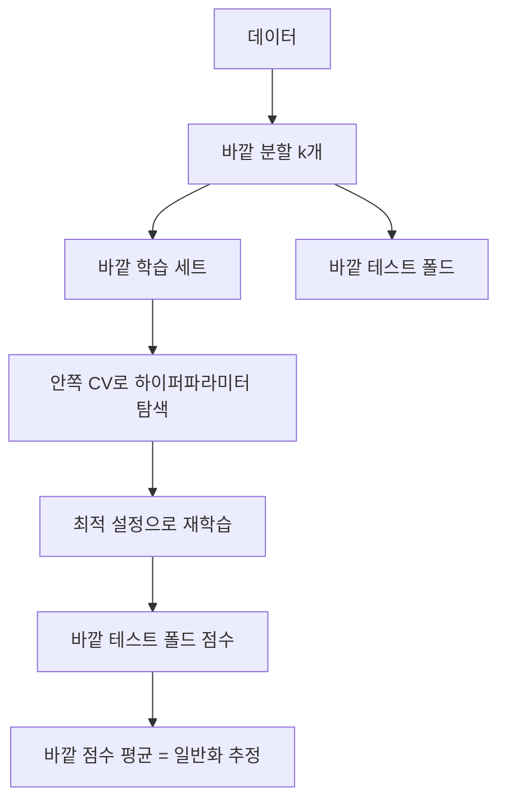

# 중첩 교차검증 (Nested Cross-Validation)

> 하이퍼파라미터 튜닝(안쪽 루프)과 성능 평가(바깥 루프)를 분리해, 같은 데이터로 튜닝하고 평가해서 생기는 낙관 편향을 줄이는 방법이다.

## 쉽게 말하면
수험생이 기출문제로 공부법을 고르고 같은 기출문제로 실력을 평가하면 점수가 후하게 나온다. 중첩 방식은 "공부법 고르기"를 하는 시험과 "최종 평가"를 하는 시험을 아예 다른 문제 묶음으로 나눈다.

## 자세히
scikit-learn 예제(2026-11 확인):
- **비중첩 CV**는 파라미터를 고른 바로 그 CV 분할의 최고 점수를 성능으로 보고하므로 **과하게 낙관적**이다. 정보가 모델로 "새어 들어" 데이터에 과적합한다(Cawley & Talbot 2010 인용). 영향 크기는 데이터 크기와 모델 안정성에 좌우.
- **안쪽 루프**(`GridSearchCV`): 각 후보를 학습 폴드로 적합, 검증 폴드로 채점해 최적 파라미터 선택.
- **바깥 루프**(`cross_val_score`): 여러 분할에서 테스트 점수를 평균해 일반화 오차를 추정. 바깥 학습 세트마다 **튜닝 전체를 다시 실행**한다.
- 패턴: `nested = cross_val_score(GridSearchCV(svm, p_grid, cv=inner_cv), X, y, cv=outer_cv).mean()`.
- 예제 결과(iris, 30회 반복): 비중첩 − 중첩 점수 차이 평균 **0.007581**(표준편차 0.007833). 항상 비중첩이 높지만 iris에선 차이가 작다.
- 비용: 안쪽 × 바깥 횟수만큼 적합하므로 계산이 크게 늘어난다(구조상).

## 그림으로 보기

## 예시
데이터가 수백 건뿐인 모델 비교에서 모델 A·B 중 무엇이 나은지 공정하게 비교하려고 각각 중첩 CV 점수를 보고한다.

## 헷갈리는 것과 비교
| 개념 | 차이 |
|---|---|
| 일반 교차검증 | 한 번의 분할로 선택과 평가 |
| 중첩 교차검증 | 선택(안쪽)과 평가(바깥)를 분리 |
| [검증 세트](#validation-set) | 단순 3분할 — 데이터가 많을 때 충분 |
| [그리드·랜덤 탐색](#grid-vs-random-search) | 안쪽 루프에서 쓰는 방법 |

## 더 읽을거리
- [Nested versus non-nested CV (scikit-learn)](https://scikit-learn.org/stable/auto_examples/model_selection/plot_nested_cross_validation_iris.html) — 코드와 결과.
