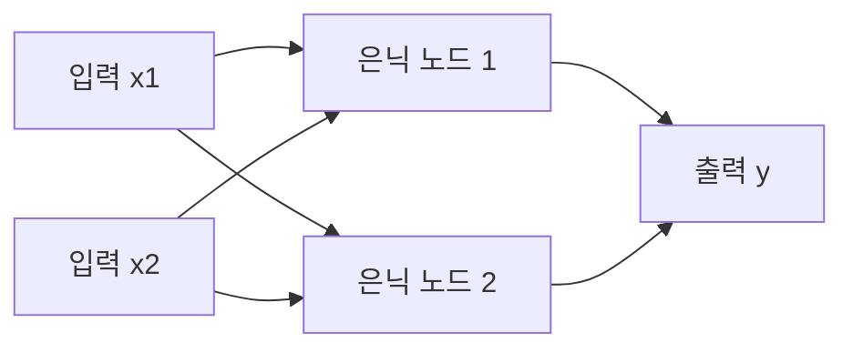

# 신경망 기초

> 입력에 가중치를 곱해 더하고 비선형 함수를 통과시키는 단순한 계산 단위(노드)를 층층이 쌓아, 복잡한 패턴을 근사하는 함수.

## 쉽게 말하면
수많은 작은 다이얼(가중치)이 달린 거대한 믹싱 보드다. 처음엔 다이얼이 엉망이라 답이 틀리지만, 틀린 만큼 각 다이얼을 조금씩 돌려 맞추는 일을 수없이 반복하면 원하는 소리가 난다. 이 "다이얼 돌리기"가 학습이다.

## 자세히
Google Machine Learning Crash Course 기준:
- **왜 필요한가**: 선형 모델(b + w₁x₁ + w₂x₂)은 직선으로 나뉘지 않는 데이터를 못 가른다. 신경망은 비선형 패턴과 특성 조합을 스스로 학습한다.
- **구성**: 입력층 → 은닉층(hidden layers, 입력과 출력 사이) → 출력층. 각 노드는 가중치(w)와 편향(b)으로 계산한다.
- **활성화 함수**: 선형 연산을 아무리 쌓아도 선형이므로, 각 노드 출력에 비선형 함수를 적용해야 층을 쌓는 의미가 생긴다.
  - sigmoid: 0~1로 압축 / tanh: -1~1 / **ReLU**: max(0, x). 계산이 싸고 기울기 소실에 덜 약해 기본 추천값.
- **학습 = 역전파(backpropagation)**: 손실(loss)을 줄이는 방향의 기울기(gradient)를 층마다 계산해 가중치를 조정한다. Keras 같은 라이브러리가 자동 처리한다.
- **흔한 문제**: 기울기 소실(앞쪽 층이 거의 안 배움, ReLU가 완화), 기울기 폭발(배치 정규화·낮은 학습률), 죽은 ReLU(LeakyReLU로 완화), 과적합(dropout으로 완화).
- 규모: 오늘의 [LLM](#llm-basics)도 같은 원리의 거대한 버전(Transformer 구조, 수십억~수조 개 가중치)이다.

## 그림으로 보기

## 예시
- 손글씨 숫자 이미지(픽셀 784개) → 은닉층 → 0~9 확률 10개.
- 공부 팁: 브라우저에서 TensorFlow Playground로 층·노드 수를 바꿔 경계가 어떻게 휘는지 직접 본다.

## 헷갈리는 것과 비교
| 개념 | 차이 |
| --- | --- |
| 신경망 | 층을 쌓은 함수 근사기 |
| 딥러닝 | 은닉층이 많은 신경망을 쓰는 방식 |
| 선형 모델 | 비선형 활성화가 없어 직선 경계만 |
| [지도학습](#supervised-unsupervised) | 신경망을 학습시키는 방식 중 하나 |

## 더 읽을거리
- [Google ML Crash Course: Neural networks](https://developers.google.com/machine-learning/crash-course/neural-networks) — 구성 개요
- [Activation functions](https://developers.google.com/machine-learning/crash-course/neural-networks/activation-functions) — sigmoid·tanh·ReLU
- [Backpropagation](https://developers.google.com/machine-learning/crash-course/neural-networks/backpropagation) — 기울기 문제와 대응
