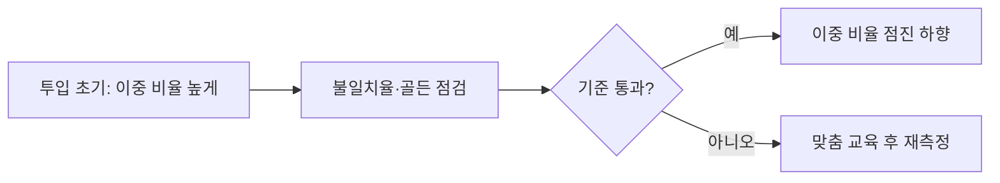
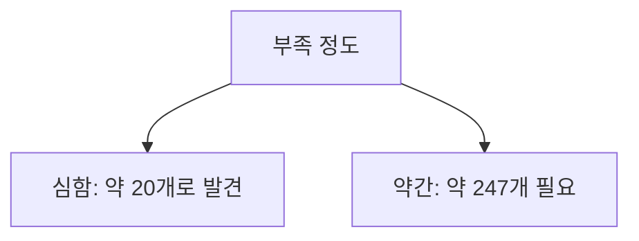

# 신규 라벨러 투입 시 이중 비율

> 새 라벨러를 투입하는 초기에는 그의 라벨을 숙련자가 함께 라벨링하는 이중 비율을 일시적으로 높여, 품질이 낮은 경우 빨리 발견하고 교육으로 보정한 뒤 비율을 낮춘다.

## 쉽게 말하면
신입 직원의 첫 몇 주는 선배가 업무를 옆에서 자주 확인하다가, 믿을 만하다고 판단되면 점검 횟수를 줄이는 것과 같다. 처음부터 점검을 줄이면 문제가 늦게 드러난다.

## 자세히
- **직접 계산(가정: 숙련 팀 정확도 0.92, 두 숙련자 간 불일치율 기준선 0.147; 신규 주석자와 숙련자의 불일치율이 기준선보다 높음을 단측 5% 유의, 검정력 약 80%로 구별하는 데 필요한 이중 라벨 샘플 수, 이진 독립 가정)**:

| 신규 주석자의 실제 정확도 | 숙련자와 불일치율 | 필요 이중 샘플 수(약) |
| --- | --- | --- |
| 0.85 | 0.206 | 247 |
| 0.75 | 0.290 | 46 |
| 0.65 | 0.374 | 20 |

  많이 부족한 신규(0.65)는 20개 정도면 드러나지만, 조금 부족한(0.85)은 약 247개가 필요해 거의 구별되지 않는다. 즉 초기 이중 비율은 "심하게 부족한 사람을 빨리 거르는 것"에는 효과적이고, "약간 부족한 사람"은 더 오래 지켜봐야 한다. (정규 근사를 쓴 개략 계산이며 실제 값은 오차가 있다.)
- **운영(해석)**: ① 첫 1~2주는 이중 비율 50% 이상(또는 전량)으로 시작 ② 골든 문항 정답률([골든 문항 선정](#golden-item-selection))을 병행 ③ 일정 건수(예: 위 표의 50~250) 후 불일치율·일치도로 평가 ④ 기준을 넘으면 비율을 점진적으로 낮춤 ⑤ [주석자 품질 통계](#annotator-quality-stats)의 `worst_class`로 맞춤 교육.
- **근거 연결(Finlayson & Erjavec, arXiv 1602.05753)**: 주석자 훈련을 허용 가능한 IAA에 이르게 하고 IAA를 추적하는 것이 Annotate 단계의 일이다([라벨러 훈련 라운드](#annotator-training-rounds)). 크라우드 연구에서는 작업자의 첫 5개 작업 성적이 장기 품질을 예측한다고 보고한다(arXiv 1609.04855).
- **주의(해석)**: 숙련자도 완벽하지 않으므로 신규와의 불일치가 곧 신규의 오류는 아니다. 불일치 샘플은 판정한다([판정 사유 기록](#adjudication-rationale-log)).

## 그림으로 보기

## 예시
- 신규 3명을 첫 주 이중 100%로 시작하고 50개를 넘으면 불일치율을 본다. 0.29 수준이면 맞춤 교육, 0.15 근처이면 비율을 20%로 낮춘다(위 계산 기준).
- 교육 활용: 위 표의 숫자를 직접 재현해 보며 "얼마나 지켜봐야 구별되는가"를 체험한다.

## 헷갈리는 것과 비교
| 개념 | 차이 |
| --- | --- |
| 신규 투입 이중 비율 | 초기에 점검을 늘림 |
| [재보정 조건](#recalibration-trigger) | 운영 중 하락 시 복귀 |
| [라벨러 훈련 라운드](#annotator-training-rounds) | 시험 라벨링 교육 |
| [표본 이중 라벨](#sampled-double-annotation) | 일상 품질 측정 |

## 더 읽을거리
- [A Glimpse Far into the Future (arXiv 1609.04855)](https://arxiv.org/abs/1609.04855) — 첫 5개 작업이 장기 품질 예측
- [Overview of Annotation Creation: Processes & Tools (arXiv 1602.05753)](https://arxiv.org/abs/1602.05753) — 주석자 훈련과 IAA 추적
