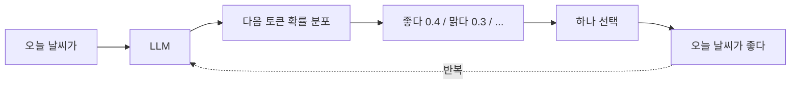
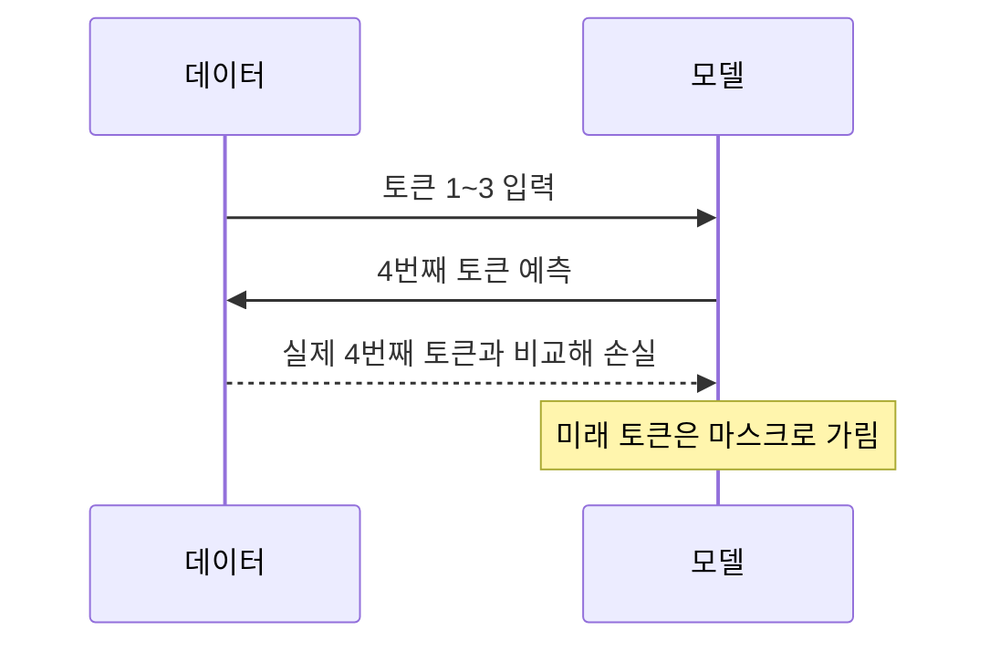

# 다음 토큰 예측

> 다음 토큰 예측은 앞의 토큰들을 보고 바로 다음에 올 토큰을 맞히게 하는 학습 목표다. GPT류 LLM 사전학습의 핵심이다.

## 쉽게 말하면
"가는 말이 고와야 오는 ___" 같은 빈칸 채우기를 인터넷 규모의 글로 수조 번 반복하는 것이다. 정답은 글 안에 이미 있으니 사람이 라벨을 달 필요가 없다. 다음 단어를 잘 맞히려면 문법, 상식, 사실, 논리까지 어느 정도 익혀야 해서 결과적으로 폭넓은 능력이 생긴다.

## 자세히
- Hugging Face LLM 코스 설명: 이 방식을 **인과 언어 모델링(causal language modeling)**이라 부른다. 출력이 과거와 현재 입력에만 의존하고 미래에는 의존하지 않기 때문이다.
- 학습 중 모델이 정답을 훔쳐보지 못하게 **어텐션 마스크**로 미래 위치를 가린다. 네 번째 토큰을 맞힐 땐 1~3번째만 보인다. 구조는 [Transformer](#transformer-architecture)의 디코더 방식이다.
- 정답이 입력 문장 자체에서 나오므로 [자기지도 학습](#self-supervised)이다. 손실은 정답 토큰의 [교차 엔트로피](#cross-entropy)로 계산한다.
- 반대편은 **마스크드 언어 모델링**(BERT류): 일부 단어를 가리고 양쪽 문맥으로 맞힌다. 이해 작업에 강하고, 다음 토큰 예측은 생성에 강하다.
- 사용할 때(추론)는 확률 분포에서 토큰 하나를 뽑아 이어 붙이고 다시 예측하는 것을 반복한다. 사전학습 뒤에는 보통 지시 따르기·선호 학습 등 후속 단계를 거친다([RLHF](#rlhf)).

## 그림으로 보기

## 예시
- "서울은 대한민국의 ___" → 학습 데이터에서 "수도"가 자주 나오므로 높은 확률을 준다.
- 코드 자동완성도 같은 원리다. 앞 코드를 보고 다음 토큰을 예측한다.

## 헷갈리는 것과 비교
| 개념 | 차이 |
|---|---|
| 인과(다음 토큰) 모델링 | 왼쪽→오른쪽, 미래를 못 봄. 생성에 적합(GPT류) |
| 마스크드 모델링 | 빈칸 양쪽 문맥 사용. 이해에 적합(BERT류) |
| [토큰화](#tokenization) | 글을 토큰으로 자르는 전처리. 예측의 단위를 정함 |

## 더 읽을거리
- [Hugging Face LLM Course 1.4 How do Transformers work?](https://huggingface.co/learn/llm-course/chapter1/4) — 인과·마스크드 언어 모델링 비교.
