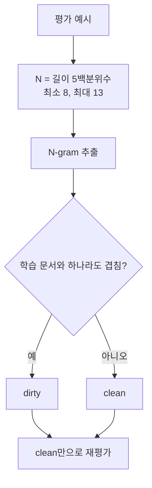
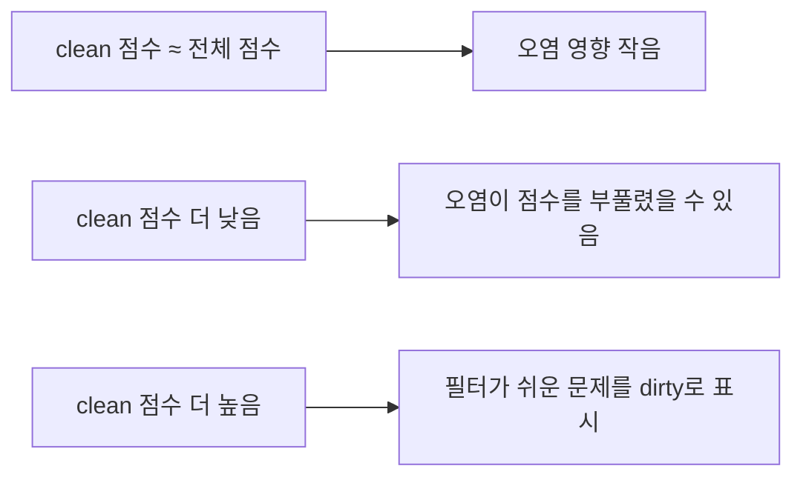

# n-그램 겹침 오염 측정

> 평가 문제가 학습 데이터에 이미 들어 있는지 알아보려고, **연속된 N개 단어(n-gram)가 학습 문서와 겹치는지** 세는 방법. GPT-3 논문은 최대 13단어 겹침을 기준으로 "오염(dirty)" 예시를 가려 냈다.

## 쉽게 말하면
시험 문제가 미리 새어 나갔는지 알려면, 학생이 공부한 자료에 문제 문장이 그대로 있는지 대조한다. 문장 한 줄이 통째로 같으면 의심스럽지만, "그리고" 같은 한두 단어가 겹치는 것은 흔하다. 그래서 "연속 몇 단어가 같으면 겹침으로 보나"를 정해야 한다.

## 자세히
(GPT-3 논문 arXiv 2005.14165의 4절과 부록 C를 PDF에서 직접 읽음)
- **학습 데이터 정제 단계**: 13-gram이 벤치마크와 겹치는 구간을 학습 데이터에서 제거하려 했다. 한 번 충돌하면 문서 전체를 지우던 방식은 책 같은 긴 문서에 불리해 충돌 구간 주변만 제거하도록 바꿨고, **10개를 넘는 학습 문서에서 나온 13-gram은 무시**했다(문화적 상투구·법률 상투 문구라서 모델이 배워도 되는 내용). 그런데 버그로 겹침이 **일부만 제거**됐고 재학습은 비용상 불가능해, 남은 겹침의 영향을 사후 분석했다.
- **오염 분석 방식**: 벤치마크마다 N을 따로 정한다. **N = 예시 길이(단어 수)의 5번째 백분위수**(구두점·공백·대소문자 무시), 가짜 일치가 많아 **비합성 과제는 최소 8**, 계산 비용 때문에 **최대 13**. 학습 문서와 한 번이라도 N-gram이 겹치면 "dirty", 아니면 "clean". Bloom 필터 대신 Apache Spark로 **정확한 충돌**을 계산했다.
- **영향 측정**: dirty를 뺀 clean 부분집합으로 다시 평가해 원래 점수와 비교한다. clean 점수가 1~2% 넘게 낮으면 모델이 본 예시에 과적합했을 가능성이 있고, clean이 크게 높으면 필터가 쉬운 예시를 먼저 dirty로 표시했을 수 있다.
- **결과**: 잠재 오염 비율이 높은 벤치마크가 많았다(벤치마크의 4분의 1이 50% 초과) 하지만 대부분 점수 변화는 미미했고, 오염 수준과 성능 차이의 상관은 보이지 않았다. 논문은 방법이 오염을 과대평가했거나 오염의 영향이 작다고 결론짓고, PIQA와 Winograd는 일부 오염 증거가 있어 별표를 붙였다. SQuAD2·DROP·QuAC는 90% 넘게 flag됐지만 직접 확인한 겹침은 **질문·정답이 아니라 원문 텍스트**였다. 독일어-영어 번역(WMT16)은 25% flag에 효과 크기 1~2 BLEU, 겹침은 단일 언어 뉴스 문장 조각이었다.
- **한계**: 겹침이 곧 학습된 정답은 아니고(배경 지식만 겹침), 말만 바꾼 변형(재진술)은 놓친다. 논문 스스로 오염 탐지가 모범 관행이 없는 새 연구 분야라고 적는다.
- **직접 실험(장난감, 단어 단위)**: 학습문서에 있는 문장을 앞 17단어로 잘라 쓴 평가문은 N=13과 N=8 모두 겹침으로 탐지됐다. 같은 뜻을 바꿔 쓴 11단어 문장과 3단어짜리 짧은 평가문은 N=8·11·3 어디서도 탐지되지 않았다(재진술·짧은 문항은 n-gram 방식의 사각지대).

## 그림으로 보기

## 예시
| 평가문 | n-gram 탐지(직접 실험) |
|---|---|
| 학습 문장을 그대로 앞부분 복사 | 탐지됨 |
| 뜻만 같은 재진술 | 탐지 안 됨 |
| 3단어 짧은 평가문 | 탐지 안 됨 |
- 업무 장면: 자체 평가 세트 문제를 사내 학습 문서와 대조해 N=8 단어 겹침이 있는 문항을 따로 빼 보고, 나머지 문항 점수와 비교한다.

## 헷갈리는 것과 비교
| 개념 | 차이 |
|---|---|
| n-gram 겹침 | 연속 단어 일치로 탐지, 재진술은 놓침 |
| [정확 일치 오염 측정](#exact-match-contamination) | 정규화한 전체 문장이 같은지만 봄 |
| [코퍼스 속 벤치마크 오염](#benchmark-contamination-in-corpus) | 이 방법들이 속한 상위 문제 |
| 임베딩 유사도 탐지 | 의미 유사도로 재진술까지 찾으려는 방법(일반 설명, 이번엔 미확인) |

## 더 읽을거리
- [Language Models are Few-Shot Learners (arXiv 2005.14165)](https://arxiv.org/abs/2005.14165) — 4절과 부록 C 오염 분석(PDF 직접 읽음).
