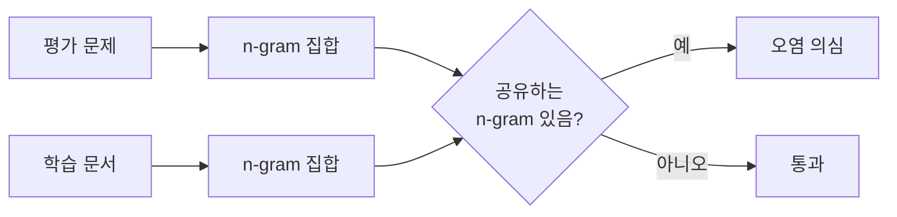
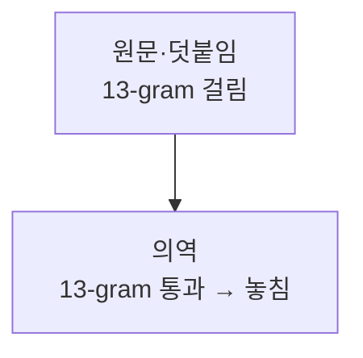

# n-gram 겹침 검사

> n-gram 겹침 검사는 평가 문제와 학습 문서가 연속된 n개 단어(예: 13개)를 공유하는지 문자열로 비교해 평가 오염을 찾는 방법이다. 복사·붙여넣기는 잘 잡지만 의역·번역은 놓친다.

## 쉽게 말하면
시험 문제와 같은 문장이 연습 문제집에 그대로 있는지 "연속 13단어가 똑같은가"로 찾는 것과 같다. 베낀 문제는 바로 걸리지만, 같은 문제를 다른 말로 바꿔 쓴 문제는 한 줄도 안 겹쳐서 그냥 통과한다.

## 자세히
- **원리**: 문서를 소문자·구두점 정리 후 단어로 나눠 길이 n의 연속 단어열(n-gram) 집합을 만들고, 평가 문제의 n-gram이 학습 문서에 하나라도 있으면 오염으로 표시한다. n이 작으면 흔한 구절 때문에 오탐이 많고, 크면 정확하지만 조금만 바뀌어도 놓친다. 13이라는 값은 널리 쓰이는 관행으로 알려져 있으나 이 글에서 원문을 열어 확인하지 않았다.
- **직접 해 본 실험(수학 문장 하나)**: 평가 문제를 원문 그대로, 원문에 문장을 덧붙여서, 의역해서 세 종류의 문서와 비교했다. 원문 그대로와 덧붙인 경우는 3·8·13-gram 모두 공유가 있어 걸렸다. 의역은 3-gram만 공유(참)하고 8-gram과 13-gram은 공유가 없어(거짓) 13-gram 검사를 통과했다. 같은 문제인데도 검사가 놓친 사례다.
- **한계에 대한 연구(Yang 외, "Rethinking Benchmark and Contamination" 초록, 열람)**: 대부분의 오염 제거가 n-gram 같은 문자열 일치에 의존하고, 의역·번역 같은 단순한 변형이 이를 쉽게 우회한다고 지적한다. 이런 의역 시험 데이터를 걸러내지 않으면 13B 모델이 MMLU·GSM8K·HumanEval에서 GPT-4와 비슷한 점수를 낼 수 있다고 보고한다(암기의 결과이고 일반 능력이 아니라는 설명).
- **용도 구분(해석)**: n-gram 검사는 싸고 빠르며 명백한 복사를 거르는 1차 방어선이다. 의역까지 보려면 임베딩이나 LLM 판정이 필요하다([LLM decontaminator](#llm-decontaminator)).
- **보고**: 오염 검사를 했다면 n값, 정규화 방식, 겹친 문제 비율을 함께 적는다.

## 그림으로 보기

## 예시
- 코드 개요: `set(zip(*[words[i:] for i in range(n)]))`로 n-gram 집합을 만들어 교집합이 비어 있는지 본다.
- 교육 활용: 같은 문제를 원문·의역으로 두고 n=3, 8, 13에서 어느 쪽이 걸리는지 표로 만들어 보는 실습.

## 헷갈리는 것과 비교
| 개념 | 차이 |
| --- | --- |
| n-gram 겹침 | 문자열 일치, 의역에 약함 |
| [MinHash](#minhash) | n-gram(shingle) 집합의 유사도 추정 |
| [의미적 중복 제거](#semantic-deduplication) | 뜻 기반 |
| [의역 샘플 오염](#rephrased-sample-contamination) | n-gram이 놓치는 문제 |

## 더 읽을거리
- [Rethinking Benchmark and Contamination for Language Models with Rephrased Samples (arXiv 2311.04850)](https://arxiv.org/abs/2311.04850) — 문자열 일치 오염 제거의 한계
