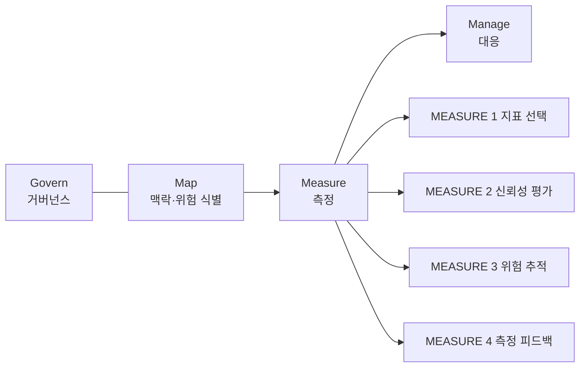

# NIST AI RMF Measure

> NIST AI 위험관리 프레임워크(AI RMF 1.0, 2023)의 네 기능(Govern·Map·Measure·Manage) 중 AI 위험을 지표와 시험으로 실제로 재는 단계.

## 쉽게 말하면
건강검진에서 "혈압을 잰다"에 해당한다. Map이 "어디가 위험할 수 있나"를 찾는 문진이라면, Measure는 수치와 검사로 확인하고, 시간이 지나 달라지지 않는지 계속 본다. 재는 방법 자체가 잘 맞는지도 점검한다.

## 자세히
- 4개 카테고리(자료에 따라 하위 항목 수는 22개 vs 17개로 엇갈림. 정확한 수는 NIST AI 100-1 원문 표에서 확인 필요):
  - **MEASURE 1**: 적절한 방법과 지표를 정하고 적용한다.
  - **MEASURE 2**: 신뢰성 특성(타당성·신뢰성, 안전, 보안, 설명 가능성, 프라이버시, 공정성 등)에 따라 시스템을 평가한다. 하위 항목이 가장 많다(2.1~2.13로 보고됨).
  - **MEASURE 3**: 식별된 위험을 시간에 따라 추적한다.
  - **MEASURE 4**: 측정이 효과적이었는지 피드백을 모아 평가한다.
- 핵심 개념 **TEVV**(시험·평가·검증·확인): 개발 전 과정에서 수행. 점수 하나가 아닌 근거(evidence)를 남긴다.
- NIST Playbook은 항목별 제안 행동을 주며 **자발적**이다(법적 의무 아님).
- 파일럿 평가에선 [AI 파일럿 지표](#ai-pilot-metrics)를 정할 때 정확도 외에 공정성·강건성·프라이버시 지표를 함께 고르는 틀로 쓴다.

## 그림으로 보기

## 예시
- 챗봇 도입 전: 지표(MEASURE 1)로 정답률·유해 응답률·편향 격차를 정하고, 시험셋으로 평가(2), 운영 중 월별 추적(3), 지표가 현업 불만과 맞는지 점검(4).
- 결과 문서를 감사·보고용 근거로 보관.

## 헷갈리는 것과 비교
| 개념 | 차이 |
| --- | --- |
| [NIST AI RMF](#nist-ai-rmf) | 전체 틀, Measure는 그중 한 기능 |
| Map | 위험을 찾는 단계 |
| Manage | 재서 나온 위험에 대응 |
| [벤치마크](#ai-evaluation) | 모델 일반 성능, Measure는 맥락별 위험 근거 |

## 더 읽을거리
- [NIST AI 100-1 (AI RMF 1.0)](https://nvlpubs.nist.gov/nistpubs/ai/nist.ai.100-1.pdf) — 원문(이번 실행에서 열지 못해 검색 요약 기준)
- [NIST AI RMF Playbook](https://airc.nist.gov/airmf-resources/playbook) — 항목별 제안 행동
- [Modulos: Measure 정리](https://docs.modulos.ai/frameworks/nist-ai-rmf/measure) — 카테고리별 해설(업체 문서)
