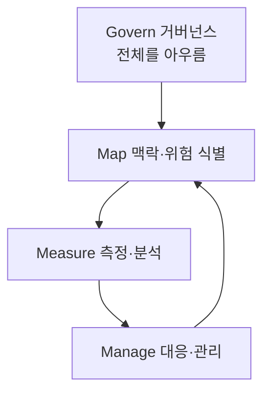
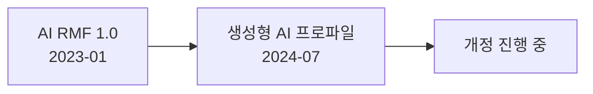

# NIST AI RMF

> NIST AI RMF(AI 위험관리 프레임워크)는 미국 NIST가 2023-01-26 공개한 **자발적** 지침으로, AI의 설계·개발·사용·평가에서 신뢰성을 높이기 위한 위험관리 방법을 Govern·Map·Measure·Manage 네 기능으로 정리한다.

## 쉽게 말하면
회사의 안전 점검표와 같다. 법이 아니라 "이렇게 점검하면 좋다"는 표준 체크리스트라서, 규모와 분야가 달라도 가져다 맞춰 쓸 수 있다.

## 자세히
- **공개**: AI RMF 1.0은 2023-01-26. 생성형 AI 전용 프로파일(NIST-AI-600-1)은 2024-07-26 공개되어 생성형 AI 고유 위험과 대응 조치를 제안한다. NIST 페이지는 1.0이 백악관 AI Action Plan에 따라 개정 중이라고 밝힌다(확인일 2026-11-01).
- **자발적**: "voluntary use"를 전제로 해 법적 의무가 아니다. 법인 [EU AI Act](#eu-ai-act)와 구분된다.
- **네 기능**(널리 알려진 구성이며 NIST 개요 페이지는 이름만 언급): **Govern**(조직의 정책·책임·문화), **Map**(맥락과 위험 식별), **Measure**(위험 분석·측정), **Manage**(우선순위 정해 대응). Govern은 나머지 셋 전체에 걸친다.
- 활용: 사내 AI 도입 심사 체크리스트, 공급업체 평가 질문지, 감사 대응의 공통 언어.

## 그림으로 보기

## 예시
- 새 AI 도구 도입 전: Map(누가 영향받나?) → Measure(오류율·편향 시험) → Manage(사람 승인 단계 추가) → Govern(책임자 지정).
- 교육 현장: 학생 대상 AI 튜터의 위험 목록을 이 네 기능으로 정리.

## 헷갈리는 것과 비교
| 개념 | 차이 |
| --- | --- |
| NIST AI RMF | 자발적 틀, 미국 |
| [EU AI Act](#eu-ai-act) | 법적 의무, EU |
| [레드팀](#red-teaming) | Measure 단계에서 쓰는 점검 기법 중 하나 |
| ISO/IEC 42001 | AI 경영시스템 인증 표준(별도) |

## 더 읽을거리
- [NIST: AI Risk Management Framework](https://www.nist.gov/itl/ai-risk-management-framework) — 공개일·생성형 AI 프로파일
