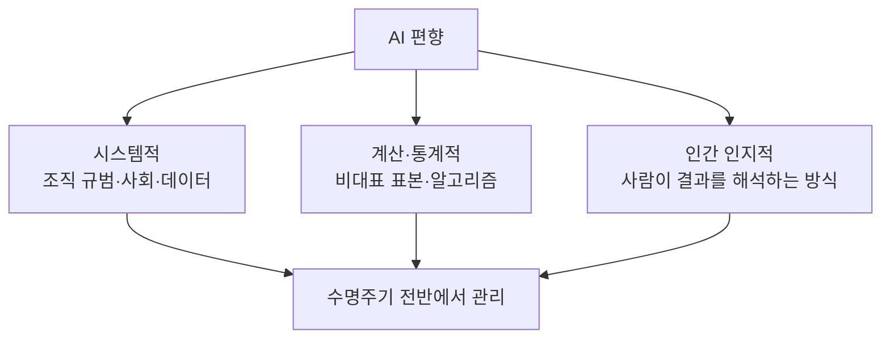

# NIST 편향 세 범주

> NIST가 AI 편향을 세 갈래, 즉 **시스템적(systemic)**, **계산·통계적(computational and statistical)**, **인간 인지적(human-cognitive)** 편향으로 나눠 관리하라고 제시한 분류. 셋 모두 누군가의 편견이나 차별 의도가 없어도 생길 수 있다.

## 쉽게 말하면
시험 점수가 낮은 이유를 세 곳에서 찾는 것과 같다. 시험 제도가 원래 한쪽에 불리한가(시스템적), 채점 표본이 한쪽으로 쏠렸나(통계적), 채점자가 결과를 읽는 방식이 편향됐나(인지적). 원인이 다르면 고치는 법도 다르다.

## 자세히
출처: NIST AI 100-1(AI RMF 1.0, 2023) §3.7(PDF를 내려받아 읽음). 세부 분류는 NIST SP 1270이 다룬다고 안내하며 이번에는 열어 보지 못했다.
- **시스템적 편향**: AI 데이터셋, 수명주기 전반의 조직 규범·관행·절차, 그리고 AI를 쓰는 더 넓은 사회에 존재할 수 있다.
- **계산·통계적 편향**: 데이터셋과 알고리즘 처리에 존재하며, 대개 **대표성 없는 표본**에서 비롯된 체계적 오류다.
- **인간 인지적 편향**: 개인이나 집단이 AI 시스템 정보를 받아 결정하거나 빈 곳을 메우는 방식, 그리고 AI의 목적·기능을 생각하는 방식과 관련된다. 설계·구현·운영·유지를 포함한 수명주기와 사용 전반에 늘 존재한다.
- **편향은 인구통계 균형·데이터 대표성보다 넓다**: 예측이 집단 간에 어느 정도 균형 잡혀도 장애인에게 접근 불가하거나 디지털 격차, 기존 격차를 악화시킬 수 있다. 그래서 "편향 완화 = 공정"이 아니다.
- **편향이 항상 나쁜 것은 아니나** AI는 편향의 속도와 규모를 키워 개인·집단·사회에 해를 증폭할 수 있다고 한다.
- 공정성 기준은 문화와 적용에 따라 달라져 정의가 어렵다.

## 그림으로 보기

## 예시
- 채용 AI: 과거 채용 기록 자체가 특정 성별에 불리(시스템적), 지원자 표본이 특정 학교에 쏠림(통계적), 면접관이 AI 점수를 맹신(인지적).
- 점검 표: 범주별로 "어디서 생겼나·누가 확인하나·어떤 지표로 재나"를 칸으로 둔다.

## 헷갈리는 것과 비교
| 개념 | 차이 |
|---|---|
| 데이터 대표성 | 통계적 편향의 한 원인, 편향 전체는 아님 |
| 공정성 | 목표 가치, 편향 완화만으로 보장 안 됨 |
| [신뢰 특성 간 상충](#trustworthiness-tradeoffs) | 공정성이 다른 특성과 균형을 맞추는 문제 |
| [타당하고 신뢰할 수 있음](#valid-and-reliable) | 기반 조건, 구간별 분해 결과가 편향 탐지에 쓰임 |

## 더 읽을거리
- [NIST AI RMF 1.0 (AI 100-1) PDF](https://nvlpubs.nist.gov/nistpubs/ai/nist.ai.100-1.pdf) — §3.7 편향 세 범주(열어서 확인)
- NIST SP 1270 — 편향 분류의 상세 문서(이번에는 열지 못함)
