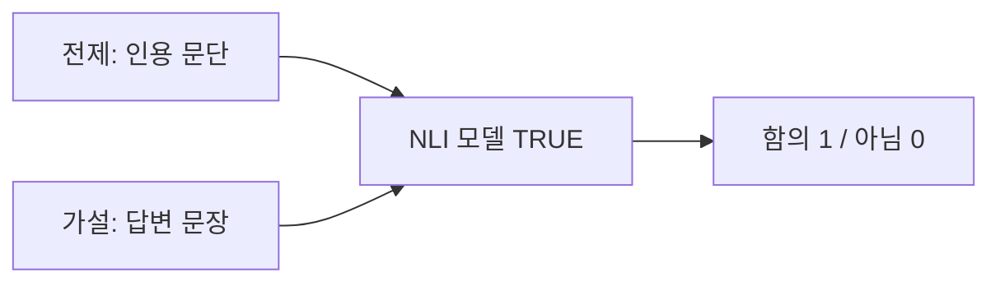

# NLI 함의 검사

> **자료(전제)가 문장(가설)을 논리적으로 뒷받침하는지** 자연어 추론(NLI) 모델이 판정하는 검사다. 인용·환각 평가에서 "이 문장이 근거에서 나오나?"를 자동으로 가린다.

## 쉽게 말하면
"철수는 어제 서울에 갔다"는 전제에서 "철수는 서울에 갔다"는 따라 나오지만 "철수는 부산에 갔다"는 따라 나오지 않는다. 이런 따라 나옴(함의) 여부를 기계가 판정한다.

## 자세히
(ALCE 논문의 평가 부분을 직접 읽었다. NLI 일반 이론은 이 글의 출처에 없다.)
- **구성(논문)**: ϕ(전제, 가설) = 1이면 전제가 가설을 **함의**, 아니면 0. ALCE는 인용 재현율에서 **인용 문단을 이어 붙인 것을 전제, 모델이 쓴 문장을 가설**로 둔다.
- **모델(논문)**: **TRUE**(Honovich 외 2022) — 여러 NLI 데이터셋으로 미세조정한 **T5-11B**. 사실 정확성을 겨냥하고 이전 연구에서도 쓰였다. 허깅페이스 `google/t5_xxl_true_nli_mixture`.
- **ELI5 정확성에도 사용(논문)**: LLM이 하위 주장 3개를 만들고, NLI 모델이 모델 출력이 각 주장을 함의하는지 확인 → claim recall.
- **의미(AIS)**: ϕ=1은 "인용 자료만으로 그 문장이 참"을 뜻한다.
- **한계(해석)**: NLI 모델은 긴 전제·여러 문서 종합에 약할 수 있고(논문이 현 시스템의 다중 출처 종합 한계를 지적), 오판이 점수에 섞인다. 사람 표본과 일치도를 확인한다.

## 그림으로 보기

## 예시
- 사내 규정 Q&A: 답변 문장을 가설, 인용한 규정 조항을 전제로 NLI를 돌려 함의가 아닌 문장을 환각 후보로 표시(제안).

## 헷갈리는 것과 비교
| 개념 | 차이 |
|---|---|
| NLI 함의 | 전제가 가설을 뒷받침하나 판정 |
| LLM 판정자 | 프롬프트로 판정(유연하지만 비용·변동) |
| [인용 재현·정밀](#citation-recall-precision) | NLI로 계산하는 지표 |
| [누출 LLM 판정자](#llm-judge-leakage) | 다른 목적의 판정자 |

## 더 읽을거리
- [Gao et al. (2023) — ALCE](https://arxiv.org/abs/2305.14627) — NLI 평가 방식(직접 읽음).
