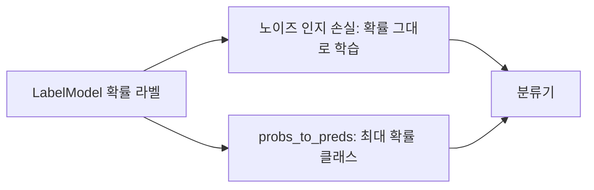
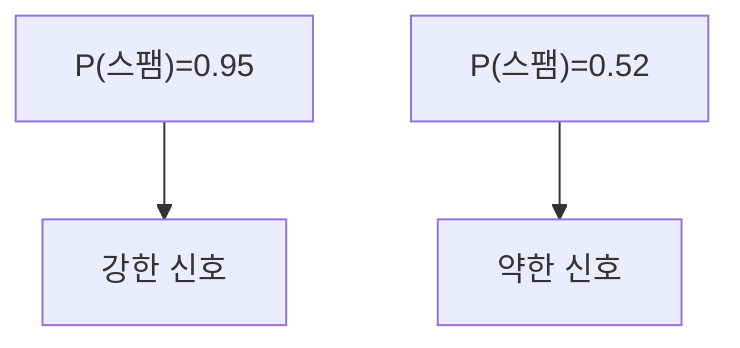

# 노이즈 인지 손실

> 확률 라벨(예: "스팸일 확률 0.8")로 모델을 학습할 때, 라벨의 불확실성을 반영해 손실을 계산하는 방식이다. 약한 지도에서 LabelModel이 낸 확률 라벨을 그대로 학습에 쓰기 위한 장치다.

## 쉽게 말하면
채점이 완벽하지 않은 문제집으로 공부할 때, "이 문제는 답이 80% 확실"이라는 표시를 보고 확신이 낮은 문제는 덜 믿고 배우는 것과 같다.

## 자세히
(Ratner 외 "Data Programming" arXiv 1605.07723 초록과 Snorkel 튜토리얼 소스를 직접 읽고 확인.)
- **Data Programming(2016)**: 사용자가 LF를 쓰면 라벨링 과정을 **생성 모델**로 보고 노이즈를 제거(denoise)해 LF 정확도를 추정한다. 이어서 **판별 손실 함수를 노이즈 인지로 수정**해 로지스틱 회귀·LSTM 등이 확률 라벨로 학습할 수 있다고 한다.
- **보고된 결과**: 2014 TAC-KBP Slot Filling에서 새 최고 점수를 낼 수 있었고, LSTM이 기존 최고 LSTM보다 **F1 약 6점 높아 2위**. 학습 데이터가 거의 없을 때 비전문가가 모델을 만들기 쉬울 수 있다는 초기 사용자 연구.
- **튜토리얼의 실무 선택**: 분류기가 float 라벨을 받으면 확률 라벨로 직접 학습(노이즈 인지 손실). 확률 라벨을 못 받는 라이브러리(예: scikit-learn)면 `probs_to_preds`로 **최대 확률 클래스**로 바꿔 학습한다 — 신뢰도 정보를 잃는 **손실 있는 변환**이다.
- **직관(제안)**: 소프트 라벨(0.5 근처)은 학습 신호가 약하므로 손실 기여도가 작다. 구현은 라이브러리별로 다르다(교차엔트로피에 확률 타깃 사용 등).

## 그림으로 보기

## 예시
- PyTorch에서 소프트 타깃 교차엔트로피로 확률 라벨 학습, 비교군은 argmax 하드 라벨 학습.
- 교육 활용: "확신도를 함께 가르치는 학습"의 직관.

## 헷갈리는 것과 비교
| 개념 | 차이 |
|---|---|
| 노이즈 인지 손실 | 확률 라벨의 불확실성 반영 |
| 하드 라벨 변환 | argmax로 신뢰도 정보 손실 |
| 라벨 스무딩 | 정답을 일부러 부드럽게(목적이 다름) |

## 더 읽을거리
- [Data Programming (arXiv 1605.07723)](https://arxiv.org/abs/1605.07723) — 노이즈 인지 판별 손실.
- [Snorkel 튜토리얼 소스(spam)](https://github.com/snorkel-team/snorkel-tutorials/blob/master/spam/01_spam_tutorial.py) — 확률→하드 라벨 변환 설명.
