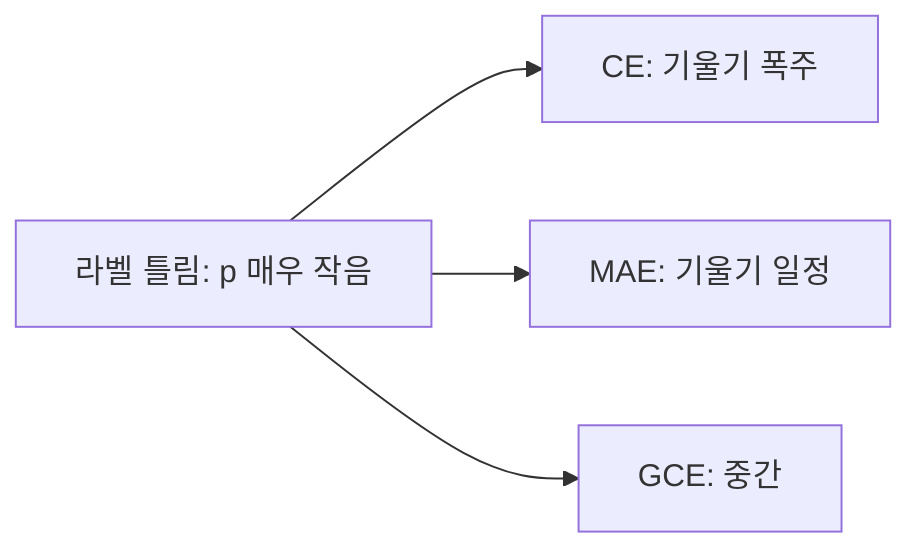
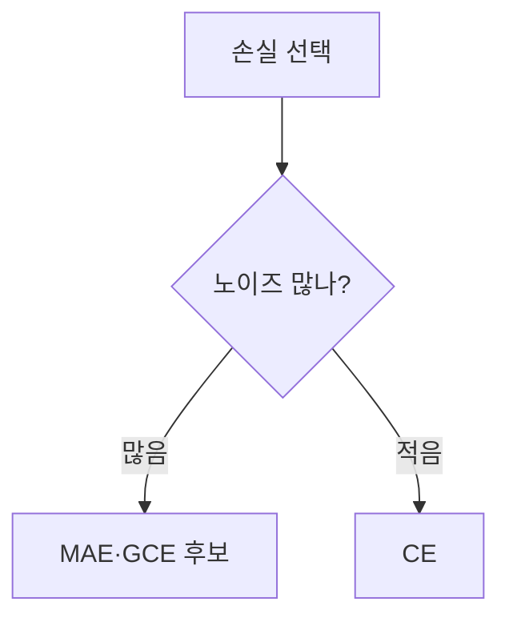

# 노이즈에 강한 손실

> 노이즈에 강한 손실(noise-robust loss)은 틀린 라벨이 있어도 학습이 덜 흔들리도록 설계한 손실 함수다. 모델이 "자신 있게 반대로 예측하는" 샘플의 기울기가 폭주하지 않게 하는 것이 핵심이다.

## 쉽게 말하면
채점 오류가 있는 문제에서 학생이 크게 틀렸다고 해서 벌점을 무한정 키우면, 학생은 그 오타 문제에 모든 노력을 쏟는다. 벌점에 상한을 두면 이상한 문제에 끌려다니지 않는다.

## 자세히
- **MAE의 강건성(Ghosh 외, arXiv 1712.09482 초록)**: 평균절대오차(MAE)가 라벨 노이즈에 본질적으로 강해, 잘못 라벨된 학습 데이터로도 올바른 분류기를 학습할 수 있다고 보인다. 다중 클래스 노이즈 허용 손실의 충분 조건을 이진 분류 결과에서 확장해 제시한다.
- **MAE의 약점(Zhang & Sabuncu, arXiv 1805.07836 초록)**: MAE는 깊은 신경망과 어려운 데이터셋에서 성능이 나쁠 수 있다고 주장한다. 그래서 MAE와 교차 엔트로피(CCE)를 모두 특수한 경우로 포함하는 노이즈 강건 손실군(generalized cross entropy, GCE)을 제안하고, CIFAR-10·CIFAR-100·Fashion-MNIST의 합성 노이즈에서 좋은 성능을 보고한다. 초록에는 수식이 없다.
- **직접 계산한 기울기 크기(정답 클래스 확률 p에 대한 손실 기울기 |dL/dp|)**: CE는 1/p, MAE는 1, GCE(q=0.7로 가정)는 p^−0.3다.

| p(라벨 클래스 확률) | CE | MAE | GCE (q=0.7) |
| --- | --- | --- | --- |
| 0.9 | 1.1 | 1.0 | 1.03 |
| 0.5 | 2.0 | 1.0 | 1.23 |
| 0.1 | 10.0 | 1.0 | 2.00 |
| 0.01 | 100.0 | 1.0 | 3.98 |

 라벨이 틀렸다면 p가 매우 작을 가능성이 높고, 이때 CE는 기울기가 커져 모델이 틀린 라벨을 맞추려 애쓴다. MAE는 일정하고 GCE는 그 중간이다(GCE 식은 논문 본문 기준으로 `(1 − p^q)/q`라고 알려져 있으나 이번엔 초록만 확인해 식 자체는 미확인, 위 표는 이 식을 가정한 계산이다).
- **트레이드오프(해석)**: 강건할수록 어려운 샘플 학습도 느려져 수렴이 더디다. 노이즈 정도가 낮으면 CE가 낫고, 높으면 강건 손실이 유리할 수 있어 검증 데이터로 고른다.

## 그림으로 보기

## 예시
- 코드 개념: GCE 손실을 직접 구현해 `loss = (1 - p_y**q) / q`로 쓰고 q를 0.7 근처에서 조정(식은 위 주의 참고).
- 교육 활용: 위 표를 보고 "왜 틀린 라벨이 CE에서 더 위험한가"를 설명하게 한다.

## 헷갈리는 것과 비교
| 개념 | 차이 |
| --- | --- |
| 강건 손실 | 학습 방식으로 노이즈 영향을 줄임 |
| 라벨 정리 | 데이터에서 노이즈를 줄임 |
| [노이즈 라벨 암기](#memorization-of-noisy-labels) | 강건 손실이 완화하려는 문제 |
| [조기 종료](#early-stopping-noise) | 시간 축 대응 |

## 더 읽을거리
- [Robust Loss Functions under Label Noise for Deep Neural Networks (arXiv 1712.09482)](https://arxiv.org/abs/1712.09482) — MAE 강건성
- [Generalized Cross Entropy Loss (arXiv 1805.07836)](https://arxiv.org/abs/1805.07836) — MAE와 CCE를 잇는 손실군
