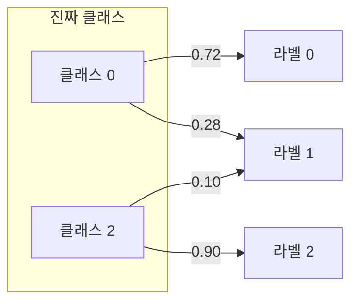
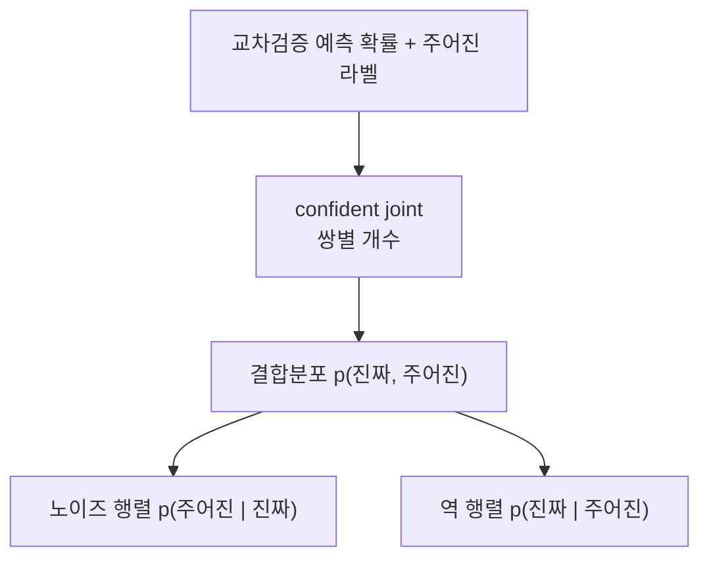

# 노이즈 전이 행렬

> **진짜 클래스가 주어졌을 때 어떤 라벨이 붙을 확률**을 표로 만든 것이다(`p(주어진 라벨 | 진짜 라벨)`). 열이 진짜 클래스, 행이 붙은 라벨이며 각 열의 합이 1이다. 라벨 노이즈가 어느 클래스에서 어느 클래스로 새는지 한눈에 보여 준다.

## 쉽게 말하면
분류원이 우편을 잘못 분류하는 "오분류 성적표"다. "등기 우편의 28%는 일반으로 분류된다"처럼 종류별로 오분류 방향과 비율을 적어 둔다.

## 자세히
- **cleanlab 정의(튜토리얼)**: 노이즈 행렬은 "주어진 라벨에 대해 진짜 클래스에서 다른 모든 클래스로 뒤집힐 확률"을 담은 조건부 확률 행렬이다. 역 노이즈 행렬 `p(진짜 | 주어진)`은 반대 방향. 가장 유용한 양은 **결합분포 `p(진짜, 주어진)`**이고 다른 통계량을 여기서 계산할 수 있다. **confident joint**는 (진짜, 주어진) 쌍별 샘플 수의 비정규화 추정치다. 추정에는 교차검증으로 얻은 표본 외(out-of-sample) 예측 확률이 필요하다.
- **직접 실험(cleanlab 2.9.0, 3클래스 합성 2,000개)**: 진짜 0→1을 30%, 2→1을 10%로 뒤집어 놓고 실제 `p(noisy|true)`를 계산하면 열0은 `[0.72, 0.28, 0]`, 열1은 `[0, 1.0, 0]`, 열2는 `[0, 0.10, 0.90]`. 라벨만 보고 추정한 노이즈 행렬은 열0 `[0.81, 0.18, 0.01]`, 열1 `[0.01, 0.97, 0.02]`, 열2 `[0.03, 0.10, 0.88]`. **방향(0→1, 2→1)과 순서는 맞게 잡혔지만 크기는 0→1이 0.28 대 0.18로 과소추정**됐다. 클래스 사전확률 py도 진짜 `[0.33,0.34,0.33]` 대 추정 `[0.28,0.39,0.33]`로 약간 어긋났다. 한 번의 합성 실험이며 모델·데이터에 따라 달라진다.
- **쓰임**: ① 노이즈 방향을 보고 라벨링 가이드·클래스 정의 개선 ② 손실 보정(forward/backward correction) 같은 노이즈 강건 학습에 전이 행렬을 입력 ③ 의심 샘플 정리(`find_label_issues`).
- **읽는 법**: 대각선이 클수록 라벨이 정확. 비대각선의 큰 값이 혼동 쌍이다. 행렬이 클래스 수의 제곱이라 클래스가 많으면 희소·불안정해진다.
- 가정은 [클래스 조건부 노이즈](#class-conditional-noise)다. 샘플별 난이도에 따른 오류는 표현하지 못한다.

## 그림으로 보기



## 예시
```python
from cleanlab.count import estimate_py_and_noise_matrices_from_probabilities
py, noise_matrix, inv_noise_matrix = estimate_py_and_noise_matrices_from_probabilities(labels, pred_probs)[:3]
```
- 고객 문의 분류에서 "환불"이 "배송"으로 자주 라벨되는 칸을 찾아 라벨러 교육 자료에 반영.

## 헷갈리는 것과 비교
| 개념 | 차이 |
|---|---|
| 노이즈 행렬 | p(주어진 | 진짜) |
| 역 노이즈 행렬 | p(진짜 | 주어진) |
| confident joint | 쌍별 *개수* 추정 |
| 혼동 행렬(confusion matrix) | 모델 예측 vs 라벨, 라벨 노이즈와 다름 |

## 더 읽을거리
- [cleanlab 튜토리얼](https://docs.cleanlab.ai/stable/tutorials/indepth_overview.html) — 노이즈 행렬·confident joint 정의와 코드.
- [Confident Learning (arXiv 1911.00068)](https://arxiv.org/abs/1911.00068) — 결합분포 추정 이론(초록 확인).
