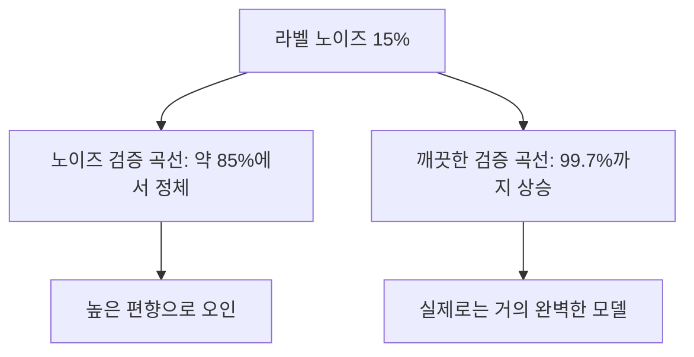
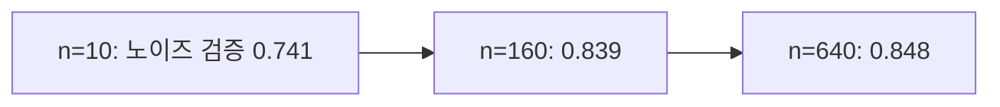

# 라벨 노이즈 정체

> 학습·검증 데이터에 **라벨 오류가 있으면 학습 곡선이 (1 − 노이즈율) 근처에서 평평해진다.** 모델은 계속 좋아져도 노이즈 섞인 검증 세트로 재는 점수는 천장에 걸려, 곡선만 보면 "더 이상 개선 안 됨"으로 오인한다.

## 쉽게 말하면
채점표에 15% 오류가 섞여 있으면 만점 학생의 점수도 85점이다. 학생 실력이 계속 오르는데 점수가 85점에서 멈춰 보이면 "실력이 정체"가 아니라 "채점표의 한계"다.

## 자세히
- **직접 시뮬레이션(순수 파이썬, 각 크기 40회 평균)**: 입력 x ~ N(0,1), 진짜 경계는 x > 0.2, **모든 라벨의 15%를 무작위로 뒤집는다.** 학습 데이터로 임계값을 정하고(학습 오류 최소화), 노이즈 섞인 검증 2만 개와 **깨끗한 검증**(진짜 라벨) 정확도를 비교.
  | 학습 크기 | 학습 정확도 | **노이즈 섞인 검증** 정확도 | **깨끗한 검증** 정확도 |
  |---|---|---|---|
  | 10 | 0.895 | 0.741 | 0.844 |
  | 40 | 0.862 | 0.815 | 0.950 |
  | 160 | 0.849 | 0.839 | 0.984 |
  | 640 | 0.848 | **0.848** | **0.997** |
  노이즈 섞인 검증 곡선은 **약 85%(=1−0.15)에서 정체**하는 반면 깨끗한 검증 정확도는 99.7%까지 오른다. 학습 정확도도 85%로 수렴해 학습·검증이 붙어 **높은 편향 곡선처럼** 보이지만 실제로는 모델이 거의 완벽하다([높은 편향 곡선](#high-bias-learning-curve)과 혼동 주의). 작은 크기에서는 학습 정확도(0.895)가 검증보다 높은데, 소표본 모델이 노이즈까지 맞춘 과적합 신호다.
- **원리**: 노이즈율 e를 가진 라벨에서는 완벽한 모델도 측정 정확도 ≤ 1−e([라벨 모호함의 상한](#label-ambiguity-ceiling)). Ng는 학습 세트가 커질수록 학습 오류가 **같거나 높아지고**, 일부 예시가 오라벨이거나 모호하면 100% 정확도 달성이 어려워진다고 설명한다(Machine Learning Yearning 29장).
- **진단 신호**
  1. 학습·검증 곡선이 **같은 값**에서 평평하고 그 값이 (1−추정 노이즈율)과 비슷하다.
  2. 모델이 확신 높게 라벨과 다르게 예측하는 예시가 많다([확신 불일치 재검수](#confident-disagreement-review)).
  3. 일부 시험 예시를 사람이 재검수하니 라벨이 틀렸다([라벨 오류 비중](#label-error-share-of-errors)).
  4. 모델·특징을 바꿔도 점수가 같은 천장에 걸린다.
- **대응**: 시험·검증 라벨 정제를 우선하고(깨끗한 소규모 검증 세트 확보), 점수는 "천장 대비"로 해석. 학습 세트의 무작위 노이즈는 모델이 어느 정도 견디지만 체계적 노이즈는 아니다([체계적 vs 무작위 라벨 오류](#systematic-vs-random-label-errors)).
- **한계**: 위 시뮬레이션은 무작위(대칭) 노이즈와 1차원 임계값 학습기 한 설정이다.

## 그림으로 보기



## 예시
```python
clean_val = relabel_by_experts(val.sample(300))           # 깨끗한 소규모 검증 세트
print("노이즈 검증:", acc(model, val), "깨끗한 검증:", acc(model, clean_val))
# 두 값 차이가 크면 천장은 라벨 노이즈
```
- 감성 분류 정확도가 88%에서 정체: 전문가 300건 재라벨에서 오라벨 11% 발견 → 천장 약 89%로 정체 설명.

## 헷갈리는 것과 비교
| 곡선 | 원인 | 처방 |
|---|---|---|
| 높은 편향 | 모델 한계 | 모델·특징 |
| 라벨 노이즈 정체 | 라벨 천장 | 라벨 정제·깨끗한 검증 |
| 높은 분산 | 일반화 부족 | 데이터·규제 |
| [점근 오류](#asymptotic-error) | 곡선의 바닥(라벨 노이즈 포함) | 구성 성분 분해 |

## 더 읽을거리
- [Andrew Ng, Machine Learning Yearning(초안 PDF) 29장](https://home-wordpress.deeplearning.ai/wp-content/uploads/2022/03/andrew-ng-machine-learning-yearning.pdf) — 학습 오류가 데이터와 함께 커지는 이유(본문 확인). 노이즈 정체 표는 이 글의 직접 시뮬레이션.
