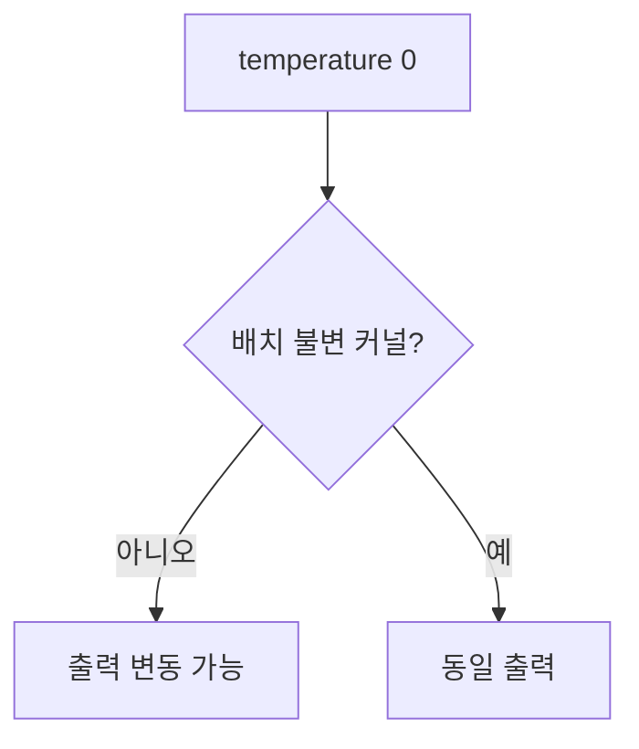

# LLM 출력의 비결정성

> 온도(temperature)를 0으로 해도 **같은 입력에서 다른 출력이 나올 수 있다.** Thinking Machines의 분석은 주원인을 "병렬 연산의 무작위성"이 아니라 서버 부하에 따라 계산 순서가 바뀌는 **배치 비불변성**으로 본다.

## 쉽게 말하면
같은 숫자들을 더해도 더하는 순서가 다르면 소수점 끝자리가 달라진다. 서버가 한가한지 붐비는지에 따라 이 순서가 바뀌면, 사용자 입장에서는 같은 질문에 답이 흔들린다.

## 자세히
- 출처: Thinking Machines 블로그 "Defeating Nondeterminism in LLM Inference"(열람 2026-11-28).
- 흔한 설명(동시성+부동소수점 원자적 덧셈)은 **불완전**하다고 한다. 진짜 원인은 순전파 커널이 **배치 불변성이 없다**는 것: 배치 크기에 따라 리덕션 순서가 달라지고, 사용자에게 서버 부하는 사실상 무작위라 결과가 달라진다.
- 실험: Qwen3-235B-A22B-Instruct-2507에 "Tell me about Richard Feynman"을 temperature 0으로 1,000번, 각 1,000토큰 생성 → **고유한 완성 80개**, 가장 흔한 것이 78번. 앞 102토큰은 같았고 103번째 토큰에서 갈렸다(992번 "Queens, New York", 8번 "New York City").
- 해결: 각 커널(RMSNorm, 행렬곱, 어텐션)의 리덕션 순서를 배치 크기와 무관하게 만든다. 배치 불변 커널을 공개했고 vLLM 결정적 모드도 제공. 켜면 1,000개가 모두 동일했다.
- 비용: 한 테스트에서 기본 vLLM 26초, 최적화 안 한 결정적 모드 55초, 개선된 어텐션 커널 42초.
- 실무 대처(내 정리): API 사용자는 완전한 결정성을 기대하지 말고, 평가·회귀 테스트는 여러 번 샘플링해 분포로 본다. 자체 호스팅이면 결정적 모드의 속도 비용을 따진다.

## 그림으로 보기

## 예시
- 같은 프롬프트를 1,000번 돌렸더니 103번째 토큰에서 "Queens"와 "New York City"로 갈라져 이후 문장이 달라짐.
- 교육: "AI는 같은 질문에 같은 답을 하나?"에 답하는 강의 슬라이드.

## 헷갈리는 것과 비교
| 개념 | 차이 |
|---|---|
| 샘플링 무작위성 | 온도·top-k 등 의도된 무작위 |
| 비결정성(이 글) | 온도 0에서도 생기는 수치적 변동 |
| [탐욕 디코딩](#greedy-decoding) | 매번 최대 확률 토큰 선택, 이론상 결정적 |

## 더 읽을거리
- [Defeating Nondeterminism in LLM Inference](https://thinkingmachines.ai/blog/defeating-nondeterminism-in-llm-inference/) — 원인·실험·해결(읽음).
