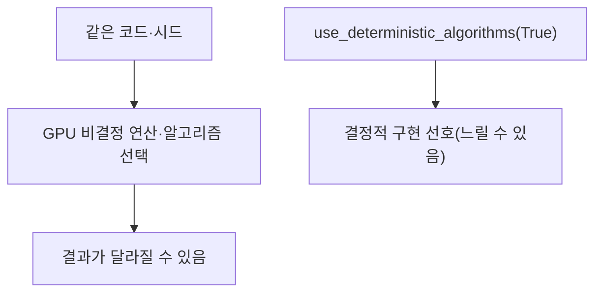

# GPU 학습의 비결정성

> 같은 코드와 같은 시드로 돌려도 GPU 연산의 알고리즘 선택·병렬 처리 때문에 결과가 달라질 수 있다. PyTorch는 결정적 알고리즘 옵션을 제공하지만 완전한 재현을 보장하지는 않는다.

## 쉽게 말하면
같은 레시피로 요리해도 조리도구(GPU 라이브러리)가 매번 다른 순서로 재료를 섞으면 맛이 조금씩 다르다. 순서를 고정하면 같아지지만 요리가 느려진다.

## 자세히
(PyTorch 재현성 문서 2.15판을 직접 열어 확인.)
- **핵심 경고**: "PyTorch 릴리스, 개별 커밋, 서로 다른 플랫폼 사이에서 완전히 재현 가능한 결과는 보장되지 않는다." 시드가 같아도 CPU와 GPU 결과가 다를 수 있다.
- **cuDNN**: `torch.backends.cudnn.benchmark = False`는 알고리즘을 결정적으로 고르게 한다(성능 저하 가능). `torch.backends.cudnn.deterministic = True`는 알고리즘 자체가 비결정적일 때 이를 제어하지만 이 동작에만 영향을 준다.
- **전역 옵션**: `torch.use_deterministic_algorithms(True)`는 결정적 구현을 선호하고 결정적 대안이 없는 알려진 비결정 연산에서는 오류를 낸다. SDPA에서 `warn_only=True`는 경고만 내므로 강제하려면 `warn_only=False`.
- **성능**: "결정적 연산은 비결정적 연산보다 느린 경우가 많다". 그래도 실험·디버깅·회귀 테스트에는 유용하다.
- **미확인**: 이 페이지에는 `CUBLAS_WORKSPACE_CONFIG=:4096:8` 안내가 없어 출처로 인용하지 못한다.
- **운영(제안)**: 재현이 필요한 실험은 환경(버전·GPU 종류)을 고정·기록하고, 결과를 여러 시드로 반복해 평균과 분산을 보고한다([랜덤 시드 기록](#random-seed-protocol)).

## 그림으로 보기



## 예시
```python
torch.manual_seed(0)
torch.backends.cudnn.benchmark = False
torch.use_deterministic_algorithms(True)
```
- 교육 활용: 같은 시드로 두 번 돌려 결과 차이를 관찰.

## 헷갈리는 것과 비교
| 설정 | 효과 |
|---|---|
| cudnn.benchmark=False | 알고리즘을 결정적으로 선택 |
| cudnn.deterministic=True | 해당 동작만 제어 |
| use_deterministic_algorithms | 전역으로 결정적 구현 요구 |

## 더 읽을거리
- [PyTorch Reproducibility](https://docs.pytorch.org/docs/2.15/notes/randomness.html) — 시드·결정적 알고리즘.
