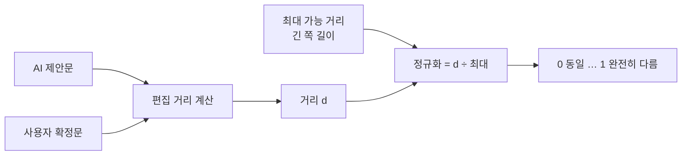

# 정규화 편집 거리

> 편집 거리를 문자열 길이로 나눠 **0~1 사이 비율**로 만든 값. 길이가 다른 문서끼리도 "얼마나 고쳤는가"를 비교할 수 있게 해 준다. 0은 동일, 1은 완전히 다름이다.

## 쉽게 말하면
한 줄짜리 문장에서 3글자를 고친 것과 한 페이지 문서에서 3글자를 고친 것은 의미가 다르다. 고친 글자 수를 전체 길이로 나누면 "몇 %를 고쳤는가"가 되어 공정하게 비교된다.

## 자세히
출처: RapidFuzz Levenshtein 문서(본문 확인, 2026-11-18). 한국어 예시 숫자는 [레벤슈타인 거리](#levenshtein)에서 직접 계산한 값이다.
- **정의(RapidFuzz)**: 정규화 거리 = 거리 ÷ 주어진 두 길이와 가중치에서 가능한 **최대 레벤슈타인 거리**. 비용이 모두 1이면 최대 거리는 두 길이 중 긴 쪽이다(거리의 상한이 max(m,n)이라는 성질에서 이어지는 해석).
- **함수**: `distance()`, `normalized_distance()`(0~1), `similarity()`(최대 거리 − 거리), `normalized_similarity()`(1 − 정규화 거리), `editops()`, `opcodes()`.
- **가중치**: `weights=(삽입, 삭제, 치환)`, 기본 (1,1,1). Indel 변형은 (1,1,2). 가중치가 달라지면 정규화 분모도 달라진다.
- **조기 종료**: `score_cutoff`를 주면 기준을 넘는 쌍은 계산을 일찍 끝낸다. 대량 쌍 비교에서 속도를 아끼는 옵션.
- **직접 계산한 값**: "환불 요청"→"환불 요청함" 정규화 0.167, "확인했습니다"→"확인 했습니다" 0.143, "300만 원 입금"→"30만 원 입금" 0.111.
- **해석 주의**: 같은 정규화 값이어도 뜻 변화는 전혀 다를 수 있다(마지막 예는 금액 10배 차이). 짧은 문장은 한 글자만 바뀌어도 값이 크고 긴 문서는 중요한 한 글자가 묻힌다.
- **임계값 정하기(제안)**: "무수정"을 거리 0이 아니라 정규화 거리 0.02 이하처럼 정의해 공백·문장부호 차이를 흡수할 수 있다. 이 임계값은 조직이 데이터로 정하며, 이 문서에서 검증한 값이 아니다.
- **지표성**: 정규화 방식에 따라 삼각부등식이 깨질 수 있다는 학술 논의가 있으나 이번 조사에서 원문을 열지 못해 내용은 확인하지 못했다.

## 그림으로 보기


## 예시
```python
from rapidfuzz.distance import Levenshtein
d = Levenshtein.normalized_distance("300만 원 입금", "30만 원 입금")   # 약 0.111
sim = Levenshtein.normalized_similarity("환불 요청", "환불 요청함")        # 약 0.833
unchanged = d <= 0.02    # 조직이 정한 "사실상 무수정" 기준
```
교육 활용: 상담 요약 도입 보고서에서 "수정률 3%"가 무엇을 뜻하는지, 정규화 방식과 임계값을 함께 적도록 연습.

## 헷갈리는 것과 비교
| 개념 | 차이 |
|---|---|
| 편집 거리 | 절댓값(편집 횟수) |
| 정규화 편집 거리 | 길이로 나눈 비율(0~1) |
| [의미 유사도](#semantic-similarity-edit) | 뜻의 차이, 표면이 달라도 뜻이 같으면 높음 |
| [무수정 수락률](#accept-without-edit-rate) | 정규화 거리 임계값으로 "무수정"을 정의할 수 있음 |

## 더 읽을거리
- [RapidFuzz Levenshtein 문서](https://rapidfuzz.github.io/RapidFuzz/Usage/distance/Levenshtein.html) — 함수·가중치·정규화 정의
- [Wikipedia: Levenshtein distance](https://en.wikipedia.org/wiki/Levenshtein_distance) — 범위와 단위 선택
