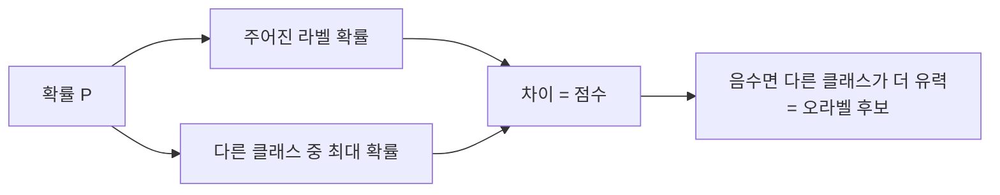
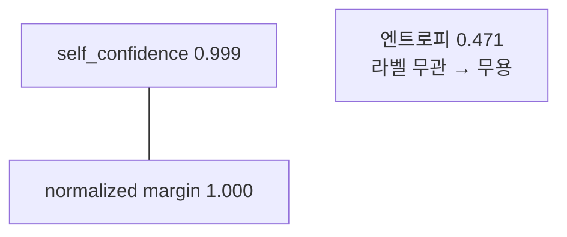

# normalized margin 점수

> normalized margin 점수는 "주어진 라벨에 대한 예측 확률"에서 "주어진 라벨을 뺀 나머지 클래스 중 가장 큰 확률"을 뺀 값이다. 양수면 모델이 주어진 라벨을 가장 유력하게 보고, 음수면 다른 클래스가 더 유력하다는 뜻이라 라벨 오류 후보를 찾는 점수로 쓴다.

## 쉽게 말하면
정답으로 적힌 보기가 조교의 확신 순위에서 1등인지, 그리고 2등과 얼마나 차이 나는지를 본다. 정답으로 적힌 보기가 오히려 2등이고 다른 보기가 1등이면 점수가 음수가 되어 의심 대상이 된다.

## 자세히
- **계산(해석)**: [표본 외 예측 확률](#out-of-sample-probabilities) P에서 샘플 n의 점수 = P[n, 주어진 라벨] − max_{j≠주어진 라벨} P[n, j]. 범위는 −1~1이다. [self_confidence](#self-confidence-score)는 주어진 라벨의 확률만 보지만 이 점수는 가장 강한 경쟁 클래스와 비교한다. cleanlab 문서의 점수 방식 중 하나로 알려져 있으나 이 글에서 문서를 열어 확인하지 않았다.
- **직접 해 본 실험(숫자 손글씨 1,797개, 라벨 20% 무작위 변경, 랜덤 포레스트 5겹의 표본 외 확률)**: 오라벨을 구분하는 AUROC가 self_confidence 0.999, normalized margin 1.000이었다. 이 쉬운 데이터에서는 둘 다 거의 완벽해 차이를 가르기 어려웠다. 라벨과 무관하게 모델의 불확실성만 보는 엔트로피 점수는 AUROC 0.471로 동전 던지기 수준이었다. 라벨 오류를 찾으려면 "주어진 라벨에 대한" 정보를 써야 한다는 뜻이다.
- **self_confidence와의 차이(해석)**: 클래스가 많거나 확률이 여러 클래스에 퍼지는 어려운 데이터에서는, 주어진 라벨의 확률이 낮아도 다른 클래스도 낮을 수 있다. 마진은 "다른 클래스가 확실히 더 유력한가"를 더 직접 반영하므로 이런 경우에 낫다고 기대되지만 이 글의 실험에서는 확인하지 못했다.
- **한계**: 모델이 약하거나 확률 보정이 나쁘면 점수가 부정확하다. 오라벨 후보는 사람이 확인해야 한다.

## 그림으로 보기



## 예시
```python
other = np.where(np.eye(K)[y_given] == 1, -1, oos).max(axis=1)
score = oos[np.arange(len(y_given)), y_given] - other
review_order = np.argsort(score)   # 낮은 점수부터 검수
```
교육 활용: 세 점수의 AUROC를 비교해 "라벨을 쓰는 점수"가 왜 필요한지 확인한다.

## 헷갈리는 것과 비교
| 개념 | 차이 |
| --- | --- |
| [self_confidence](#self-confidence-score) | 주어진 라벨의 확률만 |
| normalized margin | 주어진 라벨 확률 − 최대 경쟁 클래스 확률 |
| 엔트로피 | 라벨과 무관한 모델의 불확실성 |
| [Confident Joint](#confident-joint) | 클래스 쌍별 오류 개수 추정 |

## 더 읽을거리
- [Confident Learning (arXiv 1911.00068)](https://arxiv.org/abs/1911.00068) — 라벨 오류 탐지의 이론과 cleanlab
