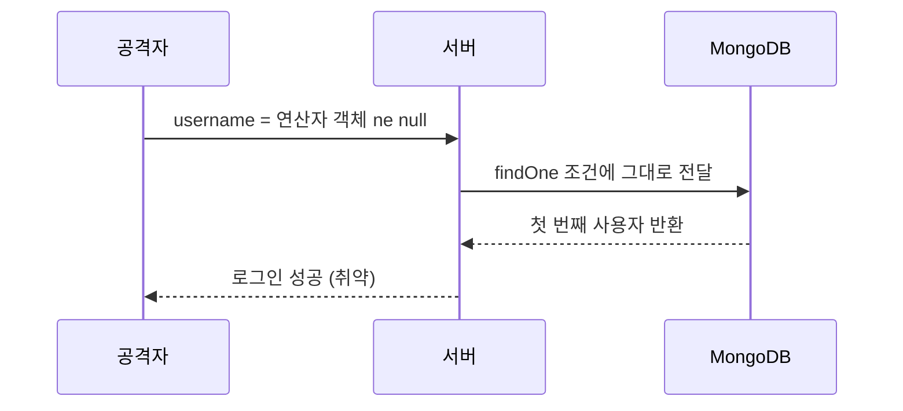
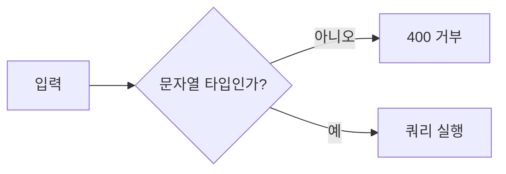

# NoSQL 인젝션

> NoSQL 인젝션은 MongoDB 같은 NoSQL DB에 들어가는 쿼리의 구조를 사용자 입력이 바꿔 버리는 공격이다. SQL 인젝션의 사촌이며, 문자열 대신 쿼리 연산자(`$ne` 등)가 들어오는 형태가 대표적이다.

## 쉽게 말하면
창구 직원에게 "이름이 홍길동인 사람"이라고 말해야 하는 자리에서 "이름이 '아무개가 아닌' 사람 아무나"라고 말하는 셈이다. 직원이 말을 그대로 조건식으로 받아 적으면 첫 번째 사람이 나온다.

## 자세히
(아래는 보안 해설 사이트들의 공통 내용이며 OWASP 원문 페이지는 직접 열리지 않아 확인하지 못했다. confidence 중간.)
- **로그인 우회**: 서버가 요청 JSON을 그대로 쿼리에 넣으면 `{"username": {"$ne": null}, "password": {"$ne": null}}`처럼 문자열 자리에 연산자 객체가 들어가 "아무 사용자"가 매칭된다. PHP에서는 `username[$ne]=1` 형태의 폼 데이터가 중첩 배열이 되어 같은 효과를 낸다.
- **서버 측 JavaScript**: `$where`·mapReduce는 입력이 서버에서 JS로 실행될 수 있어 위험하다. 필요 없으면 끈다.
- **방어**: ① 입력 **타입 검증**(문자열이어야 할 필드가 객체면 거부, Mongoose 같은 스키마 검증) ② `$`로 시작하는 키 제거·거부 ③ 쿼리를 문자열로 조립하지 않기 ④ `$where` 비활성화 ⑤ 최소 권한 DB 계정. SQL의 [허용 목록 검증](#allowlist-validation) 원리와 같다.
- AI가 만든 Express+MongoDB 로그인 코드가 `req.body`를 그대로 `findOne`에 넘기는 경우가 흔하니 리뷰 포인트다.

## 그림으로 보기

## 예시
- 점검: 로그인 API에 JSON으로 `{"username":{"$ne":null},"password":{"$ne":null}}`를 보내 성공하면 취약(내 앱에서만 시험).
- AI 지시: "모든 쿼리 입력은 string 타입을 검증하고 `$` 키는 거부해 줘."

## 헷갈리는 것과 비교
| 개념 | 차이 |
| --- | --- |
| [SQL 인젝션](#sql-injection) | SQL 문자열을 변조 |
| NoSQL 인젝션 | 연산자·JS로 쿼리 구조 변조 |
| [ORM 인젝션](#orm-injection) | ORM의 raw 쿼리·필터 구멍 |

## 더 읽을거리
- [What is NoSQL Injection and How Can You Prevent It? (Invicti)](https://www.invicti.com/blog/web-security/what-is-nosql-injection) — 개요와 예방
- [NoSQL Injection (SecureFlag)](https://knowledge-base.secureflag.com/vulnerabilities/nosql_injection/nosql_injection_vulnerability.html) — 취약점 설명
