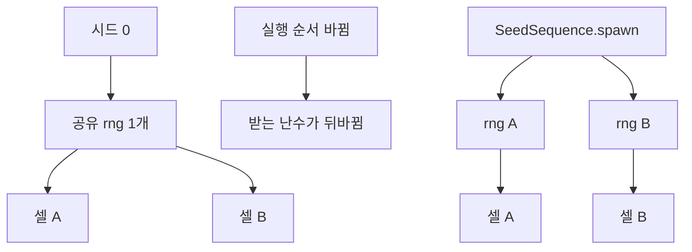

# 노트북 실행 순서와 난수

> 주피터 노트북에서 여러 셀이 **하나의 난수 생성기(전역 시드·공유 rng)** 를 쓰면, 셀을 실행하는 순서·횟수에 따라 각 셀이 받는 난수가 달라져 결과가 흔들린다. 셀마다 독립된 생성기를 쓰면 순서와 무관해진다.

## 쉽게 말하면
한 권의 주사위표를 여러 사람이 돌려 쓰는 상황이다. 먼저 읽은 사람이 앞 숫자를 가져가므로, 누가 먼저 읽느냐에 따라 각자의 숫자가 달라진다. 사람마다 자기 주사위표를 따로 가지면 순서가 상관없다.

## 자세히
- **직접 실행**(numpy 시뮬레이션: 공유 `default_rng(0)`에서 셀 A(데이터 생성)와 셀 B(노이즈 샘플)가 각각 3개씩 뽑음):

| 실행 순서 | 셀 A가 받은 값 | 셀 B가 받은 값 |
|---|---|---|
| A → B | 0.126, −0.132, 0.640 | 0.105, −0.536, 0.362 |
| B → A | 0.105, −0.536, 0.362 | 0.126, −0.132, 0.640 |

  순서를 바꾸면 두 셀이 서로의 값을 받아 간다. 한 셀을 두 번 실행해도 두 번째는 다른 값을 받는다.
- **해결**: `SeedSequence(0).spawn(2)`로 자식 시드를 만들어 셀(또는 용도)마다 별도 `default_rng`를 준다. 실행 결과, 순서를 바꿔도 A·B 모두 같은 값이었다(`spawn: A same True, B same True`).
- **실무 규칙**: ① 시드는 설정 셀 한 곳에서 정하고 용도별 rng를 만든다, ② 공유 상태가 있는 노트북은 마지막에 "Restart & Run All"로 검증한다, ③ 중요한 결과는 노트북이 아닌 스크립트로 재현한다, ④ 전역 `np.random.seed`·`random.seed`·`torch.manual_seed`는 모두 따로 설정해야 한다(라이브러리마다 별도 상태).

## 그림으로 보기


## 예시
```python
from numpy.random import SeedSequence, default_rng
rng_data, rng_noise = [default_rng(s) for s in SeedSequence(0).spawn(2)]
```
- 팀 노트북 검수 체크리스트에 "Restart & Run All 두 번 실행해 결과 같은가"를 넣는다.

## 헷갈리는 것과 비교
| 개념 | 차이 |
|---|---|
| 공유 rng | 호출 순서가 난수를 결정 |
| 용도별 독립 rng | 순서와 무관한 재현성 |
| [RandomState 인스턴스 vs 정수](#randomstate-instance-vs-int) | scikit-learn 쪽 난수 상태 |
| [사전에 정한 시드](#preregistered-seed) | 시드를 미리 고정·기록하는 습관 |

## 더 읽을거리
- [NumPy: Parallel random number generation (SeedSequence.spawn)](https://numpy.org/doc/stable/reference/random/parallel.html) — 자식 시드로 독립 스트림 만들기.
- [NumPy: Random Generator](https://numpy.org/doc/stable/reference/random/generator.html) — default_rng 사용법.
