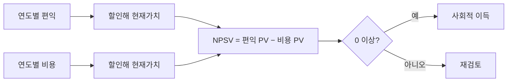
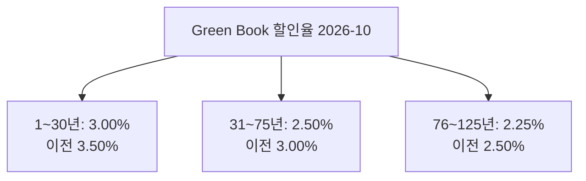

# 순현재사회가치 NPSV

> 순현재사회가치(NPSV, Net Present Social Value)는 영국 재무부 Green Book이 쓰는 지표로, 어떤 사업의 사회적 편익의 현재가치에서 비용의 현재가치를 뺀 값이다. 민간의 순현재가치(NPV)와 같은 계산이지만 편익·비용에 사회 전체의 효과를 넣는다.

## 쉽게 말하면
내년의 100만 원은 오늘의 100만 원보다 가치가 작다고 보고, 먼 미래의 효과를 "오늘 돈으로" 환산한 뒤 편익 합계에서 비용 합계를 빼는 것이다. 결과가 양수면 사회 전체로 이득이다. 이 환산에 쓰는 비율이 할인율이다.

## 자세히
- **정의와 계산(Green Book 보충 지침, HM Treasury 2026-10, 열람)**: 할인(discounting)은 미래의 사회적 비용과 편익을 현재가치로 표현하는 것이다. t년의 순편익의 현재가치는 (t년 순편익) ÷ (1+r)^t로 계산하고, 편익의 현재가치 합에서 비용의 현재가치 합을 빼면 NPSV다. 가격은 실질(real) 가치로 쓴다(Finance NI 안내의 검색 요약).
- **할인율이 2026년에 바뀌었다(HM Treasury 2026 할인율 검토 대응 문서, PDF 본문 열람)**: Groom·Freeman 교수의 검토가 2026-06에 끝났고, 2026-09에 재무장관이 핵심 권고를 수용해 처음 30년의 할인율을 3.50%에서 3.00%로 낮추기로 했다. 31~75년은 3.00%→2.50%, 76~125년은 2.50%→2.25%다. 건강 효과 전용 할인율 1.5%는 없애고 대신 미래 실질 건강 효과를 연 2%로 올려 계산한다(수학적으로 동등). 예전 글·자료의 "3.5%"는 구버전 값이다. 새 Green Book과 보충 지침은 2026-10에 나왔다.
- **가상 예시(직접 계산, 단위 백만 원)**: AI 도구를 도입해 0년차 비용 50, 1~5년차 연 편익 30·연 운영비 8이라고 가정한다.
  - 할인율 3.5%: 편익 현재가치 135.45, 운영비 36.12, NPSV = 135.45 − 36.12 − 50 = **49.33**
  - 할인율 3.0%: 편익 137.39, 운영비 36.64, NPSV = **50.75**
  - 5년짜리 사업은 할인율 변화의 영향이 작다(약 1.4). 편익이 수십 년 이어지는 사업일수록 차이가 커진다. 민간 ROI 분석에서는 사회적 편익이 아니라 회사의 현금흐름을 쓰고 할인율도 회사의 자본비용을 쓴다(해석).
- **스위칭 값과의 연결**: NPSV를 0으로 놓고 변수 하나를 구하면 결과가 뒤집히는 값을 얻는다([중단 기준 정하기](#stop-criteria)).
- **한계(해석)**: 사회적 편익의 화폐화는 불확실하고, 할인율 선택이 장기 사업의 결론을 좌우한다. AI 교육·도입 ROI에서는 회사의 가치 기준에 맞는 지표로 번역해 쓴다.

## 그림으로 보기

## 예시
- 공공 AI 민원 서비스 도입 평가: 시민 시간 절감과 공무원 시간 절감을 편익으로, 개발·운영비를 비용으로 넣어 10년치 NPSV를 3.0%로 계산한다.
- 교육 활용: 같은 사업을 할인율 3.5%와 3.0%로 비교해 기간이 길수록 차이가 커지는 것을 표로 확인하는 실습.

## 헷갈리는 것과 비교
| 개념 | 차이 |
| --- | --- |
| NPV | 기업 현금흐름의 현재가치 |
| NPSV | 사회적 편익·비용의 현재가치(공공 평가) |
| [중단 기준 정하기](#stop-criteria) | NPSV가 0이 되는 입력값을 찾아 중단 기준으로 씀 |
| [손익분기점](#breakeven-point) | 순효과가 0이 되는 지점 |

## 더 읽을거리
- [HM Treasury: Green Book supplementary guidance — discounting](https://www.gov.uk/government/publications/green-book-supplementary-guidance-discounting) — 할인 지침(2013년 최초, 2026 개정)
- [Green Book Discount Rate Review 2026 — HM Treasury response](https://assets.publishing.service.gov.uk/media/6ae0b3a97cf9b2248904678e/Green_Book_Discount_Rate_Review_2026_-_HM_Treasury_response.pdf) — 할인율 3.0% 변경 내용
