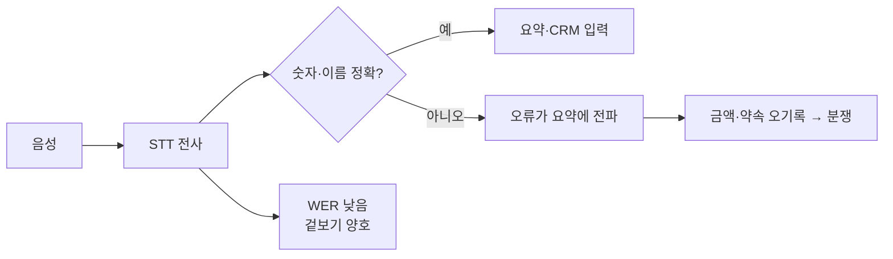

# 숫자·고유명사 오인식

> 음성 인식(STT)에서 금액·날짜·전화번호·계좌번호·사람 이름 같은 **엔티티(핵심 정보)가 틀리는 오류**. 전체 단어 오류율(WER)은 낮아도 이런 오류가 하나만 있어도 요약·기록의 신뢰도를 무너뜨릴 수 있다.

## 쉽게 말하면
회의록에서 "그리고", "음" 같은 말이 틀려도 큰 문제가 없지만, "입금 금액 300만 원"이 "30만 원"으로 적히면 분쟁이 된다. 틀린 글자 수가 같아도 피해의 크기는 전혀 다르다.

## 자세히
출처: Soniox 해설(벤더 글, 본문 확인), Earnings-21 논문 초록(arXiv 2104.11348, 확인), 검색 요약. 통화 음성에서 숫자 오류율을 직접 잰 공개 연구는 이번 조사에서 찾지 못했다.
- **WER의 맹점**: WER은 모든 단어를 같은 무게로 센다. 엔티티는 전체 단어의 작은 비율이라 틀려도 점수가 거의 안 움직인다. Soniox는 "전체 97% 정확, 전화번호는 0% 정확"인 가상 예시를 든다(실측 데이터가 아님, 벤더 주장).
- **측정 대안**: 엔티티 오류율(EER, 틀린 엔티티 ÷ 전체 엔티티), 이름·숫자·핵심 용어의 정밀도·재현율, 과제 수준 지표(올바른 필드가 채워졌나), 표기 형식과 인식 정확도의 분리 보고, 사람의 샘플 검수, 자사 오디오로의 시험.
- **숫자의 특성**: 숫자열은 문장 문맥에 기대지 못해 오인식 시 복구가 어렵다(해석). 계좌번호가 단어 토큰으로 나오고 숫자 서식이 없는 경우가 있다는 벤더 서술이 있다.
- **데이터**: Earnings-21은 실적 발표 통화 39시간의 엔티티 밀집 코퍼스다. 초록은 흔히 쓰는 말뭉치가 ASR을 충분히 도전시키지 못하며, 특정 개체명 범주의 정확도가 낮아 전사 활용의 장애가 된다고 말한다. 구체 오류율은 초록에 없다.
- **후속 오류**: 엔티티 오류는 요약·분류·CRM 입력으로 전파된다([STT 오류 전파](#stt-error-propagation)).
- **대응(제안)**: ①금액·날짜·번호만 따로 검증 규칙(형식·범위) ②상담사 확인 단계 ③원문 구간 링크([원문 링크형 요약](#source-linked-summary)) ④고객 반복 확인 스크립트.

## 그림으로 보기


## 예시
```python
import re
amounts = re.findall(r"\d[\d,]*\s*(?:원|만원|달러)", transcript)
# 요약 속 금액이 전사의 금액 집합에 있는지 대조
ok = all(a in set(amounts) for a in re.findall(r"\d[\d,]*\s*(?:원|만원|달러)", summary))
```
교육 활용: 상담 AI 도입 직무 교육에서 "정확도 97%"라는 광고 문구를 "그중 숫자 정확도는?"으로 되묻는 연습.

## 헷갈리는 것과 비교
| 개념 | 차이 |
|---|---|
| 단어 오류율(WER) | 모든 단어를 동일 가중으로 센 평균 지표 |
| 엔티티 오류율(EER) | 핵심 정보만 센 지표 |
| [STT 오류 전파](#stt-error-propagation) | 인식 오류가 후속 단계로 번지는 현상 |
| 요약 환각 | 요약 모델이 없는 내용을 만듦, STT 오류와 층이 다름 |

## 더 읽을거리
- [Soniox: Beyond WER](https://soniox.com/wiki/beyond-wer) — WER의 한계와 대안 지표(벤더 글)
- [Earnings-21 (arXiv 2104.11348)](https://arxiv.org/abs/2104.11348) — 엔티티 밀집 ASR 평가 코퍼스
