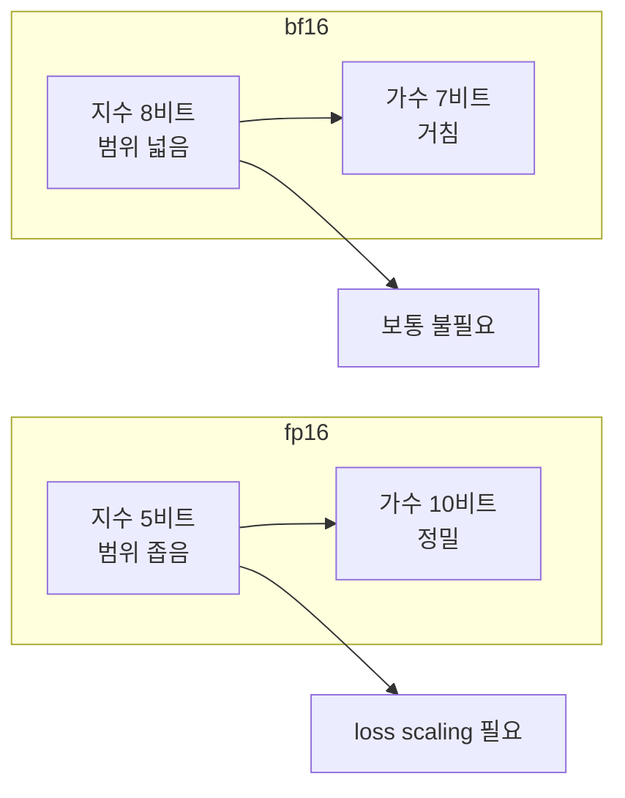

# 수치 정밀도 fp16·bf16

> fp16과 bf16은 모두 16비트 부동소수점이다. fp16은 정밀하지만 표현 범위가 좁고(최대 65,504), bf16은 범위가 fp32와 같지만 정밀도가 낮다. 그래서 fp16 학습에는 loss scaling이 필요하고 bf16은 보통 필요 없다.

## 쉽게 말하면
자(ruler)를 고르는 일이다. fp16은 눈금이 촘촘하지만 길이가 65m밖에 안 되는 자, bf16은 눈금이 성글지만 아주 긴 자다. 큰 값을 재다 자를 벗어나면(overflow) 계산이 망가진다. 눈금이 성글면 작은 변화를 못 본다.

## 자세히
| 형식 | 부호 | 지수 | 가수 | 최댓값 | 입실론(1 근처 간격) |
| --- | --- | --- | --- | --- | --- |
| fp32 | 1 | 8 | 23 | ≈3.4×10³⁸ | ≈1.2×10⁻⁷ |
| fp16 | 1 | 5 | 10 | 65,504 | ≈9.8×10⁻⁴ |
| bf16 | 1 | 8 | 7 | ≈3.4×10³⁸ | 0.0078 |

- bf16은 fp32의 앞 16비트를 그대로 자른 형태라 fp32와 범위가 같다.
- fp16 문제: 65,504 초과는 `inf`가 되어 nan으로 번진다. 반대로 약 6×10⁻⁸ 미만 그래디언트는 0으로 사라진다(underflow). [log-sum-exp](#log-sum-exp)처럼 exp를 다루는 연산이 특히 위험하다.
- **loss scaling**: 손실에 큰 수 S(PyTorch GradScaler 기본 2¹⁶)를 곱해 역전파하고, 옵티마이저 전에 다시 S로 나눈다. inf/nan이 나오면 그 스텝을 건너뛰고 S를 절반으로 줄인다.
- 혼합 정밀도 학습은 가중치의 fp32 마스터 사본을 따로 둬서 작은 업데이트가 반올림으로 사라지는 것을 막는다.
- bf16의 대가: 반올림이 거칠어 아주 작은 갱신은 묻힐 수 있다. 최근 GPU·TPU 학습에서 bf16이 기본이 된 이유는 범위 문제가 없어 설정이 단순하기 때문이다. 오래된 GPU(예: V100)는 bf16을 지원하지 않아 fp16을 쓴다.

## 그림으로 보기


## 예시
```python
with torch.autocast("cuda", dtype=torch.bfloat16):
    loss = loss_fn(model(x), y)
loss.backward(); optimizer.step()   # fp16이면 GradScaler로 감싼다
```
학습 중 loss가 갑자기 nan이 되면 fp16 overflow를 먼저 의심하고 bf16이나 fp32로 바꿔 본다.

## 헷갈리는 것과 비교
| 개념 | 차이 |
| --- | --- |
| fp16 | 정밀·좁은 범위, 스케일러 필요 |
| bf16 | 넓은 범위·거침, 학습 기본값 |
| fp8·int8 | 추론·양자화용 더 작은 형식 |
| [softmax](#softmax) | 지수 연산 탓에 overflow가 나기 쉬운 대표 연산 |

## 더 읽을거리
- [Mixed precision (PyTorch AMP 문서)](https://docs.pytorch.org/docs/stable/amp.html) — autocast·GradScaler 사용법
