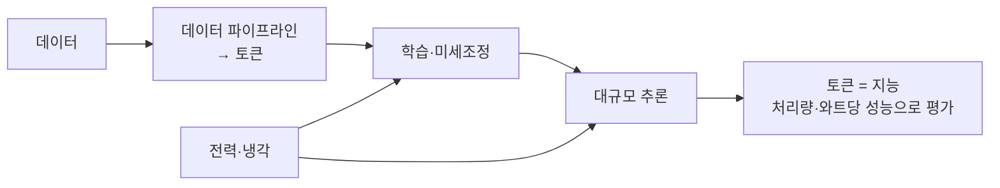

# NVIDIA의 AI factory

> 같은 "AI 팩토리"라는 이름이지만 **소프트웨어 개발 라인이 아니라 데이터센터 인프라 개념**이다. NVIDIA는 AI factory를 데이터 수집부터 학습·미세조정·대규모 추론까지 AI 전체 생애주기를 돌리는 전용 컴퓨팅 인프라로 설명하며, **"주 생산물은 지능이고 토큰 처리량으로 잰다"** 고 말한다.

## 쉽게 말하면
발전소가 전기를 만들어 파는 것처럼, AI factory는 전기와 데이터를 넣어 **토큰(AI가 읽고 쓰는 글 조각)** 을 대량 생산하는 공장이다. 공장의 성적표는 "와트당, 비용당 토큰을 얼마나 많이 뽑는가"다.

## 자세히
(NVIDIA 용어집 "AI factory" 페이지 기준, NVIDIA 자사 설명이므로 마케팅 관점이 섞여 있다)
- **정의**: 데이터 수집→학습→미세조정→고용량 추론까지 전체 생애주기를 다루는 전용 컴퓨팅 인프라.
- **입력과 출력**: 입력은 원시 비정형 데이터(데이터 파이프라인이 모델이 학습할 구조화된 토큰으로 변환), 출력은 "지능"이며 **토큰 처리량**으로 측정한다고 한다.
- **핵심 지표**: 토큰 처리량, 추론 처리량·지연·비용 효율, **와트당 성능**(에너지 효율).
- **구성 요소**: 고성능 GPU·CPU, 네트워킹, 스토리지, 첨단 냉각 / 연결(GPU 간 NVLink·NVLink Switch, 네트워크용 Quantum InfiniBand 또는 Spectrum-X 이더넷) / 소프트웨어(추론용 TensorRT, 워크플로용 Dynamo, 배포용 NIM 마이크로서비스, 지속 개선용 데이터 플라이휠) / 설계·운영(시설을 계획·시험하는 Omniverse 디지털 트윈).
- 페이지는 정량적 성능 수치를 제시하지 않는다(관련 기사 제목에 수치가 있으나 본문에서 확인되지 않음 — 인용하지 않는다).
- **두 "AI 팩토리"의 구분**:

| 구분 | 소프트웨어 팩토리 | NVIDIA AI factory |
|---|---|---|
| 정체 | 개발 운영 모델(에이전트 라인) | 인프라(데이터센터) |
| 생산물 | 검증된 코드·PR | 토큰(추론 결과) |
| 핵심 지표 | 검증된 변경 수, 리뷰 병목 | 토큰 처리량, 와트당 성능 |
| 관련 노드 | [AI 팩토리](#ai-factory) | [GPU 기초](#gpu-basics) |

  검색할 때 용어가 섞이므로 "software factory"와 "AI factory (NVIDIA)"로 구분해 찾는다.
- **왜 중요한가**: 전력이 상한인 환경에서는 "같은 전기로 얼마나 많은 토큰을 뽑느냐"가 경제성을 좌우한다는 관점이다. 이는 NVIDIA의 판매 논리이므로, 자체 워크로드의 실제 측정과 비교해 판단해야 한다.

## 그림으로 보기

## 예시
- 기업 임원 설명용: "우리 AI 서비스 비용은 토큰당 단가와 처리량으로 정해진다 — 그 뒤에 AI factory라는 인프라 경제학이 있다."
- 교육 포인트: 소프트웨어 팩토리(에이전트 개발 라인)와 AI factory(인프라)를 비교표로 구분하는 퀴즈.

## 헷갈리는 것과 비교
| 개념 | 차이 |
|---|---|
| NVIDIA AI factory | 토큰을 생산하는 인프라 |
| [AI 팩토리](#ai-factory) | 에이전트 역할 분업 개발 라인 |
| [GPU 기초](#gpu-basics) | AI factory의 핵심 하드웨어 이해 |
| [클라우드 GPU vs 로컬 GPU](#gpu-cloud-vs-local) | 계산 자원을 어떻게 조달할지 |

## 더 읽을거리
- [NVIDIA: What is an AI factory?](https://www.nvidia.com/en-us/glossary/ai-factory/) — 정의·지표·구성 요소.
