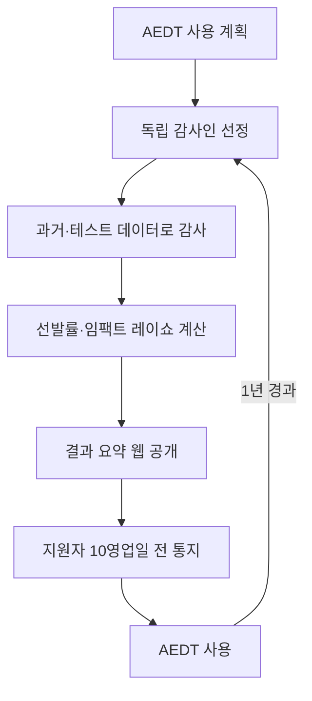

# 뉴욕시 LL144 편향 감사

> 뉴욕시 지방법 144호(Local Law 144 of 2021)와 DCWP 최종 규칙(2023-04-06 채택 공고)이 정한 규정: **자동화된 채용 결정 도구(AEDT)를 쓰려면 1년 이내 독립 편향 감사를 받고, 결과를 공개하고, 지원자에게 사전 통지**해야 한다.

## 쉽게 말하면
식당이 위생 점검 등급을 문 앞에 붙여야 영업할 수 있듯, AI 채용 도구도 "외부 점검을 받았고 결과가 이렇다"를 공개해야 쓸 수 있다. 합격선은 없다. 대신 숨기지 못하게 한다.

## 자세히
출처: DCWP 최종 규칙 채택 공고 원문(PDF, 본문 직접 확인, 2026-11-18). 이후 개정·시행 현황은 확인하지 못했다.
- **세 가지 요건(법)**: ①사용 전 1년 이내 편향 감사 ②감사 정보 공개 ③지원자·직원 통지. 규칙 5-301(a)는 마지막 감사로부터 1년이 지나면 계속 사용할 수 없다고 정한다.
- **감사 계산**: 범주별 선발률과 [임팩트 레이쇼](#adverse-impact-ratio). 성별, 인종·민족, 교차 범주를 각각 따로. 점수형 도구는 [점수 통과율](#scoring-rate)을 쓴다.
- **독립 감사인**: AEDT의 사용·개발·배포에 관여했거나, 고용주·벤더와 고용 관계 또는 재정적 이해관계가 있으면 독립 감사인이 아니다.
- **데이터**: 원칙적으로 AEDT의 과거 사용 데이터(historical data). 통계적으로 의미 있는 감사를 할 과거 데이터가 부족하면 테스트 데이터를 쓸 수 있고, 이때 요약에 이유와 테스트 데이터 설명을 써야 한다. 여러 고용주가 같은 감사를 쓰려면 자기 데이터를 감사인에게 제공해야 한다(규칙의 예: 고용주 3년치, 채용 대행사 6개월치).
- **공개(5-303)**: 사용 전 채용 웹페이지에 감사 날짜, 결과 요약(데이터 출처, 미분류 인원 수, 지원자 수, 선발·점수율, 임팩트 레이쇼), AEDT 배포일을 게시. 마지막 사용 후 최소 6개월 유지.
- **통지(5-304)**: 사용 최소 10영업일 전에 웹사이트·공고·우편·이메일 중 하나로 통지. 대체 심사 절차나 합리적 편의 요청 방법을 안내하되, 대체 절차 제공 의무는 없다. 데이터 보존 정책과 수집 데이터 정보는 서면 요청 시 30일 안에 제공.
- **한계**: 합격 기준이 없다(검색 요약). 감사 결과가 나빠도 사용 금지 규정은 아니다.

## 그림으로 보기

## 예시
- 이력서 AI 점수 도구를 쓰는 뉴욕시 고용주 → 채용 웹페이지에 감사 일자·범주별 선발률·비율표를 링크로 게시.
- 교육 활용: HR 직무 교육에서 "우리 회사 AI 채용 도구에 이런 감사 요약이 있는가"를 점검 질문으로 쓴다.

## 헷갈리는 것과 비교
| 개념 | 차이 |
|---|---|
| LL144 | 감사·공개·통지 의무, 합격선 없음 |
| [4/5 규칙](#four-fifths-rule) | EEOC 경험칙, 참조 기준 |
| [개인정보 보호법 자동화 결정 대응권](#pipa-automated-decision) | 개인의 거부·설명 권리 |
| EU AI Act 고위험 AI | 채용 AI를 고위험으로 분류, 별도 의무 체계 |

## 더 읽을거리
- [DCWP 최종 규칙 채택 공고](https://www.sidley.com/-/media/resource-pages/ai-monitor/laws-and-regulations/20230406-nyc-dcwp-notice-of-adoption-of-final-rule-for-local-law-144.pdf?la=en) — 정의·감사 절차·공개·통지 조항 원문
