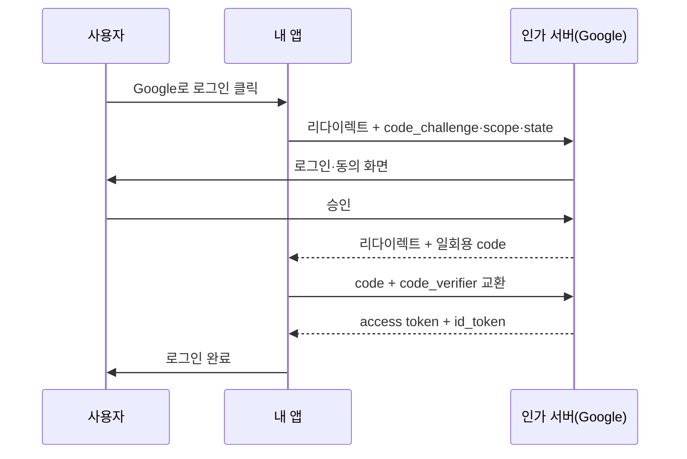
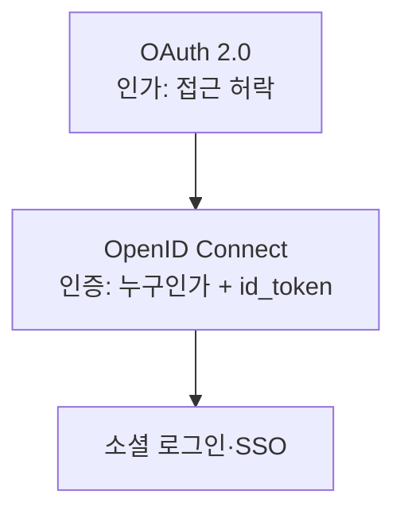

# OAuth와 소셜 로그인

> OAuth 2.0은 비밀번호를 넘기지 않고 **다른 서비스가 내 자원에 접근하도록 허락(인가)**하는 표준이다. "Google로 로그인"은 OAuth 위에 신원 확인 층을 얹은 **OpenID Connect(OIDC)**로 이뤄진다.

## 쉽게 말하면
호텔 **카드키**와 비슷하다. 내 신분증(비밀번호)을 청소 직원에게 맡기지 않고, 프런트(인가 서버)가 "이 방, 오늘만 열리는" 카드키(access token)를 발급한다. 직원은 카드키로 허락된 곳만 들어간다. 소셜 로그인은 "프런트가 이 사람이 김아무개라고 확인했다"는 증명서(ID token)를 앱에 함께 건네는 것이다.

## 자세히
- **네 역할**: 리소스 소유자(사용자), 클라이언트(내 앱), 인가 서버(Google 등), 리소스 서버(API).
- **Authorization Code + PKCE**: 현재 웹·모바일의 권장 흐름. 앱이 사용자를 인가 서버로 보내 로그인·동의 → **일회용 code**를 돌려받음 → 백채널에서 code를 token으로 교환. PKCE는 요청 시 만든 `code_verifier`의 해시(`code_challenge`)를 미리 보내고 교환 때 원본을 내서, code를 중간에 가로채도 못 쓰게 한다. 서버 시크릿을 숨길 수 없는 SPA·모바일에 필수다.
- **OAuth ≠ 로그인**: OAuth 자체는 "접근 허락"이지 "이 사람이 누구"가 아니다. 신원은 OIDC가 `id_token`(JWT, [세션과 JWT](#jwt-session) 참고)으로 추가한다.
- **스코프(scope)**: 앱이 요청하는 권한 범위(`openid email profile` 등). 최소 권한만 요청한다.
- **OAuth 2.1**: 2.0과 확장(PKCE 필수, implicit·비밀번호 grant 제거 등)을 합치는 진행 중인 작업이며 아직 확정 표준이 아니다(oauth.net 기준).
- **SSO**: 한 번 로그인하면 여러 앱에 재로그인 없이 들어가는 경험. 사내에선 SAML 또는 OIDC로 구현한다.
- 보안 체크: `redirect_uri`는 사전 등록한 정확한 값만 허용, `state` 파라미터로 CSRF 방지, client secret은 서버에만([환경변수와 비밀키 관리](#env-variables-secrets)).

## 그림으로 보기

## 예시
- 바이브코딩 앱에 Google 로그인 추가: Supabase Auth나 Auth.js에 Google 클라이언트 ID/시크릿과 redirect URI만 설정하면 위 흐름을 라이브러리가 처리한다. 직접 구현하지 말고 검증된 라이브러리를 쓰라고 프롬프트에 명시한다.
- 앱이 내 Google Drive 파일을 읽게 허용: scope `drive.readonly`를 요청하고 받은 access token으로 API를 호출한다.

## 헷갈리는 것과 비교
| 개념 | 차이 |
|---|---|
| OAuth 2.0 | 인가(위임된 접근) 프로토콜 |
| OIDC | OAuth 위의 인증 층, id_token 제공 |
| SAML | 오래된 XML 기반 기업 SSO 표준 |
| API 키 | 앱 자체의 열쇠. 사용자 위임 개념이 없음 |
| [인증과 인가](#access-control) | OAuth는 인가, OIDC는 인증 |

## 더 읽을거리
- [OAuth 2.0 (oauth.net)](https://oauth.net/2/) — 표준 개요, grant 종류, OAuth 2.1 진행 상황.
- [RFC 7636 PKCE](https://datatracker.ietf.org/doc/html/rfc7636) — code 가로채기를 막는 확장의 원문.
