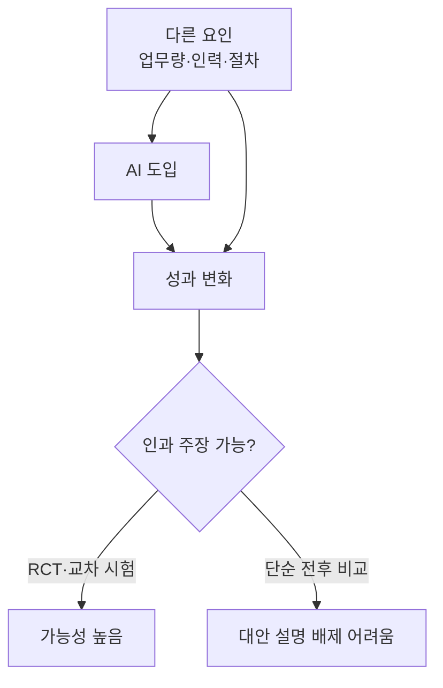
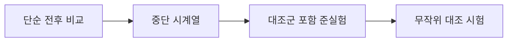

# 관찰 연구와 인과

> 관찰 연구는 연구자가 처치를 배정하지 않고 일어난 일을 그대로 측정한다. 그래서 "AI를 도입한 뒤 성과가 떨어졌다"는 전후 비교 결과가 곧 "AI 때문에 떨어졌다"는 증명이 되지 못한다. 인과를 주장하려면 무작위 배정이나 그에 준하는 설계가 필요하다.

## 쉽게 말하면
아이스크림 판매량과 익사 사고는 같이 오르내린다. 하지만 아이스크림이 사고의 원인은 아니다. 둘 다 여름이라는 다른 원인 때문이다. AI 도입 전후의 성과 비교도 같은 함정이 있다. 같은 시기에 환자 수가 늘었거나 근무표가 바뀌었다면 그 영향이 AI 효과로 오해될 수 있다.

## 자세히
출처: 위키백과 Observational study 항목과 Interrupted time series 항목(직접 읽음), 대장내시경 연구에 대한 전문가 반응(Science Media Centre, 직접 읽음). 일반 개념 설명이므로 분야별 표준 교재(예: Hernán과 Robins의 인과 추론 교재)로 보강하는 것이 좋다(이번에 열지 않음).
- **정의**: 관찰 연구는 결과를 측정해 연관성을 찾을 뿐 변수를 조작하지 않는다. 무작위 대조 시험(RCT)은 연구자가 무작위로 처치군과 대조군을 정한다.
- **한계**: 무작위 배정이 없으면 교란(confounding)과 편향에 취약하다. 위키백과는 "관찰 연구는 그 자체만으로 인과를 입증할 수 없다"고 서술한다. 주요 위협은 ① 누락 변수 편향(기록 안 된 다른 원인) ② 다중 비교 편향(많이 검사하면 우연한 상관 발견) ③ 선택 편향. 성향 점수 매칭 같은 방법은 관찰된 교란을 어느 정도 통제하지만 비판도 있다.
- **쓸모**: 현실의 진료·업무 관행, 안전 신호 탐지, 가설 생성. 한 문헌 검토(Cochrane 2014, 2024 갱신)는 관찰 연구 결과가 RCT와 대체로 비슷하다고 보고했으나 사례별로 평가해야 한다.
- **전후 비교와 중단 시계열**: 개입 전후를 한 번씩만 비교하는 것보다 개입 시점 전후의 **긴 시계열**의 수준(level)과 기울기(slope) 변화를 보는 중단 시계열(Interrupted time series, 준실험 설계)이 낫다. 다만 이 항목은 장점과 위협 요소를 자세히 다루지 않아 이 글에서는 분석 방법 이름 정도만 소개한다. 목표 시험 모방(target trial emulation)도 관찰 자료로 RCT를 흉내 내는 설계다.
- **대장내시경 사례에 적용(전문가 반응)**: 전후 3개월 비교 연구에 대해 ① 검사 수가 795건에서 1,382건으로 거의 두 배가 되어 피로·업무량이 영향을 줬을 수 있고 ② 부서 운영 변화가 있었으며 ③ 3개월은 숙련도 변화를 보기엔 짧고 ④ AI가 있던 환경에서 행동이 바뀌었을 수 있다는 대안 설명이 제시됐다. 저자들도 확정하려면 **무작위 교차 시험**이 필요하다고 했다.
- **AI 효과를 볼 때 체크리스트(이 글의 제안)**: 같은 기간 다른 변화가 있었나, 대조군이 있나, 업무량·인력 구성은 비슷한가, 측정 방법은 같았나, 개인별 변동은 얼마나 큰가, 복수 사이트에서 같은 결과인가.

## 그림으로 보기

## 예시
- 콜센터에 AI를 도입한 달에 해결 건수가 늘었다. 같은 달 신제품 단순 문의가 줄었다면 AI 효과가 과대평가될 수 있다. 단계적 도입(일부 팀 먼저)으로 비교하면 낫다([단계적 도입 설계](#staggered-rollout-design)).
- 병원이 AI 켠 검사/끈 검사를 무작위로 배정하는 교차 시험을 설계(제안).

## 헷갈리는 것과 비교
| 개념 | 차이 |
|---|---|
| 상관관계 | 함께 변한다는 사실 |
| 인과관계 | 한쪽이 다른 쪽을 일으킨다는 주장 |
| 교란 | 두 변수 모두에 영향을 주는 제3의 요인 |
| [숙련도 저하](#deskilling) | 관찰 연구 하나로는 확정하기 어려운 주장 |

## 더 읽을거리
- [Observational study (Wikipedia)](https://en.wikipedia.org/wiki/Observational_study) — 정의·한계(직접 읽음)
- [Interrupted time series (Wikipedia)](https://en.wikipedia.org/wiki/Interrupted_time_series) — 정의 수준(직접 읽음)
- [Expert reaction ... colonoscopy (Science Media Centre)](https://www.sciencemediacentre.org/expert-reaction-to-observational-study-looking-at-detection-rate-of-precancerous-growths-in-colonoscopies-by-health-professionals-who-perform-them-before-and-after-the-routine-introduction-of-ai/) — 대안 설명 예(직접 읽음)
