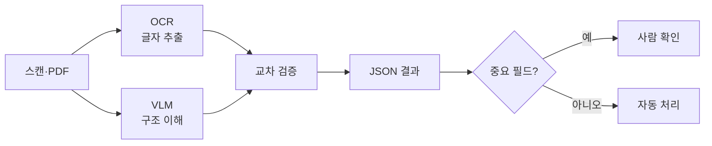

# OCR과 문서 이해

> 이미지·PDF 속 글자를 읽는 OCR에서, 표·레이아웃·맥락까지 이해해 구조화된 데이터로 뽑는 문서 AI로의 확장.

## 쉽게 말하면
OCR은 "받아쓰기"다. 종이에 적힌 글자를 그대로 옮긴다. 문서 이해는 "읽고 요약해 주는 비서"다. 표의 어느 칸이 합계인지, 각주가 어느 문장에 달렸는지까지 파악한다.

## 자세히
- **전통 OCR 파이프라인**: 글자 영역 검출 → 글자 인식 → 레이아웃 분석 → 표 복원 → 규칙/모델로 필드 추출. 단계가 많아 오류가 쌓인다.
- **VLM 방식**: [비전 모델](#vision-models)이 이미지를 보고 한 번에 글자·표·레이아웃을 읽고 JSON/마크다운/HTML로 출력한다. 구조가 단순해지고 복잡한 레이아웃에 강하다는 것이 업계 설명이다.
- **전용 소형 VLM**: PaddleOCR-VL(0.9B, 표·수식·차트 프롬프트 제공), jina-ocr-v1(표를 HTML로 출력) 같은 문서 특화 모델이 나왔다.
- **약점**: VLM은 없는 글자를 지어낼 수 있다([환각](#hallucination)). 금액의 `O`와 `0` 같은 글자 단위 오류가 치명적인 문서가 있다.
- **현실적 조합**: OCR로 빠르게 텍스트를 뽑고 VLM이 검증·보정하거나, 중요 필드만 사람이 확인한다([휴먼 인 더 루프](#human-in-the-loop)).
- 주의: 비용·정확도 비교 자료 대부분은 벤더 블로그다. 내 문서 샘플로 직접 평가해야 한다.

## 그림으로 보기

## 예시
- 영수증·세금계산서 100장에서 공급가액·세액을 JSON으로 뽑아 엑셀에 적재.
- 계약서 PDF를 [청킹](#chunking)해 RAG에 넣을 때, 표를 마크다운으로 보존해 검색 품질 유지.

## 헷갈리는 것과 비교
| 개념 | 차이 |
|---|---|
| OCR | 글자만 인식. 구조·의미는 모름 |
| 문서 AI(VLM) | 레이아웃·표·맥락까지 이해, 환각 위험 |
| [이미지 생성](#image-generation) | 새 이미지를 만드는 반대 방향 |

## 더 읽을거리
- [Layout-first APIs vs 전통 OCR(Extend)](https://www.extend.ai/resources/layout-first-apis-vs-traditional-ocr) — 레이아웃 우선 접근 비교(벤더 글).
- [jina-ocr-v1 문서 파싱(Elastic)](https://www.elastic.co/kr/search-labs/blog/ocr-model-jina-ocr-v1-document-parsing) — 특화 OCR 모델 소개.
- [PaddleOCR-VL(Hugging Face)](https://huggingface.co/NeuralMetrics/PaddleOCR-VL) — 0.9B 문서 파싱 모델 카드.
