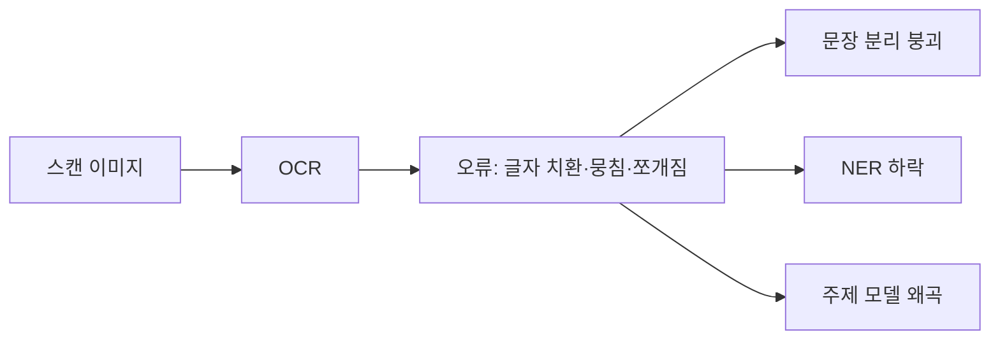
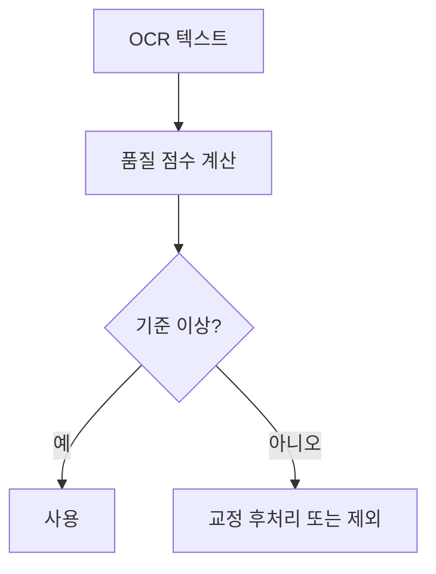

# OCR 오류 패턴

> 스캔 문서를 글자로 바꾸는 OCR은 **철자 오류·글자 뭉침·단어 쪼개짐·누락 같은 예측 가능한 오류**를 낸다. 이런 글이 학습·검색 데이터에 섞이면 문장 분리부터 개체명 인식까지 downstream 성능이 떨어진다.

## 쉽게 말하면
낡은 신문을 복사기로 여러 번 복사한 뒤 읽는 것과 같다. "concerning"이 "ooncernlug"로 보이고, 한 글자 오류가 문장 경계를 깨 버린다. 오류는 무작위 같지만 흐린 글자·비슷한 모양의 글자를 헷갈리는 일정한 방식으로 생긴다.

## 자세히
(van Strien 외, "Assessing the Impact of OCR Quality on Downstream NLP Tasks", ICAART 2020, PDF 본문 직접 읽음)
- **실험**: OCR 결과와 사람이 고친 텍스트를 짝지어(Overproof 데이터셋) Levenshtein 거리로 OCR 품질을 4개 구간으로 나누고, 문장 분리·개체명 인식(NER)·의존 구문 분석·정보 검색·주제 모델링·신경 언어 모델 미세조정에 미치는 영향을 비교했다. 기성 도구를 그대로 썼다.
- **오류 예시(논문 본문)**: OCR: `Io the Editor of the Berala. SIB,-Enclosed is a letter concernlug …` ↔ 교정: `To the Editor of the Herald. SIR,-Enclosed is a letter concerning …`. 즉 `T→I`, `H→B`, `e→a`, `R→B`, `ing→lug`처럼 모양이 비슷한 글자 치환이 흔하다.
- **문장 분리**: spaCy 문장 분리가 **한 글자 차이만으로도** 문장을 둘로 쪼개 버려, OCR 품질이 대체로 좋은 텍스트에서도 정확도가 놀랄 만큼 낮았다.
- **NER**: 사람 이름 평균 F-score는 품질 구간 1에서 0.87, 구간 4에서 0.63으로 떨어졌다. 지정학적 개체(GPE)는 0.76에서 0.54로 더 크게 떨어졌다.
- **주제 모델링**: 퍼플렉시티·일관성 같은 보통 지표로는 OCR 노이즈로 인한 변화가 잘 드러나지 않았고, 품질이 낮을수록 OCR 주제 모델이 깨끗한 텍스트의 모델과 점점 달라졌다. 저자들은 그 지표들을 신뢰성 판단에 쓰지 말라고 권한다.
- **품질 임계**: 영어 코퍼스를 비교한 이전 연구가 OCR 정확도 70~80%에 임계가 있고 그 아래에서 대부분의 과제가 크게 나빠진다고 보고했다고 논문이 소개한다(원 연구 미확인).
- **대응(제안)**: ① OCR 신뢰도 점수·단어 사전 일치율로 저품질 문서 걸러 내기 ② 글자 혼동 규칙으로 후처리 교정 ③ 교정 전후 다운스트림 점수 비교 ④ 문장 분리처럼 민감한 단계는 OCR 텍스트 전용 설정 사용.
- 한계: 이 연구는 역사 신문(영어)이 대상이다. 한국어나 현대 스캔 문서는 오류 양상이 다를 수 있다.

## 그림으로 보기

## 예시
| 원문(교정) | OCR 결과 |
|---|---|
| To the Editor of the Herald | Io the Editor of the Berala |
| concerning | concernlug |
| 구간별 NER F-score(사람) | 0.87 → 0.63 |
- 업무 장면: 사내 스캔 계약서를 검색용 데이터로 만들기 전에 OCR 품질을 점수로 매겨 저품질 문서를 사람이 확인한다.

## 헷갈리는 것과 비교
| 개념 | 차이 |
|---|---|
| OCR 오류 | 이미지→글자 변환 중 생긴 노이즈 |
| [기계 번역투](#mt-translationese) | 번역 과정에서 생긴 문체 차이 |
| [AI 생성 글의 웹 오염](#ai-generated-web-contamination) | 생성 AI 글의 혼입 |
| [기계 생성 웹 텍스트](#machine-generated-web-text) | 이 노드가 속한 상위 개념 |

## 더 읽을거리
- [Assessing the Impact of OCR Quality on Downstream NLP Tasks (ICAART 2020)](https://www.scitepress.org/Papers/2020/91690/pdf/index.html) — OCR 품질 구간별 NER·문장 분리 영향(PDF 직접 읽음).
