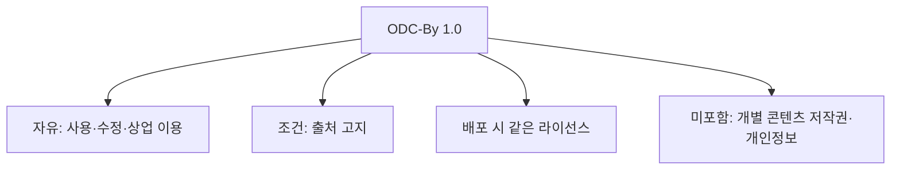
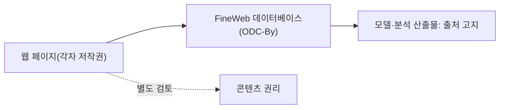

# ODC-By 라이선스

> Open Data Commons Attribution License(ODC-By) 1.0은 데이터베이스를 출처만 밝히면 자유롭게 쓰고 고치고 상업적으로도 쓰게 하는 공개 데이터 라이선스다. FineWeb 같은 대규모 학습 데이터셋이 이 라이선스로 공개된다.

## 쉽게 말하면
도서관에서 사진집 전체(데이터베이스)를 복사해 가도 좋고 고쳐서 다시 나눠 줘도 좋지만, "이 사진집에서 왔다"는 출처 표시를 남겨야 한다. 다만 사진집 속 개별 사진의 저작권은 이 허락이 다루지 않으므로 별도로 따져야 한다.

## 자세히
(opendatacommons.org의 ODC-By 1.0 페이지와 FineWeb 데이터셋 카드 README를 직접 열어 확인. 법률 자문이 아니다.)
- **허용(라이선스 페이지)**: 전 세계에서 무료·비독점으로 데이터베이스를 사용·복제·공유·수정, 상업적 목적과 모든 분야, 현재·미래 형식, 파생·집합 데이터베이스 생성과 배포.
- **조건**
  - **데이터베이스 배포**: 데이터베이스나 파생물을 공개 배포하면 이 라이선스를 쓰고, 사본이나 URI를 포함하고, 기존 저작권·데이터베이스권·라이선스 고지를 유지.
  - **산출물(produced works)**: 데이터베이스로 만든 작업물은 위 고지가 필요 없지만, 공개 사용 시 "콘텐츠가 이 데이터베이스에서 왔으며 이 라이선스로 이용 가능하다"는 고지를 넣어야 한다(문서에 예시 문구).
  - **재라이선스 금지**: 서브라이선스나 추가 제한 불가. 받는 사람은 같은 조건의 라이선스를 자동으로 받는다.
- **데이터베이스권**: EU의 sui generis권처럼 내용의 전체·상당 부분을 추출·재사용하는 권리도 포함(저작권이 없어도 적용될 수 있음).
- **다루지 않는 것**: 데이터베이스를 만들거나 돌리는 프로그램, 특허·상표, **개별 콘텐츠의 저작권·프라이버시·개인정보보호 권리**(별도 라이선스가 필요할 수 있음), 공정이용 등 법정 예외.
- **기타 조항**: 위반하면 라이선스가 자동 종료(중단 후 9.4절 규칙에 따라 복구 가능), 보증 없음, 준거법은 집행되는 관할.
- **FineWeb에 적용(데이터셋 카드)**: 라이선스 `odc-by`, 이용은 **Common Crawl 이용약관**에도 따른다고 명시. 이메일과 공개 IP 주소는 정규식으로 익명화하지만 인터넷 전반에서 모은 데이터라 **개인정보가 남아 있을 가능성이 높다**고 밝히고 삭제 요청 양식을 제공. 필터링 때문에 코드 비중이 낮아 코드 작업용 모델은 코드 데이터를 보완하라고 권한다. 이 데이터셋 페이지의 크기 표기는 훈련 분할 약 259억 행, 구성 114개(sample-10BT·100BT·350BT 포함).
- **실무 해석(제안)**: ODC-By는 "데이터를 모은 틀"에 대한 허락이다. 그 안의 웹 문서 하나하나의 저작권이 해결됐다는 뜻은 아니므로, 상업 모델 학습의 저작권 위험은 별도로 검토해야 한다([데이터 출처·라이선스](#data-licensing-provenance)).

## 그림으로 보기

## 예시
- 사내 연구에서 FineWeb 샘플로 분류기를 학습하고 결과 보고서에 "이 작업은 FineWeb(ODC-By 1.0)에서 가져온 데이터를 사용했다"는 고지를 적는다.
- 데이터를 정제해 재배포할 때: 파생 데이터에도 ODC-By를 붙이고 원 고지를 유지한다.

## 헷갈리는 것과 비교
| 라이선스 | 핵심 |
|---|---|
| ODC-By | 데이터베이스, 출처 표시만 요구 |
| CC BY | 저작물(콘텐츠) 대상 출처 표시 |
| ODbL | 파생 데이터베이스에 같은 조건(share-alike) 요구 |
| [데이터 출처·라이선스](#data-licensing-provenance) | 라이선스를 포함한 출처 관리 전체 |

## 더 읽을거리
- [Open Data Commons Attribution License 1.0](https://opendatacommons.org/licenses/by/1-0/) — 허용·조건·범위(열어 확인).
- [FineWeb 데이터셋 카드 README](https://huggingface.co/datasets/HuggingFaceFW/fineweb/raw/main/README.md) — 라이선스·익명화·이용 시 고려 사항(열어 확인).
