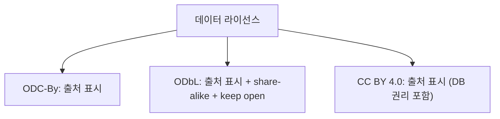
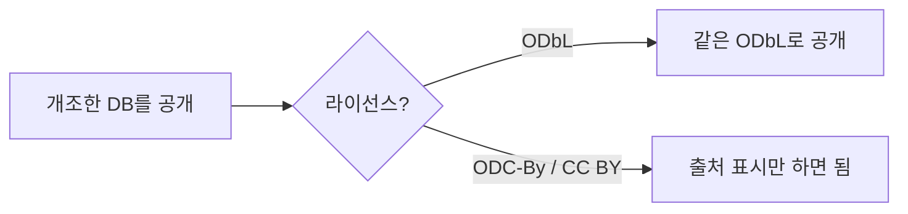

# ODC-By vs CC BY vs ODbL

> 세 라이선스 모두 **출처 표시(Attribution)**가 핵심이지만, **ODbL은 개조한 데이터베이스를 같은 조건으로 공개해야 하는 share-alike**가 있고, ODC-By와 CC BY는 없다. 데이터셋 이용 전에 이 차이를 확인한다.

## 쉽게 말하면
셋 다 "쓰되 출처는 밝혀라"를 요구한다. ODbL은 거기에 "네가 고쳐서 공개하면 너도 같은 조건으로 공개해라"를 더한다. ODC-By는 데이터베이스용 간단한 출처 표시 조건이다.

## 자세히
(opendatacommons.org의 ODC-By 1.0·ODbL 1.0 요약 페이지와 CC BY 4.0 법률 문서(legalcode)의 정의 조항을 직접 읽음. 요약 페이지는 "법적 효력이 없고 전문을 읽어야 한다"고 명시한다. 이 글은 법률 자문이 아니다)
| 항목 | ODC-By 1.0 | ODbL 1.0 | CC BY 4.0 |
|---|---|---|---|
| 공유·복사·배포·사용 | 허용 | 허용 | 허용 |
| 만들기(데이터로 작품 생성) | 허용 | 허용 | 허용 |
| 변형·개조 | 허용 | 허용 | 허용 |
| 출처 표시 | **필수**: 공개 사용 시 라이선스가 정한 방식으로, 라이선스 표시와 기존 고지 유지 | **필수**(동일) | 필수(저작자 표시 등) |
| **Share-alike** | **없음** | **있음**: 개조한 DB를 공개 이용하면 같은 ODbL로 제공 | 없음(BY-SA와 구분) |
| Keep open | 요약에 없음 | 있음: DRM 같은 기술적 제한을 쓰면 제한 없는 버전도 함께 배포 | 요약 대상 아님 |
- 적용 범위: ODC-By·ODbL은 **데이터베이스**를 대상으로 하는 ODC(Open Data Commons) 라이선스다. CC BY 4.0은 법률 문서의 정의에서 "저작권 및 유사 권리"에 **sui generis 데이터베이스 권리(EU 데이터베이스 지침 96/9/EC 등)**를 포함한다고 명시한다. 따라서 데이터베이스에 CC BY 4.0을 쓸 수도 있다([데이터베이스권](#database-right-sui-generis)).
- FineWeb은 **ODC-By 1.0**이며 Common Crawl 이용약관이 함께 적용된다고 밝힌다([FineWeb 개인정보](#fineweb-pii-removal)). 따라서 FineWeb으로 만든 파생 데이터를 공개할 때는 출처 표시와 라이선스 고지가 필요하고, share-alike 의무는 ODC-By에는 없다.
- 실무(제안): 데이터셋 카드의 라이선스 줄과 "함께 적용되는 약관"을 확인하고, 개조·재배포 계획이 있으면 share-alike 여부와 출처 표시 문구([산출물 고지](#produced-works-notice))를 정리한다. 원 데이터 자체의 저작권은 별개일 수 있다.

## 그림으로 보기

## 예시
- FineWeb에서 필터링한 하위 데이터셋을 공개: ODC-By 출처·고지 유지, 다른 라이선스로 공개해도 되는지는 전문과 약관 확인 필요.
- OpenStreetMap 데이터 개조본 공개: ODbL이라 share-alike 적용.
- 교육: "오픈 데이터 ≠ 자유 사용"이라는 점과 라이선스 읽는 습관.

## 헷갈리는 것과 비교
| 개념 | 차이 |
|---|---|
| 출처 표시(BY) | 누구인지 밝힘 |
| Share-alike(SA) | 파생물도 같은 조건 |
| sui generis | DB 구축 투자 보호 권리(EU) |
| 라이선스 요약 | 참고용, 법적 효력 없음 |

## 더 읽을거리
- [ODC-By 1.0 요약](https://opendatacommons.org/licenses/by/summary/) — 출처 표시 의무(읽음).
- [ODbL 1.0 요약](https://opendatacommons.org/licenses/odbl/summary/) — share-alike·keep open(읽음).
- [CC BY 4.0 법률 문서](https://creativecommons.org/licenses/by/4.0/legalcode.en) — sui generis 포함 정의(읽음).
