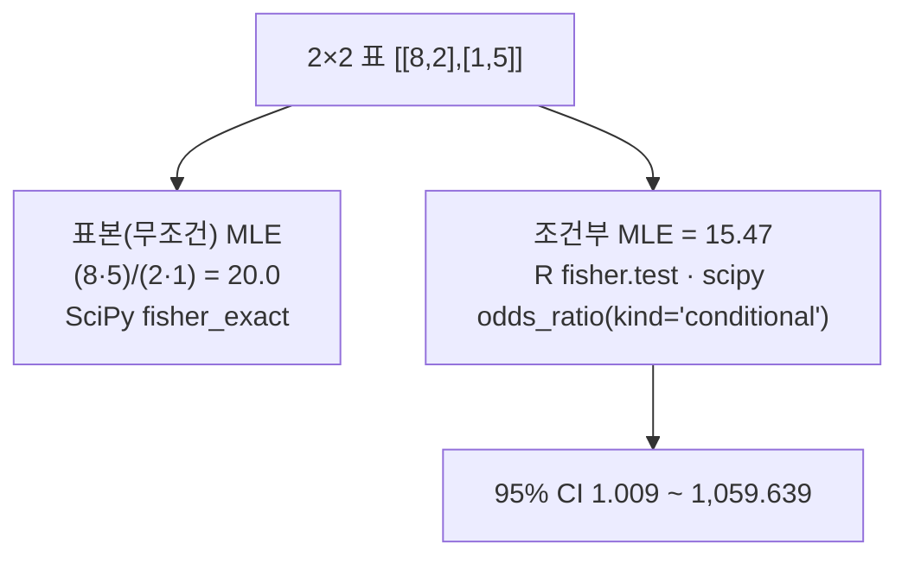

# 오즈비 무조건 대 조건부 추정

> 같은 2×2 표에서도 오즈비를 **무조건(표본) 최대우도 추정**으로 구하면 SciPy `fisher_exact`의 값이 되고, **조건부 최대우도 추정**으로 구하면 R의 `fisher.test` 값이 된다. 둘은 다를 수 있어 어떤 값인지 밝혀 적어야 한다.

## 쉽게 말하면
같은 시험지를 두 선생님이 채점했는데 점수 계산법이 달라 숫자가 다르게 나온 것과 같다. 두 값 모두 오즈비를 추정하지만 "어떤 가정과 방법으로"가 다르다.

## 자세히
출처: SciPy 공식 문서 `scipy.stats.fisher_exact`(열어서 읽음) + 이 세션의 직접 실행(scipy 1.17.1).
- **문서의 서술**: `fisher_exact`의 통계량은 2×2 표, 기본 방법에서 **표본(무조건) 최대우도 오즈비 추정**이다. R의 `fisher.test`는 **조건부 최대우도 추정**을 보고해 값이 다르다. 조건부 추정이 필요하면 `scipy.stats.contingency.odds_ratio`를 쓰라고 안내한다.
- **직접 실행(문서 예 표 [[8, 2], [1, 5]], 이 세션)**:
  - `fisher_exact(t).statistic` = **20.0**(표본 오즈비 (8·5)/(2·1))이며 문서의 통계량 20.0과 같다.
  - `odds_ratio(t, kind='sample').statistic` = 20.0.
  - `odds_ratio(t, kind='conditional').statistic` = **15.4658**.
  - 조건부 추정의 95% 신뢰구간: **1.009 ~ 1,059.639**. 구간이 매우 넓어 표본이 작을 때 추정이 불안정함을 보여 준다([신뢰구간 읽기](#credible-interval-reading)).
  - 한 표의 결과다. 두 추정의 차이는 표와 표본 크기에 따라 달라진다.
- **왜 다른가(일반 설명, 이번 문서에는 없음)**: 조건부 추정은 주변 합을 고정한 조건부 분포에서 오즈비를 추정하고, 무조건 추정은 표의 표본 비율로 직접 계산한다. 소표본에서 값이 벌어진다.
- **실무**: 논문·보고서에 오즈비를 쓸 때 사용한 소프트웨어와 추정 방식을 적는다. 다른 도구의 결과와 비교할 때 20.0과 15.47처럼 값이 다를 수 있다.

## 그림으로 보기


## 예시
```python
from scipy.stats import fisher_exact
from scipy.stats.contingency import odds_ratio
t = [[8, 2], [1, 5]]
fisher_exact(t).statistic                       # 20.0
odds_ratio(t, kind="conditional").statistic     # 약 15.47
```
- 점검: 보고서에 "오즈비 = ?"를 적을 때 어떤 추정(표본/조건부)인지, 신뢰구간이 있는지 확인.

## 헷갈리는 것과 비교
| 개념 | 차이 |
|---|---|
| 표본(무조건) 오즈비 | (a·d)/(b·c)로 직접 계산 |
| 조건부 MLE 오즈비 | 주변 합 고정 조건부 분포 기반, 값이 다를 수 있음 |
| [Fisher 정확 검정](#fisher-exact-test) | 이 오즈비가 귀무가설 값 1과 같은지 검정 |
| [신뢰구간 읽기](#credible-interval-reading) | 구간이 넓을 때 읽는 법 |

## 더 읽을거리
- [scipy.stats.fisher_exact (SciPy 문서)](https://docs.scipy.org/doc/scipy/reference/generated/scipy.stats.fisher_exact.html) — 통계량과 조건부 추정 주의(열어서 확인)
