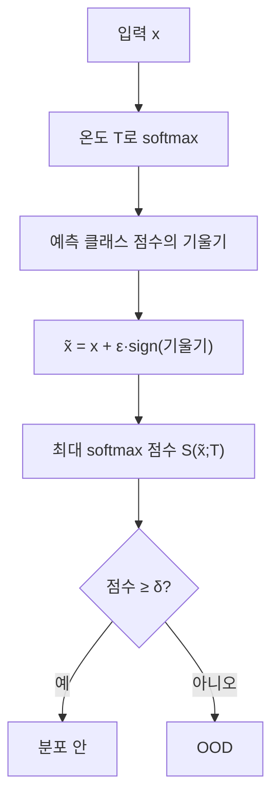
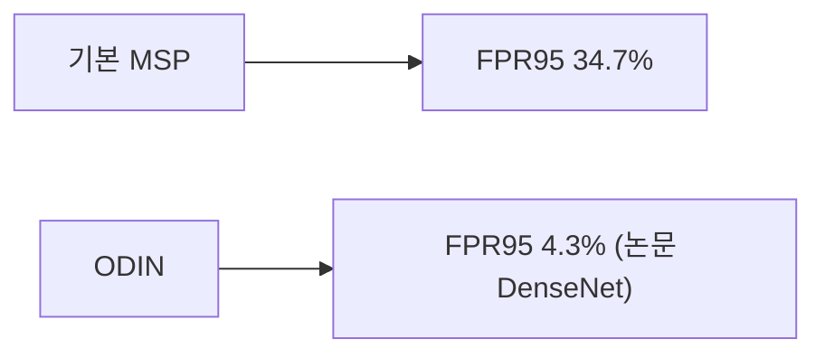

# ODIN

> 이미 학습된 분류 신경망의 **softmax 점수를 온도 스케일링하고 입력에 작은 섭동을 더하는 것만으로** 학습 데이터와 다른 입력(OOD)을 더 잘 가려내는 방법이다(Liang 등, ICLR 2018). 모델을 다시 학습하지 않는다.

## 쉽게 말하면
시험 문제를 푼 학생이 "이 답에 얼마나 자신 있나?"를 말하게 하는데, 학생이 낯선 문제에도 자신만만하다면 구분이 안 된다. ODIN은 자신감을 재는 방식을 조금 바꿔(온도 조절) 낯익은 문제와 낯선 문제의 자신감 차이를 벌리고, 문제를 살짝 흔들어 보았을 때 낯익은 문제가 더 안정적으로 자신감이 오르는지도 이용한다.

## 자세히
(ODIN 논문 arXiv 1706.02690 PDF를 직접 읽어 확인하고, 작은 MLP로 직접 구현해 실험.)
- **구성(논문)**: ① **온도 스케일링**: softmax를 `S_i(x;T) = exp(f_i/T)/Σexp(f_j/T)`로 계산, 학습 때는 T=1이고 검출 때 큰 T를 쓴다. ② **입력 전처리**: `x̃ = x − ε·sign(−∇x log S_ŷ(x;T))`처럼 예측 클래스의 점수를 **키우는 방향**으로 작은 섭동(크기 ε)을 더한다. 적대적 예시에서 영감을 얻었지만 정반대로 점수를 올린다. 논문은 이 섭동이 **분포 안 이미지에 더 큰 영향**을 주어 둘이 더 분리된다고 설명한다. 섭동은 교차 엔트로피 손실을 역전파해 쉽게 계산한다. ③ 변형된 입력의 최대 softmax 점수가 임계값 δ 이상이면 분포 안, 아니면 OOD.
- **결과(논문 초록)**: DenseNet(CIFAR-10 대 Tiny-ImageNet)에서 진양성률 95%일 때 **오검출률(FPR)을 기준선(Hendrycks & Gimpel 2017) 34.7%에서 4.3%로** 줄였다. 모든 실험에서 T=1000을 썼고, ε는 **별도의 OOD 검증 데이터(iSUN)로 선택**했으며 논문 표 3은 한 검증 세트에서 튜닝한 값이 다른 OOD 시험 세트에도 비슷하게 일반화된다고 보인다. 예로 한 DenseNet 설정에서 ε=0.0014를 썼다.
- **직접 구현 실험(scikit-learn digits 손글씨, 은닉 64개 MLP, 테스트 정확도 0.971, 입력 기울기는 직접 유도)**: 분포 안=테스트 숫자 719개, OOD 3종. 하이퍼파라미터(T∈{1,10,100,1000}, ε∈{0…0.05})는 **균일 잡음**으로 튜닝하고 **다른 OOD로 시험**.
  | 방법 | 가우시안 잡음 AUROC / FPR95 | 뒤집은 숫자+잡음 | 좌우 반전 숫자 |
  |---|---|---|---|
  | 기본 최대 softmax(MSP) | 0.767 / 0.754 | 0.917 / 0.426 | 0.828 / 0.627 |
  | ODIN(T=1, ε=0.02) | 0.770 / 0.736 | 0.921 / 0.414 | 0.834 / 0.597 |
  튜닝에서는 T=1이 최적으로 선택되어(온도 효과 없음) **섭동만으로 소폭 개선**(AUROC +0.003~0.006, FPR95 −1.2~3.0%p)이었다. 논문의 큰 개선(34.7→4.3%)은 재현되지 않았다 — **작은 MLP·저해상도 데이터에서는 효과가 작았다**(다른 구조·데이터에서 다를 수 있고 구현 세부 차이도 가능). 또 기준선에서도 잡음 입력의 **75%가 진짜 숫자 95%를 통과시키는 임계값을 넘었다**(FPR95 0.754) — 과신 문제([신경망의 과신](#overconfidence-neural-nets)).
- **주의(제안)**: ① ODIN은 **OOD 검증 데이터가 필요**한 하이퍼파라미터 튜닝이 들어간다(실제 서비스의 미지 OOD에 맞는 검증 세트를 준비하기 어렵다) ② 섭동 계산에 입력 기울기가 필요해 추론 비용이 늘어난다 ③ 점수 임계값은 서비스 손실에 맞게 정한다 ④ 최근 방법과의 비교는 이번에 확인하지 않았다.

## 그림으로 보기

## 예시
- 사진 분류 모델에 "분류 불가" 출력을 두려면 ODIN 점수를 쓰되 OOD 검증용으로 낯선 이미지(다른 카테고리·잡음) 세트를 마련해 T·ε·δ를 정하고 서비스 입력 샘플로 FPR을 점검.
- 교육 소재: "AI가 모르는 것을 모른다고 말하게 하는 법" — MSP와 ODIN 점수를 같은 이미지로 비교.

## 헷갈리는 것과 비교
| 개념 | 차이 |
|---|---|
| ODIN | 온도 스케일링+입력 섭동으로 OOD 점수 개선 |
| [OOD 탐지: softmax 점수](#ood-detection-softmax) | 기본 최대 softmax 기준선 |
| [OOD 탐지 AUROC](#auroc-ood) | 탐지 성능을 보는 지표 |
| 적대적 예시 | 점수를 낮추려는 섭동(ODIN은 높이는 방향) |

## 더 읽을거리
- [Enhancing The Reliability of Out-of-Distribution Image Detection in Neural Networks (arXiv 1706.02690)](https://arxiv.org/abs/1706.02690) — ODIN 방법과 결과(PDF 직접 확인).
