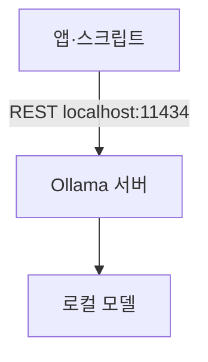

# Ollama

> **Ollama**는 오픈 모델을 내 컴퓨터에서 **한 줄 명령으로 내려받아 실행**하게 해 주는 도구다. 내부 백엔드로 llama.cpp를 쓰고 REST API를 제공한다.

## 쉽게 말하면
앱 스토어에서 앱을 설치하고 실행하듯, 모델 이름만 말하면 받아서 바로 대화하게 해 주는 모델 관리자다.

## 자세히
(Ollama GitHub README 확인)
- **정체**: "오픈 모델로 시작하기. 최신 릴리스를 로컬 또는 클라우드에서, 완전한 프라이버시로." 지원 백엔드로 **llama.cpp**를 명시한다. MIT 라이선스.
- **설치**: macOS·Linux `curl -fsSL https://ollama.com/install.sh | sh`, Windows `irm https://ollama.com/install.ps1 | iex`, Docker 이미지 `ollama/ollama`.
- **실행**: `ollama run gemma4`(대화), `ollama launch claude`(Claude Code 연동 등 에이전트·앱 통합).
- **API**: `http://localhost:11434/api/chat`로 REST 호출, Python `pip install ollama`, JS `npm i ollama` 클라이언트.
- 모델 목록과 사양은 자주 바뀌므로 README·모델 라이브러리에서 최신을 확인한다(권고). 성능은 내 하드웨어와 모델 크기에 달려 있다.

## 그림으로 보기



## 예시
```bash
ollama run gemma4
curl http://localhost:11434/api/chat -d '{"model":"gemma4","messages":[{"role":"user","content":"안녕"}],"stream":false}'
```
- 외부로 보내기 어려운 문서를 로컬 모델로 요약해 보는 개인 실험.

## 헷갈리는 것과 비교
| 도구 | 특징 |
|---|---|
| Ollama | 설치·실행이 쉬운 로컬 모델 관리 |
| [llama.cpp](#llama-cpp) | 추론 엔진 자체 |
| [vLLM](#vllm) | 서버용 고처리량 서빙 |
| [엣지 추론](#edge-inference) | 기기 안 실행이라는 개념 |

## 더 읽을거리
- [ollama/ollama](https://github.com/ollama/ollama)
