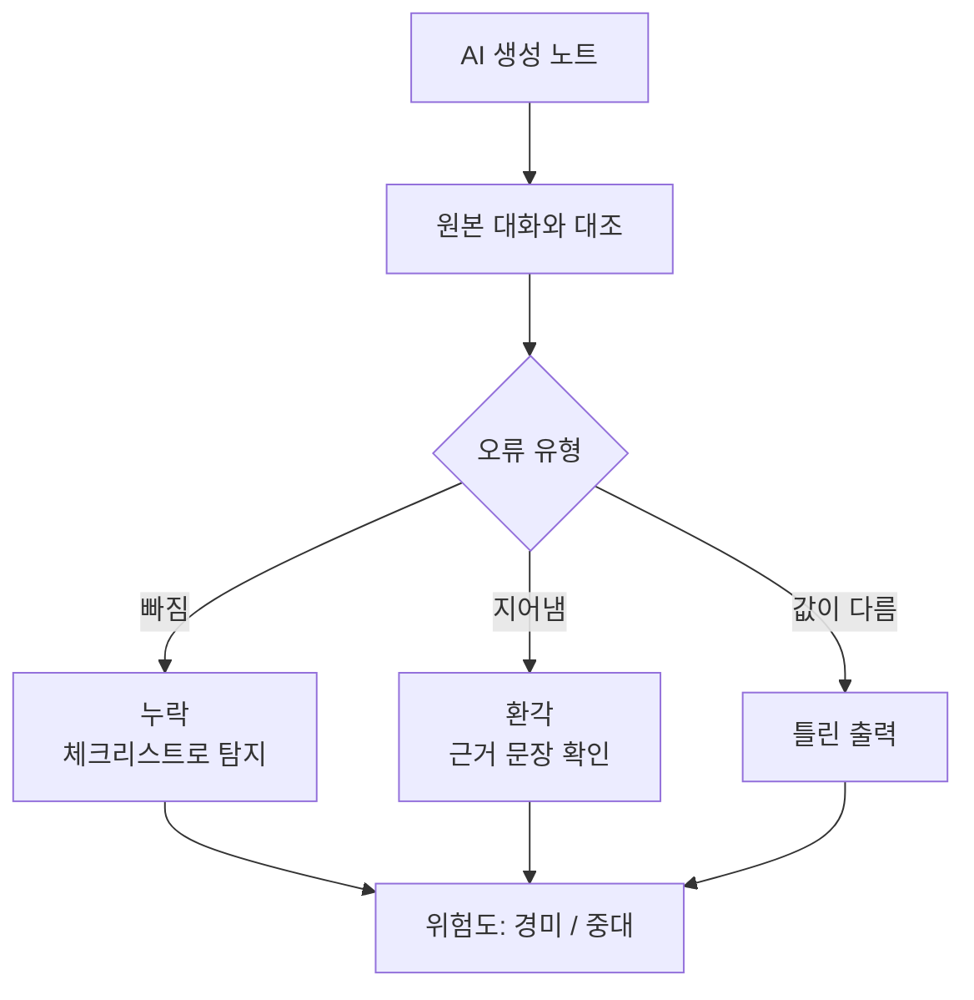

# 누락과 환각 구분

> AI가 만든 문서의 오류는 크게 "있어야 할 것이 빠짐(누락)"과 "없던 것이 들어감(환각·추가)"으로 나뉜다. 둘은 잡는 법과 위험도가 다르다.

## 쉽게 말하면
회의록에서 결정 사항 하나를 빠뜨린 것과, 하지 않은 결정을 지어낸 것은 둘 다 오류지만 찾는 방법이 다르다. 지어낸 내용은 문서 안에서 눈에 띄지만 빠진 내용은 "무엇이 있어야 했는지"를 알아야 보인다.

## 자세히
- **MedStar 연구(JMIR 2025, 검색 요약)**: 초안 노트 44건 중 31건(70%)에서 오류 127건(평균 2.9건/노트). 두 제품 모두 **누락이 가장 흔한 유형**이었고, 놓친 내용은 진료 상황을 기억해야 알 수 있어 검토자가 잡기 어렵다고 한다. 논문 본문은 이번에 열어 보지 못했다.
- **CREOLA 프레임워크 연구(npj Digit. Med., 검색 요약)**: 임상의가 문장 단위로 주석. 환각률 1.47%, 누락률 3.45%. 프롬프트·워크플로 개선 후 중대 오류가 기존 사람 노트 보고치 아래로 떨어졌다고 저자들이 주장.
- **2026 감사 프리프린트(검색 요약, 미검증)**: 배치된 AI 서기 3종에서 노트 3개 중 1개에 검증된 실패가 있었고, 오류 중 누락이 54~86%라고 주장. 다른 감사와 수치가 크게 다르다고도 함 → 정의·분모(노트/문장/진료)·판정자에 따라 비율이 달라진다.
- **흔한 분류**: 누락, 추가(환각), 틀린 값, 무관·엉뚱한 위치. 단일 합의 분류는 없다.
- **위험도**: 누락은 알레르기·약 용량 같은 안전 정보가 빠지면 위험하고, 환각은 없는 증상·진단이 기록에 남아 이후 진료에 전파된다. 어느 쪽이 더 위험한지는 항목에 따라 다르므로 오류 유형 × 위험도(경미/중대)로 따로 집계한다.
- **잡는 법**: 환각 → 원본 대화 대조(근거 표시); 누락 → 체크리스트(필수 항목 존재 여부), 원본에서 항목을 뽑아 노트와 비교.

## 그림으로 보기

## 예시
- 대화에서 "페니실린 알레르기"를 말했는데 노트에 없음 → 중대 누락. 반대로 말하지 않은 "흉통 없음"이 적힘 → 환각(음성 소견 날조).
- 평가표: 노트 100건 × 유형별 건수 × 중대 여부.

## 헷갈리는 것과 비교
| 개념 | 차이 |
|---|---|
| 누락 | 있어야 할 정보가 없음, 발견 어려움 |
| 환각 | 없는 정보를 생성, 문서만 봐도 의심 가능 |
| [PDQI-9](#pdqi-9) | 품질 점수, 오류 건수와 별도 |
| [환각](#hallucination) | LLM 일반 현상 |

## 더 읽을거리
- [JMIR 2025;27:e64993](https://www.jmir.org/2025/1/e64993) — AI 서기 초안 오류 분류 연구(페이지 내용은 확인하지 못했고 검색 요약만 사용)
- [Assessing the Quality of AI-Generated Clinical Notes](https://arxiv.org/abs/2505.17047) — 환각 포함 품질 평가(초록 확인)
