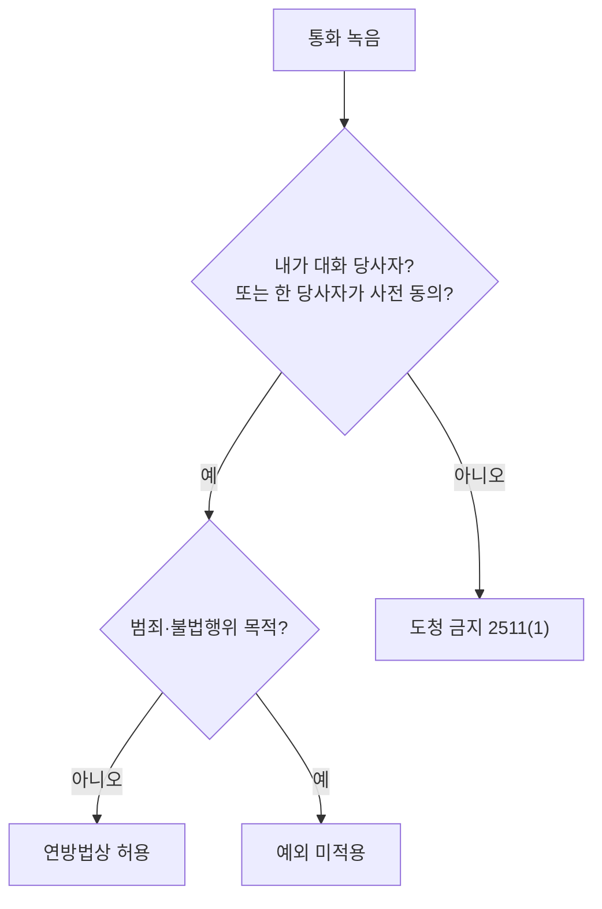
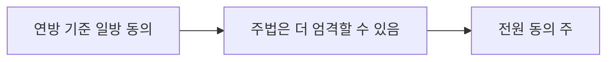

# 일방 동의 (one-party consent)

> 대화에 참여한 사람 한 명이라도 녹음에 동의했다면(또는 본인이 녹음하는 당사자라면) 녹음이 허용되는 규칙. 미국 연방 도청법이 기본으로 이 방식을 따르지만, 주마다 모든 당사자 동의를 요구하는 곳이 있어 통화 상대방 위치를 확인해야 한다.

## 쉽게 말하면
둘이 하는 대화를 그중 한 명이 녹음하는 것은 허용되지만, 제3자가 몰래 엿듣고 녹음하는 것은 금지되는 규칙이다. 내가 대화 당사자인가가 핵심이다.

## 자세히
출처는 미국 연방법 18 U.S.C. § 2511(Cornell LII, 열람)이다. 미국법 맥락이며 법률 자문이 아니다. 주법과 비미국 지역은 별도 확인이 필요하다.
- **기본 금지(2511(1))**: 유선·구두·전자 통신을 의도적으로 도청하거나 시도하면 처벌 대상이다(벌금 또는 최대 5년 징역 또는 병과). 다른 사람에게 시켜 도청하게 하는 것, 도청 장치 사용, 도청된 내용의 공개·이용(불법으로 얻은 것을 알면서)도 포함된다.
- **당사자 동의 예외(2511(2)(d))**: 정부를 대리하지 않는 개인이 자기가 참여하는 통신을 녹음하거나, 한 참여자가 사전에 도청에 동의한 경우에는 이 장에 따라 불법이 아니다. 단 "범죄나 불법행위(tortious act)를 저지르려는 목적"의 도청에는 예외가 적용되지 않는다.
- **의미**: 연방법상 대화 당사자 한 명의 동의(일방 동의)면 충분하다. 모든 당사자 동의를 요구하는 주의 법은 이 연방 기준보다 엄격할 수 있고 이번에 조항을 열람하지 않았다([전원 동의](#all-party-consent), [주 경계 통화](#cross-state-calls)).
- **AI 통화 녹음에 적용(해석)**: AI가 통화에 참여해 대화를 기록·전사하는 경우, AI 서비스를 쓰는 회사가 대화 당사자로서 동의했는지, 상대방 지역 법이 모든 당사자 동의를 요구하는지에 따라 고지·동의 절차가 달라진다. 법적 판단은 변호사와 한다.
- **한계**: 연방법 예외에도 범죄·불법행위 목적 조건이 있고, 외국 통화나 주법은 이번 자료에 없다.

## 그림으로 보기

## 예시
- 상담사가 고객과의 통화를 자기 회사 시스템에 녹음하는 경우 연방법으로는 당사자라서 허용될 수 있으나, 상대방이 전원 동의 주에 있으면 고지·동의가 필요할 수 있다(일반 설명, 개별 사안은 법률 검토).
- 교육 실습: 통화 시작 멘트(녹음 고지)를 한 문장 만들어 보고 어떤 주법에서도 문제가 없을지 토론.

## 헷갈리는 것과 비교
| 개념 | 차이 |
|---|---|
| 일방 동의 | 당사자 한 명 동의면 충분(연방 기준) |
| [전원 동의](#all-party-consent) | 모든 당사자 동의 필요 |
| 제3자 도청 | 당사자가 아닌 자의 녹음, 금지 |
| [녹음 고지 설계](#recording-notice-design) | 고지·동의 흐름 |

## 더 읽을거리
- [18 U.S.C. § 2511 (Cornell LII)](https://www.law.cornell.edu/uscode/text/18/2511) — 기본 금지와 당사자 동의 예외(열람)
