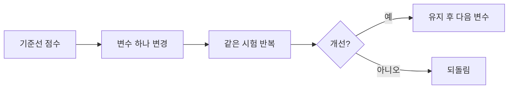

# 한 번에 한 변수

> RAG 같은 시스템을 개선할 때 **실행마다 하나만 바꿔서** 점수 변화의 원인을 분리하는 실험 원칙이다.

## 쉽게 말하면
요리가 맛없어졌을 때 소금·불·재료를 한꺼번에 바꾸면 무엇이 문제였는지 알 수 없다. 하나씩 바꿔 맛을 보면 원인이 보인다.

## 자세히
(Google Cloud 블로그를 직접 읽었다.)
- **원칙(블로그)**: 한 번에 하나의 기능만 바꿔 **점수 변화를 그것에 귀속**한다.
- **변수 후보(블로그)**: LLM에 전달하는 이웃 개수 / 임베딩 모델 / 청킹 전략(크기·겹침·요약·재서술; 블로그의 tiger team은 **400·600·1200자**와 전체 문서를 제안) / 모델 A vs B, 프롬프트 A vs B / 메타데이터 보강(제목·저자·태그) / 문맥 형태(매칭된 청크 vs 원문 전체).
- **절차(블로그)**: 기준선을 기록하고 같은 시험 세트를 변경마다 반복. 한 기능이 더 이상 오르지 않으면 설정을 고정하고 다음 구성요소로.
- **주의(해석)**: 변수 사이 상호작용(예: 청크 크기와 이웃 수)은 한 변수씩 바꿔서는 안 보일 수 있다.

## 그림으로 보기

## 예시
- 청크 크기를 400→600자로만 바꾼 결과를 비교하고, 그다음에 임베딩 모델을 바꾼다(제안).

## 헷갈리는 것과 비교
| 개념 | 차이 |
|---|---|
| 한 변수씩 | 원인 분리 |
| 전체 튜닝(grid search) | 여러 변수를 조합해 탐색 |
| [골든 레퍼런스](#golden-reference-set) | 비교용 기준 |

## 더 읽을거리
- [Google Cloud — Optimizing RAG retrieval](https://cloud.google.com/blog/products/ai-machine-learning/optimizing-rag-retrieval) — 직접 읽음.
