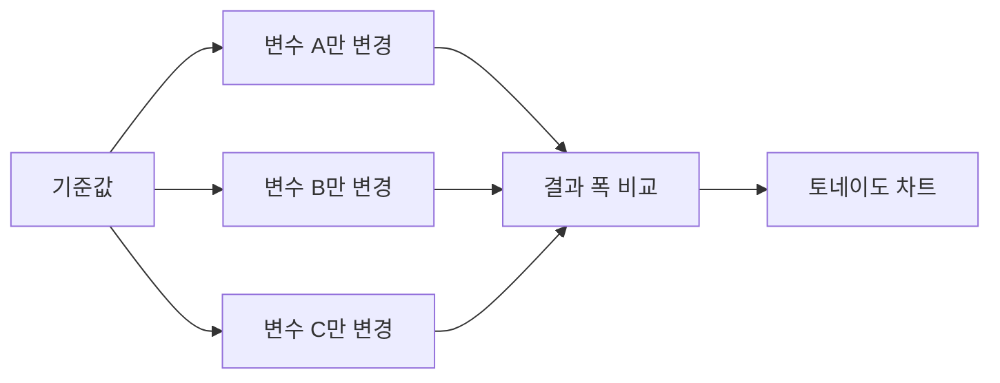
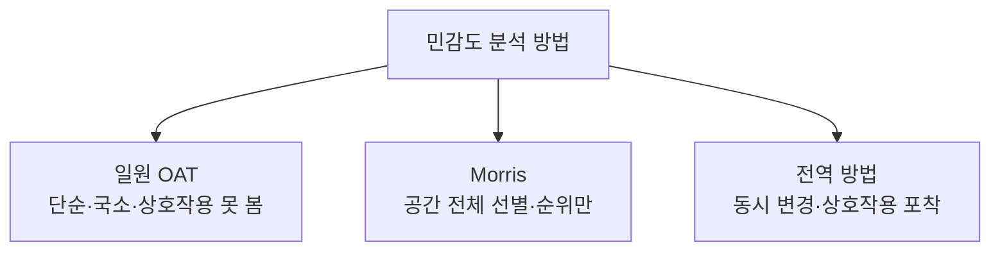

# 일원 민감도 분석

> 일원(one-way) 민감도 분석은 입력 변수를 한 번에 하나씩만 바꾸고 나머지는 기준값에 고정해 결과가 얼마나 움직이는지 보는 방법이다. 영문으로는 one-at-a-time(OAT) 또는 one-factor-at-a-time이라 부르며, 토네이도 차트의 재료가 된다.

## 쉽게 말하면
요리에서 소금만 두 배로 넣어 보고, 다음엔 설탕만 두 배로 넣어 보는 것이다. 어떤 재료가 맛에 영향이 큰지 쉽게 알지만, 소금과 설탕을 같이 바꿨을 때 생기는 맛은 모른다.

## 자세히
- **방법**: 변수마다 낮은 값·기준값·높은 값으로 모델을 다시 돌려 결과 폭(swing)을 비교한다. 이 순서대로 막대를 정렬하면 [토네이도 차트](#tornado-chart)가 된다. 변수가 10개면 변수당 3회, 총 30회 정도로 계산이 가볍다.
- **장점(JRC 방법 안내, 열람)**: 단순하고 비용이 낮다. 민감도 측정이 기준점 주변의 국소적 값이다.
- **한계 ① 상호작용 못 봄(같은 안내)**: 요인들 사이의 상호작용을 추정할 수 없다. 예를 들어 AI 도입 효과가 "사용률이 높고 절감 시간이 길 때만" 크게 나는 구조라면 각각만 바꾸는 분석은 이를 놓친다(해석).
- **한계 ② 입력 공간을 거의 탐색하지 않음(Saltelli 등, arXiv 1711.11359, 초록 열람)**: 출판된 민감도 분석의 상당수가 입력 공간을 제대로 탐색하지 못하고 "1차원 복도"를 따라 움직인다고 지적하며, 오용이 p값 오용만큼 심각하다고 주장한다. 검색 요약에는 10차원에서 OAT가 입력 공간의 99.75% 이상을 탐색하지 않는다는 수치가 있으나 본문에서 확인하지 못했다.
- **대안(JRC 안내)**: 전역(global) 방법은 모든 요인을 동시에 바꾸고 공간 전체를 평균하며 상호작용을 포착하고 모델의 선형성·가법성 가정이 필요 없다. 분산 기반 방법이 그 예다. Morris 방법은 한 점에 묶이지 않는 OAT형 설계로 입력 공간 전체를 덮는 선별용이며 순위만 주고 중요도 배수는 못 준다.
- **실무 권고(해석)**: 첫 훑어보기와 보고용 시각화는 일원 분석, 결론에 중요한 의사결정이면 [몬테카를로](#monte-carlo-roi) 같은 확률적 분석을 병행한다.

## 그림으로 보기

## 예시
- AI 도입 ROI 모델: 사용자 수·절감 시간·시간당 인건비·라이선스 비용을 각각 ±20%씩 바꿔 순효과 변화 폭을 비교하고 가장 영향이 큰 입력부터 더 정확히 추정한다.
- 교육 활용: "변수를 하나씩만 바꾸면 놓치는 것은?"을 묻고 같이 움직이는 변수(사용률과 절감 시간)의 사례를 찾게 한다.

## 헷갈리는 것과 비교
| 개념 | 차이 |
| --- | --- |
| [토네이도 차트](#tornado-chart) | 일원 분석 결과를 그린 그림 |
| [민감도 범위 선택](#sensitivity-range-selection) | 일원 분석에서 각 변수를 얼마나 움직일지 정하는 문제 |
| [몬테카를로 ROI](#monte-carlo-roi) | 모든 입력을 확률분포로 동시에 흔듦 |

## 더 읽을거리
- [JRC SAMO: 민감도 분석 방법](https://joint-research-centre.ec.europa.eu/sensitivity-analysis-samo/methods_en) — OAT·Morris·전역 방법 비교
- [Why So Many Published Sensitivity Analyses Are False (arXiv 1711.11359)](https://arxiv.org/abs/1711.11359) — 입력 공간 탐색 부족 비판
