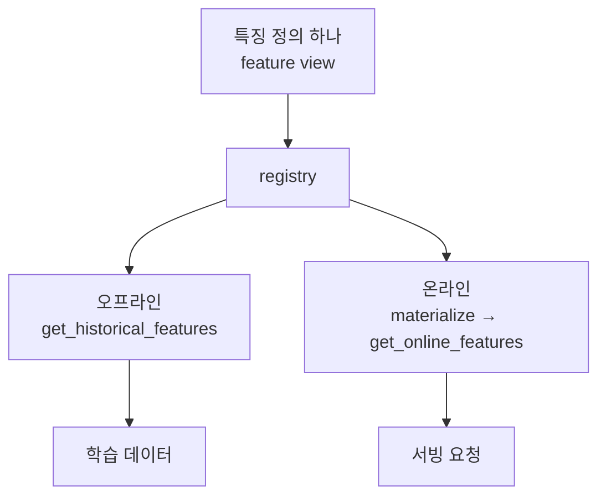
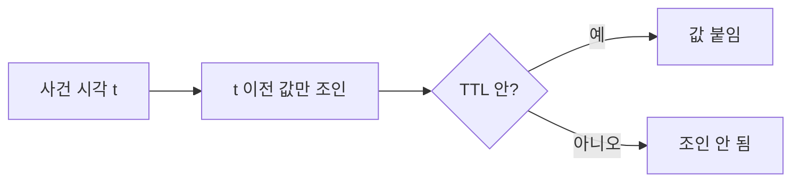

# 온라인·오프라인 특징 동등성

> 학습(오프라인)과 서빙(온라인)이 **같은 특징 정의 하나**를 재사용해 같은 값을 만들게 하는 설계 원칙이다. 두 벌의 코드를 따로 짜서 생기는 학습-서빙 불일치(skew)를 예방한다.

## 쉽게 말하면
레시피를 주방 두 곳에서 각자 기억으로 따라 하면 맛이 달라진다. 레시피 카드를 한 장만 두고 두 주방이 그것을 그대로 쓰게 하는 것이 동등성이다. [일관성 점검](#feature-consistency-check)이 "맛이 같은지 사후에 시식"이라면 동등성은 "카드를 하나로 통일"하는 예방책이다.

## 자세히
Feast 공식 문서(직접 확인, 개념·point-in-time 페이지)로 보는 구조:
- **한 번 정의**: 특징은 프로젝트 안의 **feature view**(엔티티·특징·데이터 소스)로 코드로 정의해 버전 관리 저장소에 두고 **registry**에 등록한다. **feature service**는 특징 묶음을 모델 버전과 연결한다.
- **오프라인 경로**: 학습·배치 예측은 `get_historical_features`로 기존 데이터(웨어하우스, 실험적으로 Spark·Trino)에서 읽는다.
- **온라인 경로**: 배치 특징은 **materialization**으로 온라인 저장소에 적재하고, 스트리밍 특징은 push로 양쪽에 반영한다. 실시간 조회는 `get_online_features`(SDK 또는 feature server).
- **시점 정합 조인(point-in-time join)**: 학습 데이터를 만들 때 각 사건의 타임스탬프 이전 값만 붙인다(미래 정보 누수 방지). feature view의 **TTL**이 얼마나 과거까지 볼지 정한다(문서 예: 2시간 TTL이면 11시간 어긋난 행은 조인 안 됨). `filter_by_created_timestamp=True`는 나중에 백필·정정된 값이 학습에 새어드는 것을 막아 온라인이 당시 줬을 값에 가깝게 한다(NULL 생성 시각 행은 제외, 지원 안 하는 저장소는 오류).
- **한계**: 정의를 하나로 해도 두 경로의 실행 환경(웨어하우스 vs 온라인 저장소)·갱신 주기·결측 처리가 다르면 값이 달라질 수 있다. 그래서 동등성은 예방, 일관성 점검은 검증으로 함께 쓴다. 대안으로 Confluent는 스트리밍 엔진에서 한 번 계산해 오프라인·온라인에 쓴다고 소개한다(검색 요약만 확인).

## 그림으로 보기

## 예시
- 배달 앱: `driver_hourly_stats` 한 정의로 학습 때는 `get_historical_features`, 서빙 때는 `get_online_features`로 같은 `trips_today`를 사용.
- 교육 소재: "엑셀 수식을 시트마다 복사해 쓰지 말고 한 셀을 참조하라"는 비유로 설명.

## 헷갈리는 것과 비교
| 개념 | 차이 |
|---|---|
| 온라인·오프라인 특징 동등성 | 정의를 하나로 재사용(예방) |
| [학습-서빙 특징 일관성 점검](#feature-consistency-check) | 값을 짝지어 대조(검증) |
| [서빙 시점 특징 로깅](#log-serving-features) | 서빙에 쓴 값을 저장해 학습에 사용 |
| [시점 누수](#point-in-time-leakage) | 동등성이 깨지는 대표 원인 |

## 더 읽을거리
- [Feast 개념 개요](https://docs.feast.dev/getting-started/concepts/overview) — feature view, registry, 온라인·오프라인 경로.
- [Feast point-in-time joins](https://docs.feast.dev/getting-started/concepts/point-in-time-joins) — 시점 정합 조인과 TTL.
