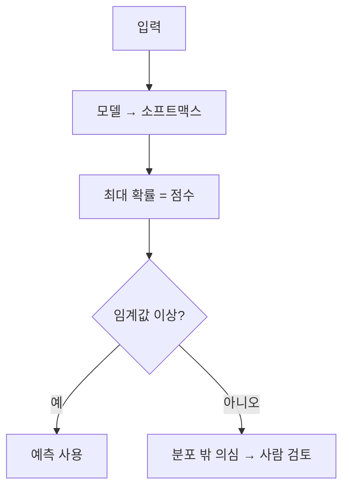
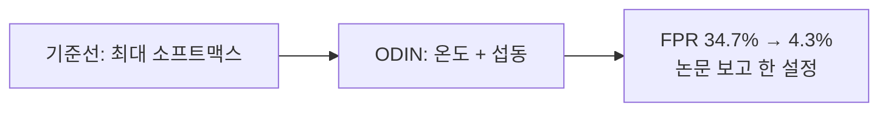

# 분포 밖 탐지(최대 소프트맥스)

> 모델이 출력한 **가장 큰 소프트맥스 확률**을 "이 입력을 얼마나 확신하나"의 점수로 삼아, 확신이 낮으면 틀린 예측이거나 학습 때 본 적 없는 입력(분포 밖, OOD)이라고 의심하는 가장 단순한 기준선이다(Hendrycks & Gimpel, ICLR 2017).

## 쉽게 말하면
시험에서 문제를 풀 때 "정답 후보 중 하나가 압도적으로 확실하다"면 대체로 맞는다. 보기 넷이 비슷비슷하게 애매하면 헷갈린다는 신호다. 모델의 확신도를 "모르겠다" 신호로 쓰는 것이다.

## 자세히
- **핵심 관찰(arXiv 1610.02136, 직접 확인)**: 올바르게 분류된 예시는 최대 소프트맥스 확률이 더 높은 경향이 있어, 오분류와 OOD 입력을 구별할 수 있다. 컴퓨터 비전·NLP·음성 인식 과제에서 평가했고, 기준선이 때로는 능가될 수 있어 후속 연구 여지가 있다고 밝힌다.
- **사용법**: 점수 = max softmax 확률. 임계값보다 낮으면 "분포 밖일 수 있음"으로 표시하고 사람에게 넘기거나 답을 보류한다.
- **개선 방법 예 ODIN(Liang 외, ICLR 2018, 직접 확인)**: 온도 스케일링과 입력에 작은 섭동을 더해 분포 내·외 점수 차이를 키운다. 사전학습 모델을 바꾸지 않아도 된다. 논문 보고: CIFAR-10으로 학습한 DenseNet에서 95% 진양성률일 때 거짓양성률이 기준선 34.7%에서 4.3%로 감소.
- **한계(해석)**: 신경망은 학습 밖 입력에도 높은 확신을 보일 수 있어(과신) 단독 신호로 믿으면 위험하다. 확률 보정이 되어 있지 않으면 임계값 선택이 어렵다.
- **평가 관점**: 임계값별 거짓양성·진양성을 곡선(AUROC 등)으로 본다. OOD로 판단된 입력을 어떻게 처리할지(사람 검토·거절)가 운영 설계의 핵심이다.

## 그림으로 보기

## 예시
- 의료 영상 분류기가 학습에 없던 장비 사진에 확신이 낮으면 자동 판정 대신 의사에게 전달.
- 교육 소재: "AI도 모른다고 말하게 하는 법"으로 설명.

## 헷갈리는 것과 비교
| 개념 | 차이 |
|---|---|
| 최대 소프트맥스 | 확신도 기반 기준선 |
| ODIN | 기준선에 온도·섭동 추가 |
| [WILDS 벤치마크](#wilds-benchmark) | 실제 분포 변화 평가용 데이터 |
| [도메인 통째로 떼기](#held-out-domain-split) | 평가 설계 방식 |

## 더 읽을거리
- [Hendrycks & Gimpel (arXiv 1610.02136)](https://arxiv.org/abs/1610.02136) — 기준선 논문(초록 확인).
- [ODIN (arXiv 1706.02690)](https://arxiv.org/abs/1706.02690) — 온도 스케일링·섭동 방법(초록 확인).
