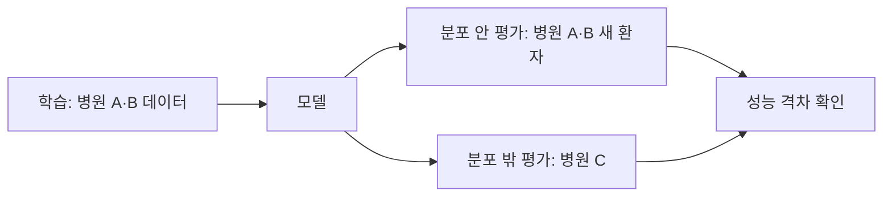
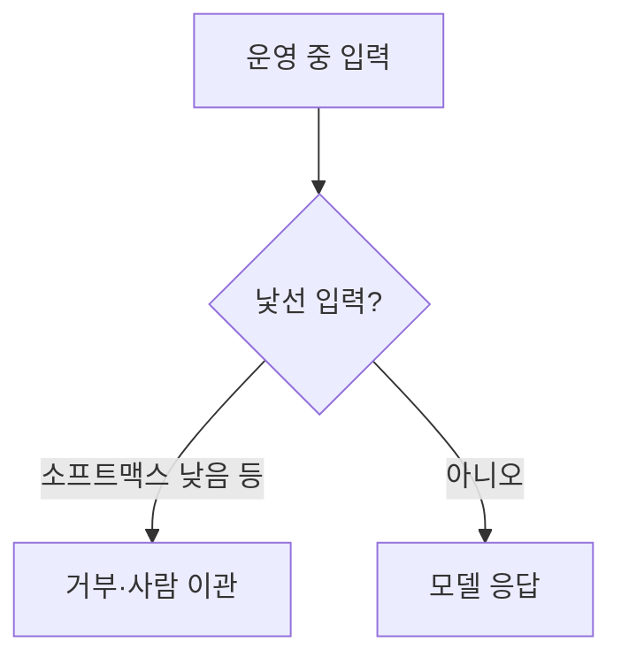

# 분포 밖 평가

> 학습 데이터와 다른 분포에서 온 입력(다른 병원·카메라·시기·지역)으로 모델을 평가하는 일이다. 학습 분포 안에서의 높은 점수가 실제 배포 환경의 성능을 보장하지 않기 때문에 필요하다.

## 쉽게 말하면
한 학교 학생들로만 연습 시험을 본 학생이 다른 지역 학교의 시험에서도 같은 점수를 받을까? 보통은 조금 떨어진다. 얼마나 떨어지는지를 미리 재 보는 것이 분포 밖 평가다.

## 자세히
(WILDS 논문 초록과 Hendrycks·Gimpel 논문 초록을 직접 확인.)
- **왜 필요한가(WILDS, arXiv:2012.07421, 초록 확인)**: 실제 배포에서는 병원 간(종양 식별), 카메라 트랩 간(야생동물 감시), 시간·장소 간(위성 이미지·빈곤 지도)처럼 분포 변화가 흔하다. WILDS는 이런 변화를 담은 **10개 데이터셋**을 모은 벤치마크이며, 표준 학습은 분포 밖 성능이 분포 안보다 **상당히 낮고**, 분포 변화를 다루도록 설계된 기존 방법을 써도 격차가 남는다고 보고한다. 저자들은 새로운 강건 학습 방법이 필요하다고 주장한다.
- **분포 밖 탐지(Hendrycks·Gimpel, arXiv:1610.02136, 초록 확인)**: 신경망 출력의 **최대 소프트맥스 확률**이 잘못 분류됐거나 분포 밖인 입력을 찾아내는 단순한 기준선이 된다는 보고. 올바르게 분류된 예제는 최대 소프트맥스 확률이 더 큰 경향이 있다. 비전·NLP·음성 인식에서 확인했다고 한다. 다만 경향일 뿐이며 이 기준선이 "때로는 다른 방법에 뒤진다"고 저자도 인정한다.
- **평가 vs 탐지**: 분포 밖 **평가**는 개발 단계에서 분포가 다른 테스트 세트로 성능을 재는 일이고, 분포 밖 **탐지**는 운영 중 입력이 낯선지 알아채 거부·사람 이관으로 연결하는 일이다.
- **평가 세트 만들기(제안)**: 학습에 쓰지 않은 병원·기간·지역·기기·언어의 데이터를 통째로 떼어 둔다([그룹 단위 분할](#group-wise-split), [시계열 분할](#time-series-split)). 같은 분포에서 임의로 뽑은 시험 세트는 분포 안 평가다.
- **한계**: 분포 변화는 끝이 없어서 어떤 평가 세트도 모든 현실을 덮지 못한다. 평가에 쓴 분포를 문서에 명시한다([모델 카드](#model-cards)).

## 그림으로 보기

## 예시
- 상담 분류기를 2024년 문의로 학습, 2025년 신상품 출시 이후 문의로 평가해 정확도 하락을 측정.
- 한 지점 CCTV로 학습한 불량 검출 모델을 다른 지점 설비 영상으로 평가(WILDS의 카메라 간 변화와 같은 구조).

## 헷갈리는 것과 비교
| 개념 | 차이 |
|---|---|
| 분포 안 평가 | 학습과 같은 분포의 새 샘플 |
| 분포 밖 평가 | 다른 환경의 샘플 |
| [데이터 드리프트](#data-drift) | 운영 중 분포가 시간에 따라 변하는 현상 |
| [데이터 슬라이싱](#data-slicing) | 같은 분포 안 하위 집단별 평가 |

## 더 읽을거리
- [WILDS (arXiv:2012.07421)](https://arxiv.org/abs/2012.07421) — 실제 분포 변화 10개 데이터셋과 격차(초록 직접 확인).
- [A Baseline for Detecting Misclassified and Out-of-Distribution Examples (arXiv:1610.02136)](https://arxiv.org/abs/1610.02136) — 최대 소프트맥스 확률 기준선(초록 직접 확인).
