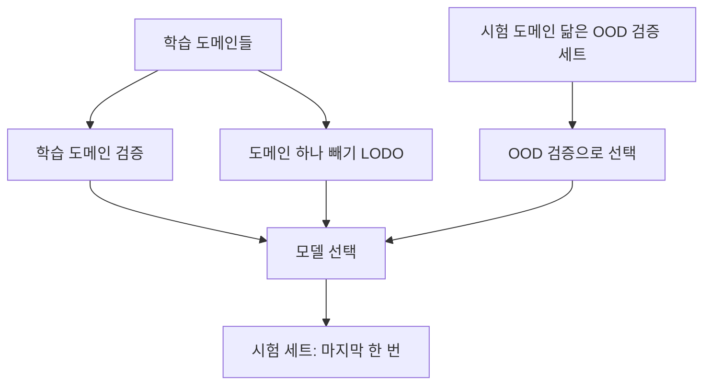

# OOD 검증 세트

> 모델 선택(하이퍼파라미터·조기 종료)에 쓰는 검증 세트가 **학습 데이터와 같은 분포가 아니라, 시험 때 마주칠 분포 변화를 닮은 별도 세트**인 경우다. 분포 안 검증 세트로만 고르면 새 환경에서 좋은 모델을 못 고를 수 있다.

## 쉽게 말하면
같은 교실 학생들끼리 모의고사를 쳐서 고른 공부법이, 다른 학교 시험에서도 최선이라는 보장은 없다. 시험 볼 환경과 비슷한 모의고사를 따로 마련해 공부법을 고르는 것이 OOD 검증 세트다.

## 자세히
(Gulrajani & Lopez-Paz의 「In Search of Lost Domain Generalization」(arXiv 2007.01434)의 모델 선택 절을 PDF로 직접 읽어 확인하고, 선택 방법 비교는 직접 실험했다. WILDS의 OOD 검증은 상위 노드 [도메인 홀드아웃](#held-out-domain-split)에서 설명.)
- **문제(논문)**: 시험 분포와 같은 분포의 검증 세트가 없으므로 도메인 일반화에서 모델 선택은 일반 지도 학습만큼 단순하지 않다. 일부 연구는 선택 방법을 적지 않아 **시험 데이터로 하이퍼파라미터를 골랐을 가능성**이 열려 있고 이는 방법론적으로 옳지 않다고 논문이 지적한다. 저자들은 모델 선택이 모델 학습만큼 어려운 학습 문제이고 가정(시험이 학습과 어떻게 관련되는가)이 필요하다며, 모델 선택 전략이 없는 알고리즘은 **불완전**하다고 주장한다(권고 1). 오라클(시험 도메인에서 선택) 결과는 그렇다고 명시하고 시험 도메인 접근을 제한하라는 것이 권고 2다.
- **논문이 정리한 세 가지 선택 방법**
  | 방법 | 내용 | 가정 |
  |---|---|---|
  | **학습 도메인 검증** | 각 학습 도메인을 학습/검증으로 쪼개고 검증을 합쳐 정확도가 최고인 모델 선택 | 학습과 시험 분포가 비슷하다 |
  | **도메인 하나 빼기 교차 검증(LODO)** | 학습 도메인을 하나씩 빼고 학습해 빼놓은 도메인에서 평가한 평균으로 선택 | 학습·시험 도메인이 도메인들의 메타 분포에서 뽑혔다 |
  | **시험 도메인 검증(오라클)** | 시험 도메인과 같은 분포의 검증 세트로 선택(논문은 20회 질의 제한) | 시험 도메인 접근이 필요해 정당한 벤치마킹 방법이 아님 |
  오라클 결과는 시험 분포에 접근했으므로 낙관적일 수도, 질의 제한 때문에 비관적일 수도 있다고 논문이 적는다.
- **직접 실험(digits 손글씨를 도메인으로 변형: 학습 도메인 3개는 밝기 1.0/0.7/0.5와 잡음 0/0.05/0.10, 시험 도메인은 밝기 0.25와 잡음 0.18, 릿지 분류기의 정규화 강도 7가지 중 선택, 30회 반복 평균)**
  | 선택 방법 | 시험 도메인 정확도 평균(표준편차) |
  |---|---|
  | 학습 도메인 검증 | 0.443 (0.042) |
  | LODO | 0.427 (0.024) |
  | 오라클(시험 도메인 검증) | 0.503 (0.016) |
  | 선택지 중 시험에서 최고 | 0.510 (0.014) |
  분포가 크게 바뀐 이 설정에서는 **분포 안 방식의 선택이 오라클보다 약 6%p 낮았다**. 학습 도메인 검증은 중간 강도(10)를 주로 골랐고, 오라클은 가장 강한 정규화(100~1,000)를 골랐다. 이 설정에서는 LODO가 학습 도메인 검증보다 정확도가 낮았으나(0.427 대 0.443) 선택 변동은 더 작았다(표준편차 0.024 대 0.042). **어떤 선택 방법이 항상 낫다는 결론은 못 낸다** — 한 데이터·한 모델이다.
- **실무 지침(제안)**: ① 서비스 환경과 비슷한 분포 변화를 반영한 **별도 OOD 검증 세트**(다른 병원·시기·기기)를 확보 ② 검증 세트와 최종 시험 세트를 분리하고 시험은 마지막에 한 번만 ③ 오라클 선택은 상한 참고값으로만 쓰고 보고 시 명시 ④ 도메인이 적으면 선택 결과가 변동이 크므로 반복·구간 보고([도메인 수가 적을 때의 변동](#few-domain-variance)) ⑤ 선택 방법을 알고리즘의 일부로 문서화.
- **한계**: 시뮬레이션은 변형(밝기·잡음)에 의한 합성 도메인 변화이며 실제 도메인 변화(병원·시기)와 다르다.

## 그림으로 보기

## 예시
- 병원 A·B 영상으로 학습한 폐렴 모델을 병원 C에 배포 예정: 병원 C와 비슷한 장비의 소량 영상을 OOD 검증 세트로 확보해 임계값·조기 종료를 선택하고 최종 시험은 병원 C의 별도 영상.
- 교육 소재: "연습 시험과 실전 시험이 다를 때 공부법을 어떻게 고르나" — 위 표로 토론.

## 헷갈리는 것과 비교
| 개념 | 차이 |
|---|---|
| OOD 검증 세트 | 모델 선택용, 시험 분포를 닮은 세트 |
| OOD 시험 세트 | 최종 평가용(검증과 분리) |
| [도메인 홀드아웃](#held-out-domain-split) | 도메인을 통째로 떼어 두는 분할 방식 |
| 오라클 선택 | 시험 도메인에서 하이퍼파라미터를 고름(상한 참고용) |

## 더 읽을거리
- [In Search of Lost Domain Generalization (arXiv 2007.01434)](https://arxiv.org/abs/2007.01434) — 모델 선택의 중요성과 세 가지 선택 방법(PDF 직접 확인).
