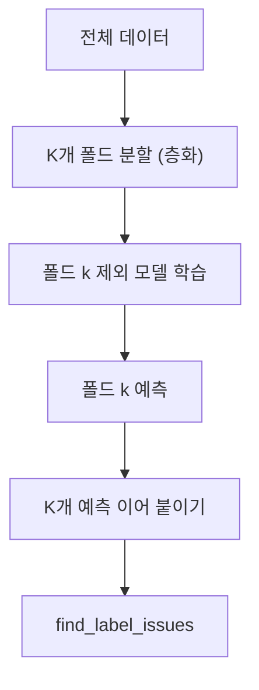
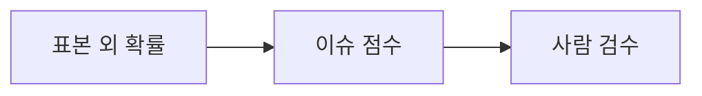

# 표본 외 예측 작업 절차

> 표본 외(out-of-sample) 예측 절차는 데이터를 K개 폴드로 나누고, 각 폴드를 뺀 모델로 그 폴드를 예측해 모든 샘플이 자기를 학습에 쓰지 않은 모델의 예측 확률을 하나씩 얻은 뒤 라벨 오류를 찾는 순서다.

## 쉽게 말하면
반 학생 전체의 숙제를 서로 바꿔 채점하는 방식이다. 자기 숙제는 자기를 제외한 사람들이 만든 채점 기준으로만 채점된다.

## 자세히
- **절차(cleanlab 튜토리얼)**: ① 데이터를 서로 겹치지 않는 K개 폴드로 나눈다 ② 폴드 하나씩 빼고 K개의 모델을 학습한다 ③ 빠진 폴드를 예측한다 ④ K개의 예측을 이어 붙여 모든 샘플이 하나의 표본 외 예측을 갖게 한다. 클래스 비율을 비슷하게 유지하는 층화 교차 검증을 권한다. sklearn 호환 모델은 `cross_val_predict`로 한다. 예시는 K=5(그림)·K=3(의사코드)이며 권장 K는 없다. 셔플·시드·보정은 이 문서가 다루지 않는다.
- **실행 순서(해석)**: ① `StratifiedKFold(n_splits=5, shuffle=True, random_state=0)` ② `cross_val_predict(model, X, y, cv=cv, method="predict_proba")` ③ 반환 배열의 열 순서가 클래스 순서와 같은지 확인 ④ `find_label_issues(labels, pred_probs)` ⑤ 후보를 사람 검수([정리→재학습 라운드](#relabel-retrain-rounds)).
- **점검 목록(해석)**: ① 경고(클래스 누락)가 없는가([폴드에 클래스가 빠질 때](#missing-class-in-fold)) ② 같은 샘플이 중복돼 학습·테스트 폴드에 갈리지 않았나(중복·거의 같은 샘플은 한 폴드로 묶는다) ③ 여러 시드로 반복해 후보 목록이 얼마나 안정적인가.
- **예외(문서)**: 별도 데이터로 학습한 모델이라면 학습에 쓰지 않은 테스트셋은 바로 검사할 수 있다.

## 그림으로 보기



## 예시
```python
cv = StratifiedKFold(n_splits=5, shuffle=True, random_state=0)
pred_probs = cross_val_predict(clf, X, y, cv=cv, method="predict_proba")
```
- 교육 활용: 12개 샘플 표를 K=3으로 직접 나누어 각 샘플이 어느 폴드 모델에서 예측되는지 표를 채워 본다.

## 헷갈리는 것과 비교
| 개념 | 차이 |
| --- | --- |
| 표본 외 예측 | 폴드 교차로 얻은 샘플별 예측 |
| 표본 안 예측 | 학습에 쓴 샘플 재예측, 오류 탐지 부적합 |
| [cross_val_score vs predict](#cross-val-score-vs-predict) | 두 함수 구분 |
| [pred_probs용 층화 폴드](#stratified-folds-for-pred-probs) | 분할 설정 |

## 더 읽을거리
- [cleanlab pred_probs 교차 검증 튜토리얼](https://docs.cleanlab.ai/stable/tutorials/pred_probs_cross_val.html) — 절차와 층화 권고
- [scikit-learn Cross-validation 가이드](https://scikit-learn.org/stable/modules/cross_validation.html) — cross_val_predict 사용법
