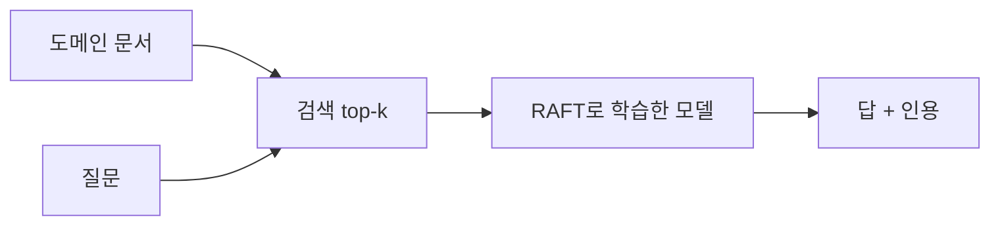

# 도메인 오픈북 QA

> **시험 도메인을 미리 알고** 있는 상태에서, 검색된 문서를 참고해 답하는 질의응답이다. RAFT가 겨냥하는 설정이다.

## 쉽게 말하면
회계 자격시험 응시자가 회계 교재를 들고 가서 푸는 시험이다. 어느 분야 시험인지 미리 알아 준비할 수 있다.

## 자세히
(RAFT 논문의 서론·정의를 직접 읽었다.)
- **세 설정(논문)**: **Closed-book**(문서 없이 모델 기억만), **Open-book**(검색된 문서로만 도메인 지식에 접근), **도메인 특화 open-book**(시험될 도메인을 **사전에 안다**). 논문은 마지막을 다룬다.
- **비유(논문)**: 기존 in-context 검색 방식은 공부 없이 오픈북 시험을 치는 것, 미세조정 방식은 외우는 것. RAFT는 **오픈북 시험을 공부하듯** 문서 읽기를 연습시킨다.
- **쓸 곳(논문)**: 기업 사내 문서, 최근 뉴스, 조직 코드 저장소 같은 비공개·최신 도메인. 목표는 도메인 지식을 배우면서 **검색 문서 수와 방해 문서 변화에 강건**해지는 것.
- **데이터(논문)**: PubMed QA(생의학), HotpotQA(위키 일반 상식), Gorilla APIBench의 HuggingFace Hub·Torch Hub·TensorFlow Hub(API 호출).

## 그림으로 보기

## 예시
- 사내 HR 규정 챗봇: 규정 문서 도메인을 알고 있으므로 RAFT식 학습 데이터를 만들 수 있다(제안).

## 헷갈리는 것과 비교
| 설정 | 문서 접근 |
|---|---|
| closed-book | 없음 |
| open-book | 검색 문서 |
| 도메인 특화 open-book | 도메인을 사전에 앎 |
| [DSF](#dsf-domain-specific-finetuning) | 문서 없이 도메인 미세조정 |

## 더 읽을거리
- [RAFT 논문](https://arxiv.org/abs/2403.10131) — 직접 읽음.
