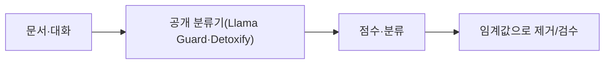
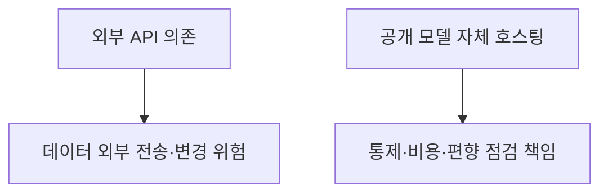

# 공개 안전 분류기 대안

> 외부 안전 서비스(SafeSearch·API)에 의존하지 않고 직접 내려받아 쓸 수 있는 공개 분류기들이다. 데이터 필터링이나 챗봇 입출력 검사에 쓴다. 예: Llama Guard, Detoxify.

## 쉽게 말하면
외부 검사소에 맡기는 대신 사내에 검사 장비를 두는 것이다. 데이터가 밖으로 나가지 않고 규칙(분류 체계)도 조정할 수 있지만, 장비의 편향과 성능은 직접 확인해야 한다.

## 자세히
(Llama Guard arXiv 2312.06674 초록, Detoxify GitHub README를 직접 열어 확인.)
- **Llama Guard**: 사람-AI 대화의 **입력(프롬프트)과 출력(응답)** 을 모두 검사하는 LLM 기반 안전장치. 안전 위험 분류 체계를 두고 프롬프트와 응답을 따로 분류한다. Llama2-7b를 소량의 고품질 데이터로 지시 미세조정. 다중 클래스 분류와 이진 판정 점수를 내며 OpenAI Moderation Evaluation 데이터셋과 ToxicChat에서 기존 도구와 비슷하거나 더 낫다고 보고. 지시 조정으로 분류 항목·출력 형식을 바꿀 수 있고 제로·퓨샷으로 다른 분류 체계에도 적용 가능. 가중치 공개.
- **Detoxify**(Apache-2.0): 독성 댓글 분류기. 모델 3종 — `original`(bert-base-uncased, 2018 Toxic Comment), `unbiased`(roberta-base, 2019 Civil Comments, 정체성 라벨 포함), `multilingual`(xlm-roberta-base, 영·프·스·이·포·터·러 7개 언어). `pip install detoxify`, `Detoxify("original").predict("text")`.
- **주의(Detoxify README)**: 욕설·모욕 단어가 있으면 의도와 무관하게 독성으로 표시될 수 있어 취약 집단에 불리할 수 있다. 연구·세밀한 데이터 미세조정·중재자 보조 용도라고 밝힌다.
- **선택 기준(제안)**: 필터링 대상(문서 vs 대화), 언어 지원(한국어는 두 곳 모두 직접 검증 필요), 라이선스·모델 라이선스 조건, 오탐 편향 감사([필터 제거율 감사](#filter-removal-audit)).

## 그림으로 보기

## 예시
- 크롤링 문서에 Detoxify 점수를 매기고 높은 점수 표본 100건을 사람이 읽어 오탐 확인 후 임계값 설정.
- 교육 활용: 분류기 두 개의 판정이 갈리는 문장을 비교하는 토론.

## 헷갈리는 것과 비교
| 개념 | 차이 |
|---|---|
| Llama Guard | 대화 입출력, LLM 기반, 분류 체계 조정 가능 |
| Detoxify | 댓글 독성, BERT/RoBERTa 계열 |
| [SafeSearch vs 단어 목록](#safesearch-vs-wordlist) | 외부 서비스 vs 단어 필터 비교 |

## 더 읽을거리
- [Llama Guard (arXiv 2312.06674)](https://arxiv.org/abs/2312.06674) — 방법·성능.
- [unitaryai/detoxify (GitHub)](https://github.com/unitaryai/detoxify) — 모델 3종·사용법·주의.
