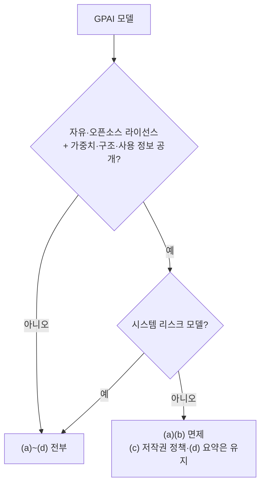
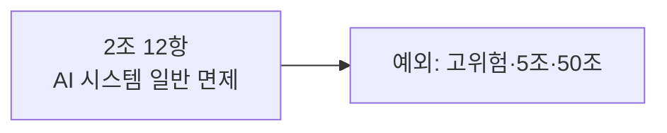

# GPAI 오픈소스 면제

> EU AI Act 53조 2항은 자유·오픈소스 라이선스로 공개된 범용 AI(GPAI) 모델 제공자에게 기술 문서(부속서 XI)와 하류 제공자 정보(부속서 XII) 의무를 면제한다. 단, 시스템 리스크가 있는 모델은 면제되지 않는다.

## 쉽게 말하면
설계도를 누구나 보게 공개한 제품은 별도 설명서를 또 만들 필요가 줄지만, 사고가 크게 날 수 있는 제품이면 공개했어도 안전 의무는 그대로 지라는 규칙이다.

## 자세히
출처는 artificialintelligenceact.eu의 53조(열람), 서문 102(열람), 2조 12항(열람). 법률 자문이 아니다.
- **면제 범위(53조 2항)**: (a) 기술 문서 유지와 (b) 하류 제공자 정보 제공 의무는 자유·오픈소스 라이선스로 공개된 모델에 적용되지 않는다. 조건은 가중치·아키텍처·사용 정보가 공개돼 있는 것이다. 시스템 리스크 모델은 이 면제에서 제외된다.
- **면제되지 않는 것(53조 1항)**: (c) 저작권 정책과 (d) 학습 콘텐츠 요약은 면제 대상에 나열되지 않았다. 즉 오픈소스 모델도 이 두 의무는 진다(53조 2항이 (a)(b)만 면제한다고 적힌 것에 근거한 읽기).
- **오픈소스 라이선스의 의미(서문 102)**: 사용자가 소프트웨어·모델을 실행·복사·배포·연구·수정·개선할 수 있게 허용하는 라이선스. 원 제공자 표기와 같거나 비슷한 배포 조건 준수 같은 조건이 붙을 수 있다. 서문은 가중치·아키텍처·사용 정보가 공개된 오픈소스 GPAI는 높은 투명성·개방성을 위해 고려돼야 한다고 설명한다. 서문 102 페이지는 수익화 관련 내용을 담지 않았다(내가 확인한 범위).
- **일반 면제(2조 12항)**: AI Act는 자유·오픈소스 라이선스로 공개된 AI 시스템에 적용되지 않는다. 단, 고위험 AI 시스템으로 시장에 출시·사용 개시되거나 5조(금지) 또는 50조(투명성)에 해당하는 AI 시스템은 예외다.
- **구분**: 2조 12항은 "AI 시스템"에 관한 일반 면제이고, 53조 2항은 "GPAI 모델" 제공자의 두 의무에 관한 면제다. 둘은 다른 조항이다.
- **한계**: "가중치·아키텍처·사용 정보 공개"의 구체 충족 요건, 수익화와의 관계는 이번 자료로 확인하지 못했다.

## 그림으로 보기

## 예시
- 오픈 가중치 모델 제공자가 시스템 리스크 기준에 해당하지 않으면 부속서 XI·XII 문서 의무는 면제되나 저작권 정책과 학습 요약은 준비해야 한다(조문 구조에 따른 설명 예).
- 교육 실습: 오픈 모델 3개를 골라 라이선스와 공개 범위(가중치·아키텍처·사용 정보)를 표로 정리.

## 헷갈리는 것과 비교
| 개념 | 차이 |
|---|---|
| 53조 2항 면제 | GPAI 모델 제공자의 (a)(b) 면제 |
| 2조 12항 면제 | 오픈소스 AI 시스템의 일반 면제 |
| [시스템 리스크 모델](#systemic-risk-model) | 53조 2항 면제에서 제외 |
| [부속서 XI](#annex-xi-documentation)·[XII](#annex-xii-info) | 면제되는 문서 |

## 더 읽을거리
- [AI Act Article 53](https://artificialintelligenceact.eu/article/53/) — 면제 조항(열람)
- [AI Act Recital 102](https://artificialintelligenceact.eu/recital/102/) — 오픈소스 라이선스 설명(열람)
- [AI Act Article 2](https://artificialintelligenceact.eu/article/2/) — 12항 일반 면제(열람)
